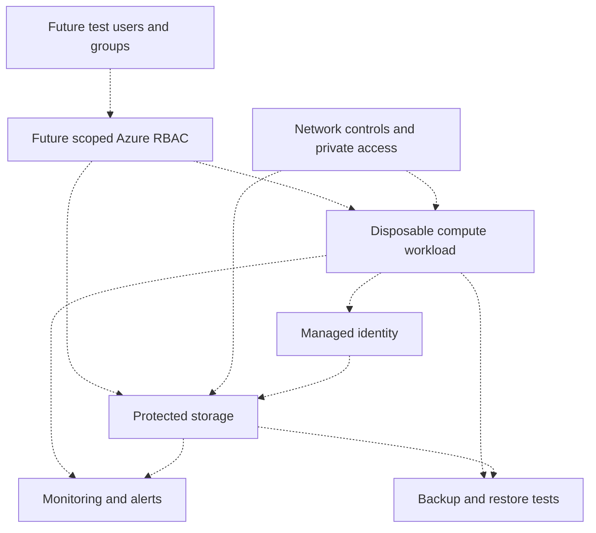
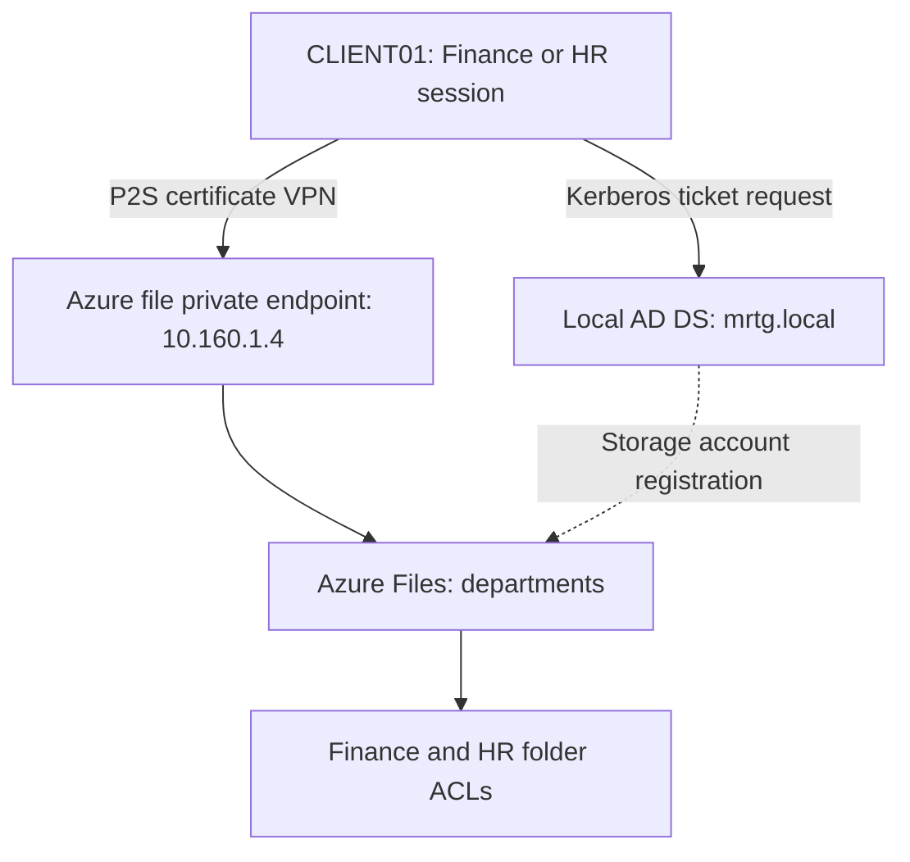

# MRTG architecture

**Status: Labs 01–17 validated. Disposable Azure workload groups were removed after testing. Lab 16 additionally demonstrated local AD DS Kerberos authentication and department file access over a P2S VPN/file private endpoint; no Entra identity synchronization or production hybrid DNS is claimed.**

The initial Lab 01 baseline used the existing Entra directory and active `MRTG-AZ104-Lab-Subscription` with Owner access. A $10 monthly budget was configured. The temporary tagged resource group was deleted; no paid workload was deployed. Later workload deployments and cleanup are recorded below. This is historical evidence, not a live inventory check. See [Lab 01](../labs/lab-01-subscription-inventory-and-cost-baseline/README.md).

## Observed Azure organization

[Lab 02](../labs/lab-02-resource-organization-and-management-hierarchy/README.md) recorded the subscription directly under **Tenant Root Group**. Two empty departmental groups in Central US were created and tagged, then deleted. The final resource-group list was empty. No management groups were created and the subscription was not moved.

[Lab 04](../labs/lab-04-scoped-administration/README.md) recreated separate temporary Operations and Security resource groups. Assigned security groups received Reader and Contributor on Operations only. A Reader tag write was rejected, while the Operator saved a tag change; that Operator received 401 on Security and could not add a role assignment on Operations. Cleanup captures show no matching Lab 04 groups or resource groups and only the original administrator in active users; permanent deletion was not checked.

## Demonstrated workload networking

[Lab 09](../labs/lab-09-traffic-permissions/README.md) tested ASG-based HTTP access and a denied alternate port. Removing and restoring client ASG membership changed observed access; its resource group was deleted.

[Lab 10](../labs/lab-10-peering-and-route-investigation/README.md) connected Operations (`10.100.0.0/16`) and Security (`10.101.0.0/16`) by VNet peering. Ubuntu VMs at `10.100.10.4` and `10.101.10.4` passed ICMP and TCP/22 tests initiated from both sides. An Operations-subnet user route for `10.101.10.0/24` with next hop None caused packet loss and TCP failure. Removing the route restored the tested connectivity. Both VMs had no public IP; temporary default outbound access was explicitly enabled on their subnets. The Lab 10 group was removed, and its October 18 posted cost review showed USD 0.13.

[Lab 11](../labs/lab-11-name-resolution-and-application-availability/README.md) linked `mrtg.internal` to `vnet-mrtg-lab11-app` (`10.110.0.0/16`). The client at `10.110.20.4` resolved `app.mrtg.internal` to the internal Standard load balancer at `10.110.10.10`, serving nginx on web01 (`10.110.10.4`) and web02 (`10.110.10.5`). Stopping web02 nginx left successful requests through web01; restarting it returned both backends to observed traffic. An incorrect DNS A record caused named access to time out while direct frontend-IP access worked; restoring the record restored named access. Private subnets used explicit NAT egress and NIC NSGs. The group was deleted; October 21 posted cost was USD 0.15.

[Lab 12](../labs/lab-12-private-access-and-administrator-entry/README.md) used `vnet-mrtg-lab12-private` (`10.120.0.0/16`), a client VM at `10.120.10.4`, and a Blob private endpoint at `10.120.20.4`. Bastion Developer provided SSH entry without a VM public IP. A container-scoped managed identity read the test blob with HTTP 200 through a Storage service endpoint, then through the private endpoint with public network access disabled. Private DNS resolved the normal storage hostname to the endpoint IP; the home portal received 403. The 11-resource group was deleted; the October 24–31 cost snapshot showed USD 1.74.

These results establish the tested network behavior. Those Labs 09–12 results do not establish application authentication, production hardening, or a retained running environment. Lab 16 hybrid connectivity and SMB authentication are documented separately below.

## Demonstrated workstation storage transfers

[Lab 13](../labs/lab-13-storage-baseline-and-transfer/README.md) deployed one Standard LRS Hot storage account in Central US. A private container held three synthetic files uploaded using Microsoft Entra user authentication with a storage-account-scoped Storage Blob Data Contributor role. Public network access was enabled for the workstation transfers; anonymous blob access and account-key access were disabled. Two initial file comparisons passed and the CSV mismatched; downloading the CSV again produced a matching hash. All three final SHA-256 comparisons passed. The storage account resource group was deleted and absent from the filtered list. A November 3 cost capture showed Storage and Bandwidth at USD 0.00 with an unavailable Actual cost total.

## Demonstrated blob recovery

[Lab 15](../labs/lab-15-recover-an-accidental-document-deletion/README.md) used a disposable Standard LRS Hot storage account in Central US, a private container, and Entra-authenticated portal operations through a public endpoint. Blob and container soft delete were configured for 7 days. Soft-delete recovery was tested before enabling versioning; an overwrite was subsequently recovered from an earlier version. Both fresh recovery downloads matched the original SHA-256. An exported lifecycle rule targets block blobs under `lab15-recovery/` for Cool tier after more than 30 days since modification; execution was not observed. The lab group was absent from the November 5 cleanup list, and November 6 reported cost remained below USD 0.01.

## Existing foundation

The earlier IAM repository documents Hyper-V, `mrtg.local`, `MRTG-DC01`, `MRTG-DC02`, `MRTG-LOG01` (Splunk), and `MRTG-CLIENT-01`. Lab 16 verified CLIENT01 domain sign-ins and trust against MRTG-DC01 and MRTG-DC02. The other systems and present runtime state are not revalidated.

## Proposed Azure workload

This diagram remains a target design, not a live deployment inventory. Lab 12 separately demonstrated the managed-identity and protected-storage relationship described above. Dashed arrows denote proposed relationships. The diagram omits the separate, historical Lab 16 VPN/file-share path shown below. On-premises identity synchronization remains unimplemented.

Network reachability and identity authorization must both be tested; success at one does not establish the other. RBAC management access does not automatically establish data access.

## State register

| Component | Status | Evidence | Next verification |
|---|---|---|---|
| On-premises domain and systems | Documented in previous IAM series | [Prior repository](https://github.com/mattallen-it/MRTG-Enterprise-IAM-Lab-Series) | Confirm health only when needed |
| Azure directory, subscription, and budget | Baseline validated; retained at cleanup | [Lab 01](../labs/lab-01-subscription-inventory-and-cost-baseline/README.md) | Recheck context and costs at next session |
| Temporary Lab 01 resource group | Created, tagged, then deleted | Lab 01 creation and cleanup evidence | Recreate only when needed |
| Lab 02 departmental groups | Operations and Security groups created, then deleted | [Lab 02](../labs/lab-02-resource-organization-and-management-hierarchy/README.md) | Historical evidence; no groups retained |
| Management hierarchy | Tenant Root Group → lab subscription inspected | Lab 02 hierarchy capture | Recheck before hierarchy changes |
| Lab 03 cloud identities and groups | Two synthetic users and four groups created, then cleaned up | [Lab 03](../labs/lab-03-employee-and-contractor-lifecycle/README.md); active-list cleanup captured, permanent user deletion confirmed by operator | Historical evidence; no lab objects retained |
| Lab 04 scoped management roles | Reader and Contributor tested at temporary Operations resource-group scope; active-object cleanup captured, role removal operator-confirmed | [Lab 04](../labs/lab-04-scoped-administration/README.md) | Recreate scoped assignments if needed for a workload |
| Lab 06 recovery identity | Created, reset, password changed, recovery sign-in captured, and removed from active users | [Lab 06](../labs/lab-06-password-recovery-and-licensing/README.md); reset and target audit evidence; permanent deletion not verified | Historical evidence; recreate only if needed |
| Lab 07 manual review environment | Contributor corrected to Reader; reviewer read/write boundary tested; temporary assignment, resource group, group, and active user cleaned up | [Lab 07](../labs/lab-07-access-review-and-cost-review/README.md) | Historical evidence; no Lab 07 workload retained |
| Lab 08 address plan | VNet and two private subnets deployed; portal overlap validation captured; lab resource group deleted | [Lab 08](../labs/lab-08-address-plan-and-subnets/README.md) | Historical evidence; no Lab 08 VNet retained |
| NetworkWatcherRG | Present in the final unfiltered resource-group list; contents not inspected | Lab 08 cleanup capture | Inspect before using Network Watcher features |
| Lab 09 traffic controls | ASG HTTP tests, access removal/restoration, and cleanup validated | [Lab 09](../labs/lab-09-traffic-permissions/README.md) | Historical evidence; no Lab 09 workload retained |
| Lab 10 peering and routes | Two-VM connectivity, user-route failure, and recovery validated; group removed | [Lab 10](../labs/lab-10-peering-and-route-investigation/README.md); sanitized cleanup evidence published | Historical evidence; no Lab 10 workload retained |
| Lab 11 DNS and application availability | Private DNS, internal load balancing, backend failure/recovery and DNS fault isolation/recovery validated; group deleted | [Lab 11](../labs/lab-11-name-resolution-and-application-availability/README.md) | Historical evidence; no Lab 11 workload retained |
| Private access and storage boundary | Service/private endpoint reads, private DNS and public denial validated; lab group deleted | [Lab 12](../labs/lab-12-private-access-and-administrator-entry/README.md) | Historical evidence; further storage lifecycle tests in Labs 14–17 |
| Managed identity for workloads | Container-scoped Storage Blob Data Reader assigned to client VM; authenticated HTTP 200 read verified | [Lab 12](../labs/lab-12-private-access-and-administrator-entry/README.md) | Write denial and cross-container access not tested |
| Lab 13 storage transfers | Three files uploaded/downloaded with Entra authentication; final SHA-256 hashes matched; group removed | [Lab 13](../labs/lab-13-storage-baseline-and-transfer/README.md) | Historical evidence; mismatch cause and final cost total unverified |
| Lab 15 blob recovery | Soft-delete and version recovery verified by SHA-256; lifecycle configured; group removed | [Lab 15](../labs/lab-15-recover-an-accidental-document-deletion/README.md) | Historical evidence; lifecycle execution not observed |
| Alerts and backup-service restore | Planned | None | Labs 25–29 |
| Lab 16 AD DS and Azure Files | Snapshot recovery; rebuilt P2S/private endpoint, Kerberos and Finance/HR folder tests passed; Azure group, hosts override and storage AD object removed | [Lab 16](../labs/lab-16-department-file-access-and-the-ad-bridge/README.md) | Historical evidence; final rebuild cost unverified; local test users/groups/OU retained |
| Hybrid connectivity and identity | Lab 16 private VPN SMB path and local AD DS Kerberos demonstrated; no Entra synchronization | Lab 16 user connectivity and CIFS ticket evidence | Hybrid DNS forwarding, identity sync and narrower share assignments remain future work |

Removed deployments remain documented as historical evidence. The proposed workload diagram does not represent running resources.

## Lab 16 — Historical AD DS file-access bridge

CLIENT01 (`192.168.10.20`) retained local DC connectivity while its Azure VPN interface received `172.30.240.2` from pool `172.30.240.0/24`. OpenVPN SSL terminated at `vpngw-mrtg-lab16` in VNet `10.160.0.0/16`. The `file` private endpoint was `10.160.1.4` in subnet `10.160.1.0/24`; GatewaySubnet was `10.160.255.0/26`. Storage public network access was disabled.

The Azure private DNS zone was integrated with the endpoint, but CLIENT01 resolved the normal storage hostname through a temporary hosts entry. This is not proof of DNS forwarding over VPN. The default SMB Share Contributor permission covered authenticated users; group-based Windows ACLs implemented folder separation. Azure resources, the client override and the storage-account AD computer object were removed after testing; the diagram is historical, not a retained deployment.
