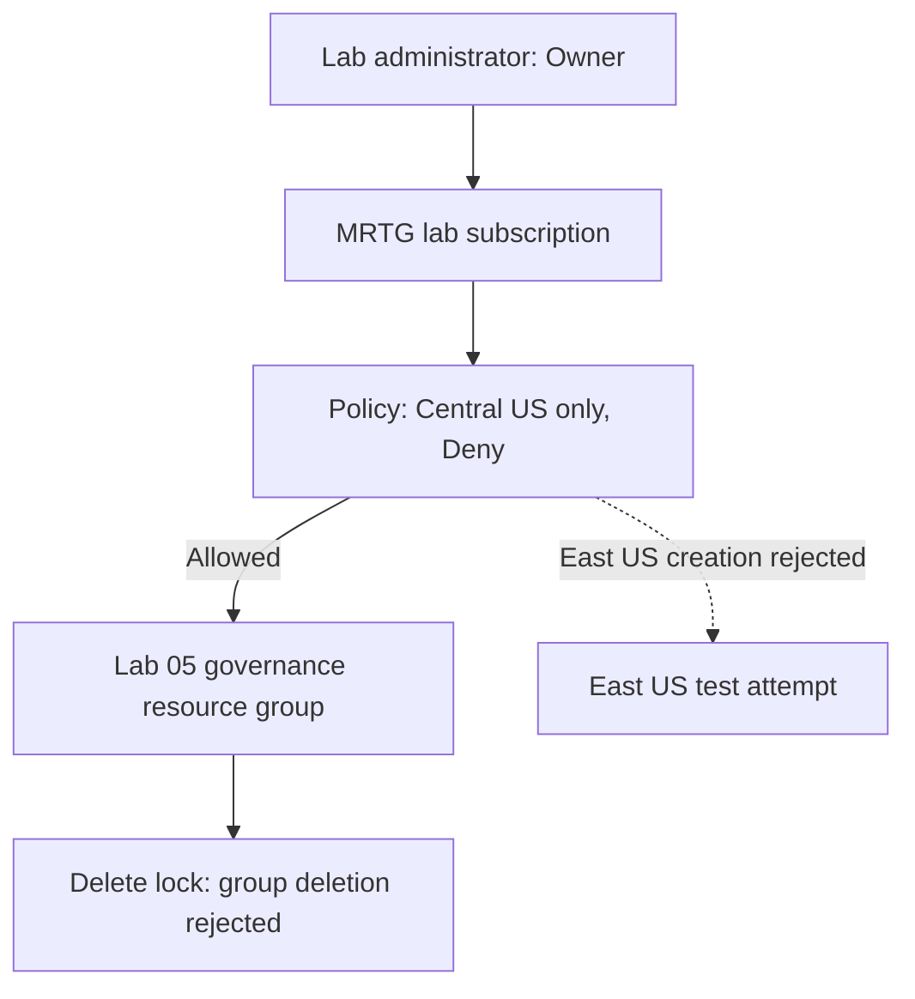
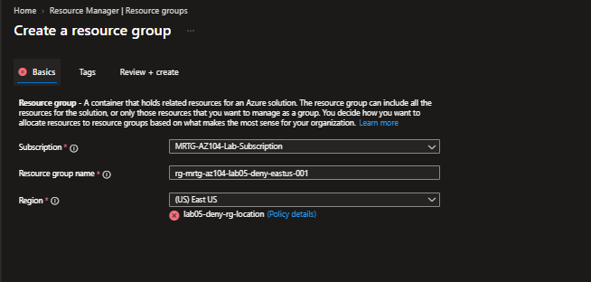

# Lab 05 — Guardrails with policy and locks

 

[Portfolio](../../README.md) · [All labs](../../docs/progress.md) · [Evidence gallery](screenshots/README.md)

## Outcome

Created a Central US resource group, observed an East US rejection identifying the lab policy, and verified that a Delete lock blocked group deletion. The group and policy were removed after testing.

## Business problem

MRTG wants its lab resource groups created only in Central US and wants a temporary governance group protected from accidental deletion. This lab tests two different management-plane guardrails: **Azure Policy** decides whether a new resource group may be created in a region; a **Delete lock** blocks deletion of an existing group, even for an Owner.

## Environment and decisions

### Design

The policy assignment is at **subscription scope** because the test creates new resource groups. A group-scoped assignment would not govern creation of a separate East US group. The lock is at **resource-group scope**. Azure RBAC grants the administrator permission to try these actions; policy and locks still restrict the operations.

## Work performed

1. Assigned `lab05-deny-rg-location` at subscription scope, with Central US as the allowed location and Default enforcement. The retained review capture does not display Effect.
2. Created the empty Central US governance group.
3. Proposed the East US test group; the portal identified the lab policy in its rejection. Cancelled the proposal before deployment.
4. Applied `lab05-delete-protection` as a Delete lock to the governance group.
5. Attempted group deletion and observed the lock rejection.
6. Removed the lock, deleted the group, removed the policy assignment, and checked both filtered lists.

## Validation results

The following results were reviewed from the completed portal exercise.

| Test | Observed result | Evidence |
|---|---|---|
| Policy configuration | Subscription scope, no exclusions, Central US allowed, Default enforcement, and assignment name visible. Effect is absent from the retained review screenshot. | [Configuration](screenshots/lab05-deny-policy-configuration.png) |
| Central US creation | Governance group present in the lab subscription in Central US. | [Allowed group](screenshots/lab05-centralus-group-created.png) |
| East US attempt | Portal displayed a policy rejection beside East US identifying `lab05-deny-rg-location`. The attempt was cancelled before deployment. | [Policy rejection](screenshots/lab05-eastus-creation-denied.png) |
| Delete lock applied | `lab05-delete-protection` shown as Delete at the governance group scope. | [Lock](screenshots/lab05-delete-lock-applied.png) |
| Deletion blocked | Azure notification stated that the governance group was locked and could not be deleted. | [Blocked deletion](screenshots/lab05-locked-group-delete-denied.png) |
| Resource-group cleanup | Reviewed Resource groups list showed no matches for `lab05`. | [Resource-group cleanup](screenshots/lab05-resource-group-cleanup.png) |
| Policy cleanup | Authoring → Assignments showed zero matches for `lab05` at the lab subscription scope. | [Assignments cleanup](screenshots/lab05-policy-cleanup.png) |

## Troubleshooting and lessons

The earlier Audit attempt depended on a compliance dashboard that had not evaluated the test groups. An initial 100% result with zero evaluated resources did not prove compliance. The exercise was restarted using Deny so the portal's rejection supplied an immediate checkpoint.

The cleanup capture initially showed resources inside the governance group, then the Policy Compliance page. The corrected checks used the subscription's Resource groups list and **Authoring → Assignments**. Screenshot filenames describe evidence; the selected portal view determines what that evidence proves.

This connects Lab 04's scoped access work to governance: permission to manage a resource does not establish that every operation will be permitted. Region policy and deletion protection add constraints to authorized administration.

## Cleanup and costs

The East US evidence demonstrates a portal policy rejection before deployment; it does not contain a submitted ARM deployment failure or a captured `RequestDisallowedByPolicy` response. The retained configuration screenshot does not show Effect, so enforcement is evidenced by the named policy rejection.

The lock test verifies management-plane deletion protection. Data-plane behavior and independent RBAC denial were not tested in this lab. The operator removed the lock, deleted the governance group, and removed the assignment; the final filtered lists were reviewed. A separate lock-removal screenshot was not retained.

Only an empty resource group, policy assignment, and management lock were used. No metered workload was deployed for this exercise; subscription-wide charges were not independently verified.

## Evidence and limits

**7 published screenshots:** [complete evidence gallery](screenshots/README.md). The gallery indexes every image in this lab’s screenshot folder. Validation applies to the recorded tests and states; it does not establish production hardening or regulatory compliance.

### References

- [Azure Policy built-in definitions](https://learn.microsoft.com/en-us/azure/governance/policy/samples/built-in-policies)
- [Assign a policy in the Azure portal](https://learn.microsoft.com/en-us/azure/governance/policy/assign-policy-portal)
- [Azure Policy compliance evaluation and timing](https://learn.microsoft.com/en-us/azure/governance/policy/how-to/get-compliance-data)
- [Lock Azure resources](https://learn.microsoft.com/en-us/azure/azure-resource-manager/management/lock-resources)

---

[← Lab 04](../lab-04-scoped-administration/README.md) · [All labs](../../docs/progress.md) · [Lab 06 →](../lab-06-password-recovery-and-licensing/README.md)
