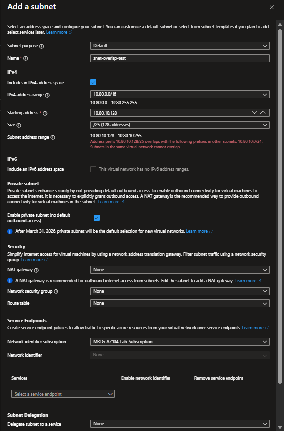

# Lab 08 — Address plan and subnets

 

[Portfolio](../../README.md) · [All labs](../../docs/progress.md) · [Evidence gallery](screenshots/README.md)

## Outcome

Deployed two private subnets, observed portal rejection of an overlapping proposal, and verified that the original ranges remained unchanged. The lab resource group was removed.

## Business problem

MRTG needs a clear address plan for future Operations and Security workloads. This exercise establishes separate subnet ranges and tests how the portal handles an overlapping proposal before workloads are introduced.

## Environment and decisions

Subscription: `MRTG-AZ104-Lab-Subscription`. Resource group: `rg-mrtg-lab08-network`. Region: Central US.

| Component | Name | CIDR | Address range |
|---|---|---|---|
| Virtual network | `vnet-mrtg-lab08` | `10.80.0.0/16` | 10.80.0.0–10.80.255.255 |
| Operations subnet | `snet-operations` | `10.80.10.0/24` | 10.80.10.0–10.80.10.255 |
| Security subnet | `snet-security` | `10.80.20.0/24` | 10.80.20.0–10.80.20.255 |
| Rejected proposal | `snet-overlap-test` | `10.80.10.128/25` | 10.80.10.128–10.80.10.255 |

Tags: Environment = Lab; Project = MRTG-AZ104-Administration; Lab = Lab-08; Owner = MRTG-Cloud-Operations.

Both subnets were configured with private subnet enabled (no default outbound access). NAT gateway, network security group, route table, and delegation were set to None; service endpoints were unselected. The deployment review showed Bastion, Firewall, and DDoS Network Protection disabled. No compute workloads were deployed.

## Work performed

1. Created the tagged resource group and captured its empty resource list.
2. Replaced the wizard's default address plan with `10.80.0.0/16` and configured the two /24 subnets.
3. Reviewed validation and settings, deployed the VNet, and captured successful deployment and resource overview.
4. Inspected the deployed subnet list: both intended CIDRs appeared, each with 251 available IPs and no attached NSG, route table, or delegation.
5. Proposed `10.80.10.128/25`. The portal displayed an overlap error naming `10.80.10.0/24` and stating that subnets in the same VNet cannot overlap.
6. Closed the unsaved proposal and refreshed. Only the two original subnets remained with unchanged CIDRs.
7. Verified that the lab resource group contained only the VNet, deleted the group, and captured the final unfiltered resource-group list.
8. Reviewed October subscription costs after cleanup: Actual cost displayed `--` with “No cost reported during this period.”

## Validation results

| Check | Observed result |
|---|---|
| Deployed address plan | Two intended /24 subnets; 251 available IPs each |
| Overlap test | Unsaved /25 proposal rejected by portal validation |
| Retest | Original two subnet CIDRs unchanged |
| Cleanup | Lab group absent; NetworkWatcherRG remained |

## Troubleshooting and lessons

### Findings and evidence limits

The attempted /25 lies entirely inside the Operations /24. The captured result is portal validation of an unsaved proposal, not a submitted deployment failure.

Separate subnet ranges establish address organization, not a tested traffic security boundary. No NSG rules, packet flows, internet connectivity, peering, routing behavior, or identity access tests were performed in this lab. Private subnet configuration was captured; outbound behavior was not tested.

The final cost view records the subscription's reported state at capture time. It does not prove a final $0 bill, remaining credits, or a current budget alert. No paid Entra or Microsoft 365 license or trial was used.

## Cleanup and costs

The final unfiltered list no longer contained `rg-mrtg-lab08-network`; only `NetworkWatcherRG` remained. Its contents were not inspected. The lab VNet and its subnets were removed with their resource group.

## Evidence and limits

**13 published screenshots:** [complete evidence gallery](screenshots/README.md). The gallery indexes every image in this lab’s screenshot folder. Validation applies to the recorded tests and states; it does not establish production hardening or regulatory compliance.

### Next lab

[Lab 09 — Traffic permissions](../lab-09-traffic-permissions/README.md) extends the network work into traffic controls.

---

[← Lab 07](../lab-07-access-review-and-cost-review/README.md) · [All labs](../../docs/progress.md) · [Lab 09 →](../lab-09-traffic-permissions/README.md)
