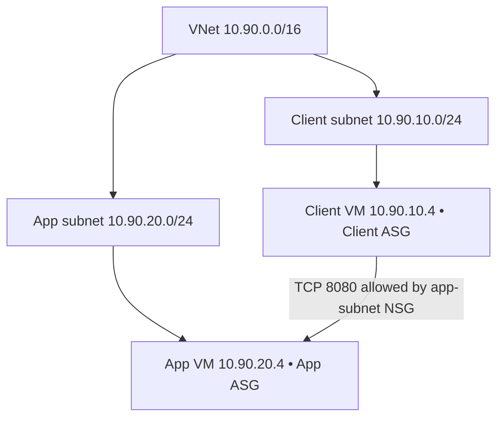
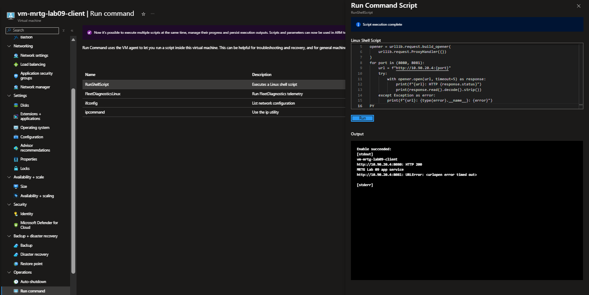

# Lab 09 — Traffic permissions

 

[Portfolio](../../README.md) · [All labs](../../docs/progress.md) · [Evidence gallery](screenshots/README.md)

## Outcome

Tested HTTP reachability through ASG membership removal and restoration: port 8080 succeeded only with the client membership present; port 8081 timed out. Cleanup was verified and USD 0.02 posted usage was reviewed.

## Business problem

Restrict client-to-application traffic using application security group (ASG) membership and network security group (NSG) rules, then test access removal and restoration using actual HTTP requests.

## Environment and decisions

### Architecture

### Deployed environment

| Component | Configuration |
|---|---|
| Resource group / region | `rg-mrtg-lab09-traffic` / Central US |
| VNet | `vnet-mrtg-lab09`, `10.90.0.0/16` |
| Client subnet / VM address | `snet-client`, `10.90.10.0/24` / `10.90.10.4` |
| App subnet / VM address | `snet-app`, `10.90.20.0/24` / `10.90.20.4` |
| VMs | Two Ubuntu 24.04 LTS VMs, Standard_B2ts_v2 |
| ASGs | `asg-mrtg-lab09-client` and `asg-mrtg-lab09-app`, assigned to their respective VM NICs |
| NSG placement | `nsg-mrtg-lab09-app` associated with the app subnet; no NIC NSGs |
| Public IP / public inbound ports | None |
| OS disks | Standard SSD LRS |

The initial subnet form enabled private subnets. Before creating the VMs, default outbound access was enabled on both subnets to support Azure VM agent / Run Command communication. This temporary lab choice did not assign public IPs to the VMs; production outbound design was outside the tested scope.

### Inbound policy

| Priority | Rule | Source | Destination | Protocol / port | Action |
|---|---|---|---|---|---|
| 100 | Allow-Client-To-App-TCP-8080 | Client ASG | App ASG | TCP / 8080 | Allow |
| 200 | Deny-Other-Inbound-To-App | Any | App ASG | Any / * | Deny |

The custom deny precedes Azure's default AllowVnetInBound rule. It targets app ASG members, rather than automatically targeting every NIC in the subnet.

## Work performed

1. Deployed the client and application network, NSG and ASGs; reviewed and corrected VM settings before deployment.
2. Started local HTTP listeners on ports 8080 and 8081 and verified both locally.
3. Tested both ports from the client with its ASG membership present, removed, and restored.
4. Deleted the lab resource group and rechecked posted costs the next day.

## Validation results

### Observed results

Both app services listened on ports 8080 and 8081 and returned HTTP 200 locally. Client tests used fresh Python HTTP requests to the app's private address.

| Client ASG state | TCP 8080 | TCP 8081 |
|---|---|---|
| Member | HTTP 200; expected lab response body | Timed out |
| Membership removed | Timed out | Timed out |
| Membership restored | HTTP 200; expected lab response body | Timed out |

These results validate the tested membership and port boundary. They do not claim every protocol, effective-rule export, Network Watcher flow verification, production hardening, or application authentication was tested. ASG membership controls network reachability; it is not an Entra user authorization mechanism.

## Troubleshooting and lessons

- Check regional and VM-family quotas separately; a quota increase does not guarantee SKU capacity.
- Review the complete VM form before deployment, including size, zone, public IP and required accelerated networking.
- Apply the app-subnet NSG and both ASG memberships before interpreting traffic tests. Use fresh requests after membership changes.
- Prove both permitted and denied traffic, then prove removal and restoration. Network reachability does not establish user authorization.
- Verify resource group deletion separately from an empty resource list. Review posted charges after cleanup; missing cost data is not zero cost.

## Cleanup and costs

### Troubleshooting and cleanup

Legacy VM sizes were unavailable. A Basv2-family quota request was unsuccessful; a Bsv2-family limit increase to four vCPUs succeeded, allowing two two-vCPU B2ts_v2 VMs. Quota approval was allocation permission, not actual usage or a capacity guarantee.

Final deployment reviews corrected unexpected availability-zone and public-IP selections before deployment. Accelerated networking remained enabled because the selected size required it.

The lab resource group and its VMs, disks, NICs, SSH key resources, ASGs, NSG and VNet were deleted. The resource group list subsequently showed only NetworkWatcherRG. No private SSH key files are published.

October Cost analysis showed “No cost reported during this period” and Actual cost `--` after cleanup. This is unreported cost data, not a zero-cost result. On October 11, the billing-account Cost analysis view filtered to `rg-mrtg-lab09-traffic` showed USD 0.02 total, Virtual Machines USD 0.02, Storage below USD 0.01 and Bandwidth below USD 0.01. The personal billing-account name is redacted. This is the rounded posted-usage snapshot at review time, not a finalized invoice or cash-payment amount; later reporting can change the total.

## Evidence and limits

**70 published screenshots:** [complete evidence gallery](screenshots/README.md). The gallery indexes every image in this lab’s screenshot folder. Validation applies to the recorded tests and states; it does not establish production hardening or regulatory compliance.

---

[← Lab 08](../lab-08-address-plan-and-subnets/README.md) · [All labs](../../docs/progress.md) · [Lab 10 →](../lab-10-peering-and-route-investigation/README.md)
