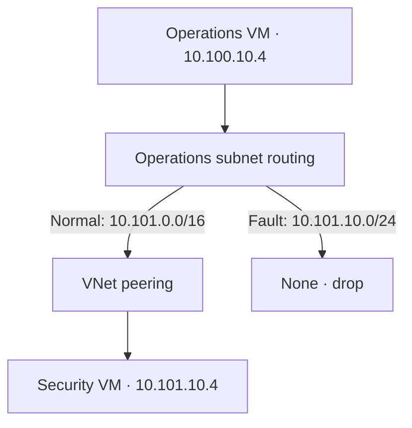
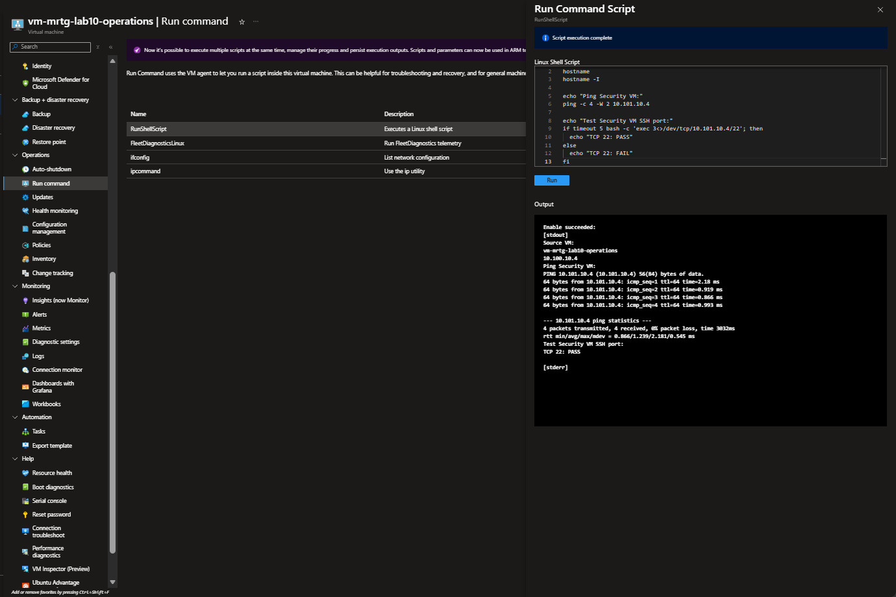

# Lab 10 — Peering and route investigation

 

[Portfolio](../../README.md) · [All labs](../../docs/progress.md) · [Evidence gallery](screenshots/README.md)

## Outcome

Verified private-IP connectivity across peered VNets, introduced a more specific drop route, and restored connectivity by removing it. Cleanup was verified; the October 18 review showed USD 0.13 posted usage.

## Business problem

MRTG needs connectivity between departmental networks and a repeatable way to investigate a failure. A connected peering status alone does not prove that a workload can communicate. This exercise pairs configuration evidence with traffic tests and a controlled fault.

## Environment and decisions

| Component | Configuration |
|---|---|
| Subscription / region | MRTG-AZ104-Lab-Subscription / Central US |
| Resource group | `rg-mrtg-lab10-peering` |
| Operations VNet / subnet | `vnet-mrtg-lab10-operations` — `10.100.0.0/16`; `snet-operations` — `10.100.10.0/24` |
| Security VNet / subnet | `vnet-mrtg-lab10-security` — `10.101.0.0/16`; `snet-security` — `10.101.10.0/24` |
| Operations VM / private IP | `vm-mrtg-lab10-operations` / `10.100.10.4` |
| Security VM / private IP | `vm-mrtg-lab10-security` / `10.101.10.4` |
| Compute | Ubuntu Server 24.04 LTS x64; Standard_B2ts_v2; Standard SSD LRS OS disks |
| VM security / access | Trusted Launch, Secure Boot and vTPM; SSH keys; no public IP; Run Command used for tests |
| Peering | `peer-operations-to-security` and `peer-security-to-operations`; Connected and Fully Synchronized |
| Fault | `rt-mrtg-lab10-operations` associated with `snet-operations`; `blackhole-security-subnet` routes `10.101.10.0/24` to None |
| Tags | Environment=Lab; Project=MRTG-AZ104-Administration; Lab=Lab-10; Owner=MRTG-Cloud-Operations |

Historical test topology; all Lab 10 resources were subsequently removed:

The VNets were initially reviewed with private subnets enabled. Before VM deployment, the private-subnet option was deliberately unchecked on both subnets to permit default outbound access; the VM overview displayed the default-outbound warning. This was a temporary lab tradeoff, not a production egress design. No NAT gateway, Bastion, Firewall, gateway transit, or forwarded-traffic scenario was validated. No NSG was associated with either test subnet or NIC.

## Work performed

1. Created and tagged the resource group, deployed nonoverlapping VNets, and configured both peerings.
2. Reviewed Central US quotas: Standard Bsv2 family 0/4 vCPUs and total regional 0/14 before deployment. Quota availability was not treated as a capacity guarantee.
3. Configured the temporary outbound setting and deployed two VMs into the existing VNets. Verified private IPs and ready VM agents.
4. Used RunShellScript on each VM to test the peer by IP with four pings and a five-second TCP/22 connection attempt.
5. Captured both NICs' baseline effective routes. Operations had an active peering route to `10.101.0.0/16`; Security had the reverse route to `10.100.0.0/16`.
6. Created the /24 drop route and associated its table with Operations. Captured the active User route with next hop None, then repeated the Operations test.
7. Deleted the drop route while leaving the empty table associated. Captured the restored effective routes and repeated the Operations test successfully.
8. Reviewed the 11-resource inventory, deleted the lab group, and reviewed posted costs after cleanup and again the next day.

## Validation results

| Check | Observed result |
|---|---|
| Operations → Security baseline | 4/4 ICMP replies, 0% packet loss; TCP 22 PASS |
| Security → Operations baseline | 4/4 ICMP replies, 0% packet loss; TCP 22 PASS |
| Fault effective routes | User /24 route Active, next hop None; broader /16 peering route still Active |
| Operations → Security during fault | 0/4 replies, 100% packet loss; TCP 22 FAIL |
| After route removal | /16 peering route remained Active; drop route no longer shown in the captured view |
| Operations → Security recovery | 4/4 replies, 0% packet loss; TCP 22 PASS |
| Cleanup | Post-deletion subscription resource-group list showed NetworkWatcherRG and no Lab 10 group |
| Posted cost review | USD 0.13 displayed on October 18, filtered to the Lab 10 resource group |

The /24 route matched the Security VM destination more specifically than the /16 peering route. Its next hop None dropped matching traffic. Recovery after removing that route, with the same destination and test, supports the routing diagnosis. The fault and recovery were tested from Operations; reverse-initiated traffic was tested only at baseline. TCP/22 PASS proves connection establishment, not an authenticated SSH session or application authorization.

## Troubleshooting and lessons

- Verify the destination IP, source VM, and actual traffic before interpreting a configuration status.
- A broader peering route can remain active while a more specific route drops the workload's traffic.
- Capture working, failed, and restored behavior using the same test to make the diagnosis reviewable.
- Separate reachability from identity authorization; an open TCP port does not establish who may sign in.
- Verify cleanup and recheck delayed costs, preserving the scope and filters used.

## Cleanup and costs

The [pre-cleanup inventory](screenshots/lab10-resources-before-cleanup.png) contained two VMs, two NICs, two OS disks, two VNets, two SSH key resources, and one route table. The published [post-deletion list](screenshots/lab10-resource-group-cleanup.png) shows only NetworkWatcherRG in the selected subscription; its contents were not inspected. Sanitized [Operations VM readiness](screenshots/lab10-operations-vm-ready-for-testing.png), Security VM readiness, and both subnet outbound-settings captures are included. Superseded captures with visible identifiers are excluded. The [route-removal overview](screenshots/lab10-blackhole-route-removed.png), restored effective routes, and successful connectivity tests document recovery.

| Review | Scope and observation |
|---|---|
| Before VMs | Lab resource-group scope; Actual cost `--`, no cost reported; not evidence of zero charge |
| October 17 after cleanup | Billing-account scope, Lab 10 resource-group filter; USD 0.04 displayed |
| October 17 update | Same resource-group filter; USD 0.07 displayed |
| October 18 recheck | Same filter; USD 0.13 displayed: Storage USD 0.09, Virtual Machines USD 0.04, Bandwidth and Virtual Network each below USD 0.01 |

Values are rounded posted snapshots, not a finalized invoice or verified cash spend. The unfiltered billing-account total was excluded from Lab 10 attribution. VM creation estimates were monthly projections, not session totals. No paid Entra or Microsoft 365 license or trial was used; budget alerts were not revalidated during this lab.

## Evidence and limits

**39 published screenshots:** [complete evidence gallery](screenshots/README.md). The gallery indexes every image in this lab’s screenshot folder. Validation applies to the recorded tests and states; it does not establish production hardening or regulatory compliance.

### References

[Manage VNet peering](https://learn.microsoft.com/en-us/azure/virtual-network/virtual-network-manage-peering) · [Diagnose routing problems](https://learn.microsoft.com/en-us/azure/virtual-network/diagnose-network-routing-problem) · [Manage route tables](https://learn.microsoft.com/en-us/azure/virtual-network/manage-route-table) · [Default outbound access](https://learn.microsoft.com/en-us/azure/virtual-network/ip-services/default-outbound-access) · [Linux Run Command](https://learn.microsoft.com/en-us/azure/virtual-machines/linux/run-command)

---

[← Lab 09](../lab-09-traffic-permissions/README.md) · [All labs](../../docs/progress.md) · [Lab 11 →](../lab-11-name-resolution-and-application-availability/README.md)
