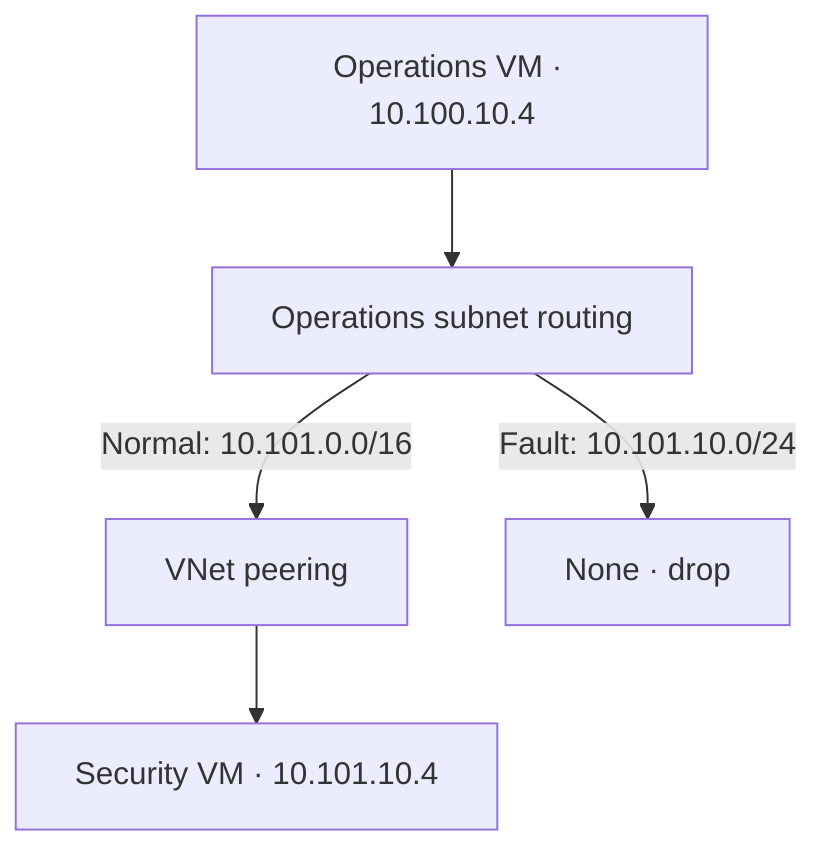
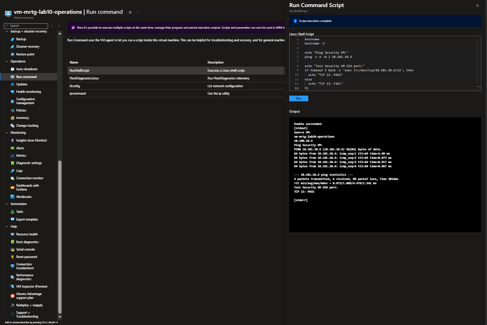
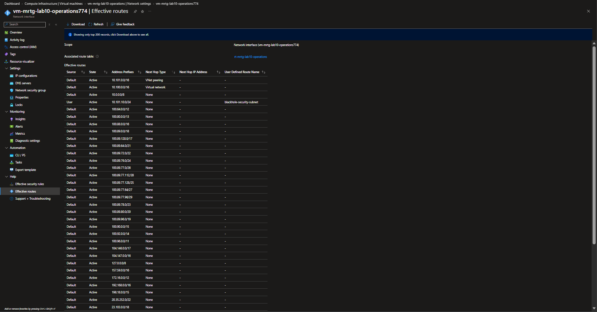
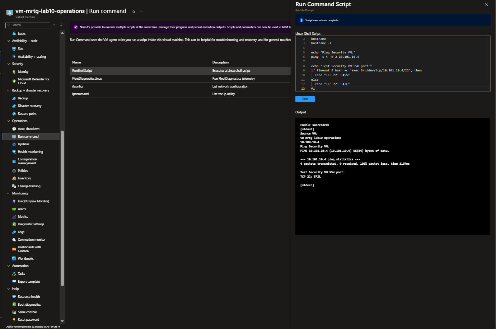
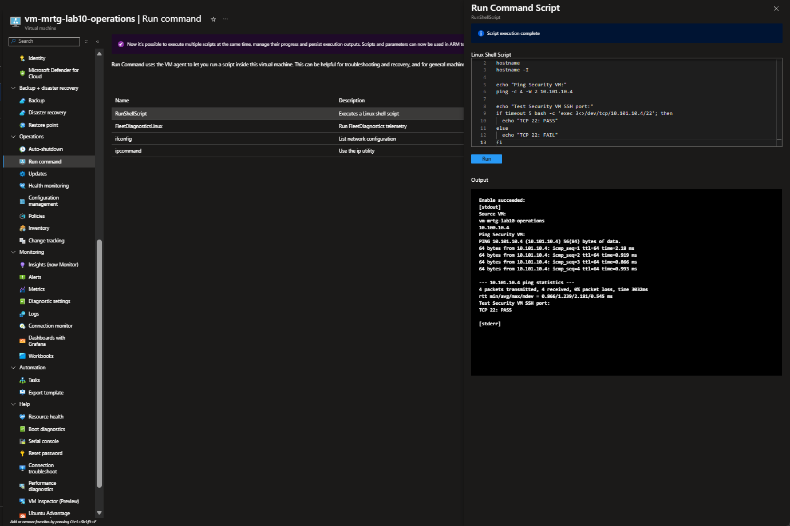

# Lab 10 — Peering and route investigation

 

Two private-IP Ubuntu VMs communicated across peered Operations and Security VNets. A more specific user-defined drop route then broke Operations-to-Security connectivity. Effective routes exposed the cause; removing the route restored ICMP and TCP/22 connectivity. The lab resource group was deleted, and the October 18 cost review showed **USD 0.13 posted usage**.

[Portfolio](../../README.md) · [All labs](../../docs/progress.md) · [Cost ledger](../../docs/cost-ledger.md)

## Business problem

MRTG needs connectivity between departmental networks and a repeatable way to investigate a failure. A connected peering status alone does not prove that a workload can communicate. This exercise pairs configuration evidence with traffic tests and a controlled fault.

## Environment and decisions

| Component | Configuration |
|---|---|
| Subscription / region | MRTG-AZ104-Lab-Subscription / Central US |
| Resource group | `rg-mrtg-lab10-peering` |
| Operations VNet / subnet | `vnet-mrtg-lab10-operations` — `10.100.0.0/16`; `snet-operations` — `10.100.10.0/24` |
| Security VNet / subnet | `vnet-mrtg-lab10-security` — `10.101.0.0/16`; `snet-security` — `10.101.10.0/24` |
| Operations VM / private IP | `vm-mrtg-lab10-operations` / `10.100.10.4` |
| Security VM / private IP | `vm-mrtg-lab10-security` / `10.101.10.4` |
| Compute | Ubuntu Server 24.04 LTS x64; Standard_B2ts_v2; Standard SSD LRS OS disks |
| VM security / access | Trusted Launch, Secure Boot and vTPM; SSH keys; no public IP; Run Command used for tests |
| Peering | `peer-operations-to-security` and `peer-security-to-operations`; Connected and Fully Synchronized |
| Fault | `rt-mrtg-lab10-operations` associated with `snet-operations`; `blackhole-security-subnet` routes `10.101.10.0/24` to None |
| Tags | Environment=Lab; Project=MRTG-AZ104-Administration; Lab=Lab-10; Owner=MRTG-Cloud-Operations |

Historical test topology; all Lab 10 resources were subsequently removed:

The VNets were initially reviewed with private subnets enabled. Before VM deployment, the private-subnet option was deliberately unchecked on both subnets to permit default outbound access; the VM overview displayed the default-outbound warning. This was a temporary lab tradeoff, not a production egress design. No NAT gateway, Bastion, Firewall, gateway transit, or forwarded-traffic scenario was validated. No NSG was associated with either test subnet or NIC.

## Work performed

1. Created and tagged the resource group, deployed nonoverlapping VNets, and configured both peerings.
2. Reviewed Central US quotas: Standard Bsv2 family 0/4 vCPUs and total regional 0/14 before deployment. Quota availability was not treated as a capacity guarantee.
3. Configured the temporary outbound setting and deployed two VMs into the existing VNets. Verified private IPs and ready VM agents.
4. Used RunShellScript on each VM to test the peer by IP with four pings and a five-second TCP/22 connection attempt.
5. Captured both NICs' baseline effective routes. Operations had an active peering route to `10.101.0.0/16`; Security had the reverse route to `10.100.0.0/16`.
6. Created the /24 drop route and associated its table with Operations. Captured the active User route with next hop None, then repeated the Operations test.
7. Deleted the drop route while leaving the empty table associated. Captured the restored effective routes and repeated the Operations test successfully.
8. Reviewed the 11-resource inventory, deleted the lab group, and reviewed posted costs after cleanup and again the next day.

## Validation results

| Check | Observed result |
|---|---|
| Operations → Security baseline | 4/4 ICMP replies, 0% packet loss; TCP 22 PASS |
| Security → Operations baseline | 4/4 ICMP replies, 0% packet loss; TCP 22 PASS |
| Fault effective routes | User /24 route Active, next hop None; broader /16 peering route still Active |
| Operations → Security during fault | 0/4 replies, 100% packet loss; TCP 22 FAIL |
| After route removal | /16 peering route remained Active; drop route no longer shown in the captured view |
| Operations → Security recovery | 4/4 replies, 0% packet loss; TCP 22 PASS |
| Cleanup | Post-deletion subscription resource-group list showed NetworkWatcherRG and no Lab 10 group |
| Posted cost review | USD 0.13 displayed on October 18, filtered to the Lab 10 resource group |

The /24 route matched the Security VM destination more specifically than the /16 peering route. Its next hop None dropped matching traffic. Recovery after removing that route, with the same destination and test, supports the routing diagnosis. The fault and recovery were tested from Operations; reverse-initiated traffic was tested only at baseline. TCP/22 PASS proves connection establishment, not an authenticated SSH session or application authorization.

## Key evidence

### Working baseline

[Reverse-direction baseline](screenshots/lab10-security-to-operations-baseline.png) · [Operations routes](screenshots/lab10-operations-effective-routes-baseline.png) · [Security routes](screenshots/lab10-security-effective-routes-baseline.png)

### Controlled failure

### Verified recovery

[Restored effective routes](screenshots/lab10-operations-effective-routes-restored.png)

### Cost review

The October 18 capture was reviewed and showed USD 0.13. Its upload remains pending; the earlier [October 17 cost update](screenshots/lab10-cost-review-update.png) is published.

## Cleanup and costs

The reviewed pre-cleanup inventory contained two VMs, two NICs, two OS disks, two VNets, two SSH key resources, and one route table. The published [post-deletion list](screenshots/lab10-resource-group-cleanup.png) shows only NetworkWatcherRG in the selected subscription; its contents were not inspected. Sanitized Security VM readiness and both subnet outbound-settings captures are included. Superseded captures with visible identifiers are excluded. Four additional reviewed captures remain unpublished pending upload clearance: the resource inventory, October 18 cost review, Operations VM readiness, and route-removal overview. Restored effective routes and successful connectivity tests are published.

| Review | Scope and observation |
|---|---|
| Before VMs | Lab resource-group scope; Actual cost `--`, no cost reported; not evidence of zero charge |
| October 17 after cleanup | Billing-account scope, Lab 10 resource-group filter; USD 0.04 displayed |
| October 17 update | Same resource-group filter; USD 0.07 displayed |
| October 18 recheck | Same filter; USD 0.13 displayed: Storage USD 0.09, Virtual Machines USD 0.04, Bandwidth and Virtual Network each below USD 0.01 |

Values are rounded posted snapshots, not a finalized invoice or verified cash spend. The unfiltered billing-account total was excluded from Lab 10 attribution. VM creation estimates were monthly projections, not session totals. No paid Entra or Microsoft 365 license or trial was used; budget alerts were not revalidated during this lab.

## Lessons learned

- Verify the destination IP, source VM, and actual traffic before interpreting a configuration status.
- A broader peering route can remain active while a more specific route drops the workload's traffic.
- Capture working, failed, and restored behavior using the same test to make the diagnosis reviewable.
- Separate reachability from identity authorization; an open TCP port does not establish who may sign in.
- Verify cleanup and recheck delayed costs, preserving the scope and filters used.

## Evidence index

The public gallery contains 34 reviewed screenshots. Duplicate uploads and captures with unredacted identifiers are excluded.

- [resource group created](screenshots/lab10-resource-group-created.png)
- [operations vnet review](screenshots/lab10-operations-vnet-review.png)
- [operations vnet deployment complete](screenshots/lab10-operations-vnet-deployment-complete.png)
- [security vnet review](screenshots/lab10-security-vnet-review.png)
- [security vnet deployment complete](screenshots/lab10-security-vnet-deployment-complete.png)
- [operations peering connected](screenshots/lab10-operations-peering-connected.png)
- [security peering connected](screenshots/lab10-security-peering-connected.png)
- [cost before vms](screenshots/lab10-cost-before-vms.png)
- [bsv2 quota baseline](screenshots/lab10-bsv2-quota-baseline.png)
- [regional vcpu quota baseline](screenshots/lab10-regional-vcpu-quota-baseline.png)
- [security subnet outbound](screenshots/lab10-security-subnet-outbound.png)
- [operations vm review](screenshots/lab10-operations-vm-review.png)
- [operations vm review networking](screenshots/lab10-operations-vm-review-networking.png)
- [operations vm created](screenshots/lab10-operations-vm-created.png)
- [security vm review networking](screenshots/lab10-security-vm-review-networking.png)
- [security vm deployment complete](screenshots/lab10-security-vm-deployment-complete.png)
- [security vm created](screenshots/lab10-security-vm-created.png)
- [operations to security baseline](screenshots/lab10-operations-to-security-baseline.png)
- [security to operations baseline](screenshots/lab10-security-to-operations-baseline.png)
- [operations effective routes baseline](screenshots/lab10-operations-effective-routes-baseline.png)
- [security effective routes baseline](screenshots/lab10-security-effective-routes-baseline.png)
- [route table review](screenshots/lab10-route-table-review.png)
- [blackhole route created](screenshots/lab10-blackhole-route-created.png)
- [route table subnet associated](screenshots/lab10-route-table-subnet-associated.png)
- [operations effective routes blackhole](screenshots/lab10-operations-effective-routes-blackhole.png)
- [operations to security route failure](screenshots/lab10-operations-to-security-route-failure.png)
- [operations effective routes restored](screenshots/lab10-operations-effective-routes-restored.png)
- [operations to security connectivity restored](screenshots/lab10-operations-to-security-connectivity-restored.png)
- [cost review after cleanup](screenshots/lab10-cost-review-after-cleanup.png)
- [cost review update](screenshots/lab10-cost-review-update.png)
- [security vm review](screenshots/lab10-security-vm-review.png)
- [security vm ready for testing](screenshots/lab10-security-vm-ready-for-testing.png)
- [resource group cleanup](screenshots/lab10-resource-group-cleanup.png)
- [operations subnet outbound](screenshots/lab10-operations-subnet-outbound.png)

## References

[Manage VNet peering](https://learn.microsoft.com/en-us/azure/virtual-network/virtual-network-manage-peering) · [Diagnose routing problems](https://learn.microsoft.com/en-us/azure/virtual-network/diagnose-network-routing-problem) · [Manage route tables](https://learn.microsoft.com/en-us/azure/virtual-network/manage-route-table) · [Default outbound access](https://learn.microsoft.com/en-us/azure/virtual-network/ip-services/default-outbound-access) · [Linux Run Command](https://learn.microsoft.com/en-us/azure/virtual-machines/linux/run-command)
