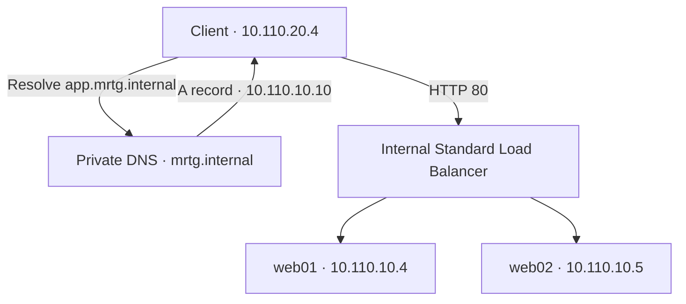
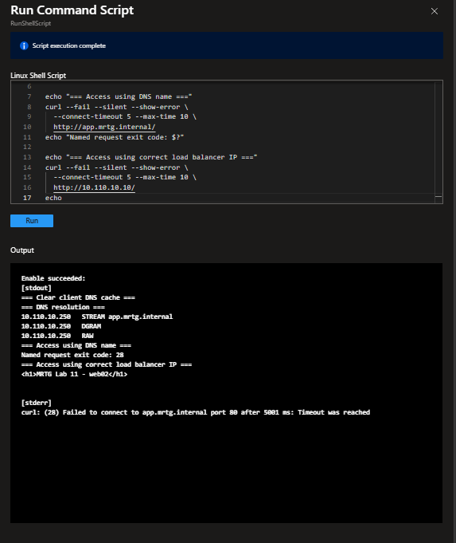

# Lab 11 — Name resolution and application availability

 

[Portfolio](../../README.md) · [All labs](../../docs/progress.md) · [Evidence gallery](screenshots/README.md)

## Outcome

Verified private DNS and two load-balanced web backends, continued service with one backend stopped, and isolated a wrong DNS address from the working application path. Recovery and cleanup were verified; USD 0.15 posted usage was reviewed.

## Business problem

MRTG needs a stable internal application name and a way to distinguish name-resolution failures from failed web services. This exercise establishes a working baseline, changes one component at a time, and checks client behavior before and after recovery.

## Environment and decisions

| Component | Configuration |
|---|---|
| Resource group / region | `rg-mrtg-lab11-dns-availability` / Central US |
| VNet | `vnet-mrtg-lab11-app` — `10.110.0.0/16` |
| Web subnet | `snet-web` — `10.110.10.0/24` |
| Client subnet | `snet-client` — `10.110.20.0/24` |
| Web VMs | `vm-mrtg-lab11-web01` — `10.110.10.4`; `vm-mrtg-lab11-web02` — `10.110.10.5` |
| Client VM | `vm-mrtg-lab11-client` — `10.110.20.4`; excluded from the backend pool |
| Compute | Three Ubuntu Server 24.04 LTS x64 Gen2 Standard_B2ts_v2 VMs; Standard SSD LRS OS disks |
| VM security / management | Trusted Launch, Secure Boot, vTPM, SSH-key configuration, accelerated networking; no VM public IP; tests through Run Command |
| NIC NSGs | Shared `nsg-mrtg-lab11-web` on web VMs; `nsg-mrtg-lab11-client` on client |
| Explicit outbound access | Standard `nat-mrtg-lab11-egress`, with `pip-mrtg-lab11-egress`, associated with both private subnets |
| Load balancer | Standard, Internal, Regional `lb-mrtg-lab11-internal`; zone-redundant frontend `fe-mrtg-lab11-app` — static `10.110.10.10` |
| Backend / rule / probe | NIC pool `bp-mrtg-lab11-web`; `rule-mrtg-lab11-http`, TCP 80 → 80, session persistence None; selected HTTP:80 probe `probe-mrtg-lab11-http` |
| Private DNS | `mrtg.internal`; `link-mrtg-lab11-app` Completed; autoregistration and fallback to Internet Disabled |
| Application record | Manual A record `app.mrtg.internal` → `10.110.10.10`, TTL 30 seconds |
| Tags | Environment=Lab; Project=MRTG-AZ104-Administration; Lab=Lab-11; Owner=MRTG-Cloud-Operations |

Historical test topology; the Lab 11 deployment was subsequently deleted:

NAT supplied outbound connectivity for VM management and package installation. Its public IP was an egress address, not a public frontend on the VMs. The client was kept outside the backend pool. The zone-redundant frontend does not establish zone resilience for these VMs: their creation used no infrastructure redundancy requirement.

## Work performed

1. Created and tagged the resource group, VNet, web and client subnets, private DNS zone and VNet link. Kept autoregistration disabled for the manually managed application name.
2. Raised the Standard Bsv2 family quota from 4 to 6 vCPUs for three two-vCPU VMs. Added explicit NAT egress to both private subnets.
3. Deployed the VMs with NIC NSGs and no VM public IP. Corrected a proposed public IP and a missing NSG during review, before deployment. Waited for VM agent readiness before using Run Command.
4. Installed nginx on both web VMs and wrote distinct web01/web02 pages. Verified each service locally, then tested both backend private IPs from the client.
5. Created the internal frontend, selected only web01/web02 in the NIC backend pool, and configured TCP 80 forwarding. Corrected the proposed TCP probe to HTTP before deployment; the final rule review shows HTTP:80.
6. Tested repeated client requests to the frontend private IP. Added the app A record and verified resolution and HTTP access through the application name.
7. Stopped nginx on web02, verified it was inactive, and repeated named client requests. Restarted nginx, verified its local page, then repeated frontend requests until both backends were observed.
8. Changed the app record to the incorrect `10.110.10.250`, flushed the client resolver cache, and compared named access with direct access to the correct load balancer IP. Restored the record and verified named access again.
9. Reviewed the 19-resource inventory, deleted the resource group, verified the empty resource list and absent group, and rechecked delayed usage costs the following day.

## Validation results

| Check | Observed result |
|---|---|
| Local web services | nginx active; each local HTTP test returned its matching backend page |
| Client → backend IPs | Both `10.110.10.4` and `10.110.10.5` returned the expected pages |
| Client → frontend IP | Successful responses from both web01 and web02 were visible |
| DNS baseline | `app.mrtg.internal` resolved to `10.110.10.10`; six successful named HTTP requests |
| Backend fault | web02 nginx inactive; six named requests succeeded through web01; DNS unchanged |
| Backend recovery | web02 nginx active and local page working; subsequent 30-request sample returned 9 web01 and 21 web02 responses |
| DNS fault | Name resolved to `10.110.10.250`; named HTTP request timed out with curl exit code 28; direct frontend-IP request returned web02 |
| DNS recovery | Name resolved to `10.110.10.10` again; named HTTP request returned web01 |
| Cleanup | Empty lab inventory; selected subscription resource-group list showed only NetworkWatcherRG |
| Posted cost | October 21 resource-group-filtered October view displayed USD 0.15 |

The recovery count script also counted 30 blank lines because it printed an extra newline after each page. Those blank lines are not additional requests. Traffic did not need to alternate evenly between backends. An initial recovery sample showed only web01; the later count demonstrated that web02 had returned to observed traffic, without establishing the exact cause or duration of the earlier distribution.

The DNS fault was a wrong address, not a failure to resolve the name. Successful direct-IP access during the fault isolated the incorrect DNS mapping from the functioning application path. These tests establish HTTP reachability and service recovery; they do not establish user authentication, application authorization, TLS, regulatory compliance, or production availability guarantees. NSG hardening and denied-port tests were not performed in this lab. Per-backend probe metrics were not captured; availability conclusions use observed client responses and service status.

## Troubleshooting and lessons

- Establish direct backend access, frontend-IP access, and named access separately to isolate faults.
- A running VM is not proof of a working web service; verify the service and its response.
- A load balancer can continue serving while a backend service is down; verify client behavior after changing it.
- Successful DNS resolution can still return the wrong address. Compare the returned address with the intended frontend.
- Preserve evidence of failure, the corrective change, and recovery. Do not label a one-backend response sample as proof that both backends recovered.
- Explicit egress is a separate design decision from private inbound access. Include NAT and public-IP resources in cleanup and cost review.

[Resource-group configuration and tags](screenshots/lab11-resource-group-review.png) · [Resources before cleanup](screenshots/lab11-resources-before-cleanup.png)

## Cleanup and costs

The [sanitized pre-cleanup inventory](screenshots/lab11-resources-before-cleanup.png) contained 19 resources: three SSH key resources, three VMs, three NICs, three OS disks, two NSGs, a VNet, private DNS zone, load balancer, NAT gateway, and public IP. The [empty inventory](screenshots/lab11-resources-cleanup-verified.png) and resource-group list document cleanup. NetworkWatcherRG remained; its contents were not inspected.

| Review | Scope and observation |
|---|---|
| Before VMs | Lab resource-group filter; below USD 0.01, Azure DNS only |
| October 20 after cleanup | Same group filter; below USD 0.01, Azure DNS only; remaining usage not yet visible |
| October 21 recheck | Billing-account scope, October 2026, exact Lab 11 resource-group filter; USD 0.15 displayed |

The October 21 service breakdown showed NAT Gateway USD 0.07, Virtual Machines USD 0.03, Azure DNS USD 0.02, Storage USD 0.01, Load Balancer USD 0.01, Virtual Network below USD 0.01, and Bandwidth USD 0.00. Rounded categories may not sum to the displayed total. This is posted usage subject to reporting updates, not a finalized invoice or verified cash spend. Credits were not assumed; creation-screen monthly estimates were not session costs. No paid Entra or Microsoft 365 license purchase or trial was used. Budget alerts were not revalidated during this lab.

The [October 21 cost review](screenshots/lab11-final-cost-review.png) shows USD 0.15 in posted usage. The three VM readiness captures hide the subscription ID and NAT public IP. The sanitized [initial web01 agent warning](screenshots/lab11-web01-vm-agent-not-ready.png) records the provisioning state before the later agent-ready captures.

## Evidence and limits

**65 published screenshots:** [complete evidence gallery](screenshots/README.md). The gallery indexes every image in this lab’s screenshot folder. Validation applies to the recorded tests and states; it does not establish production hardening or regulatory compliance.

### References

[Internal load balancer](https://learn.microsoft.com/en-us/azure/load-balancer/quickstart-load-balancer-standard-internal-portal) · [Private DNS](https://learn.microsoft.com/en-us/azure/dns/private-dns-getstarted-portal) · [NAT gateway](https://learn.microsoft.com/en-us/azure/nat-gateway/nat-overview) · [Linux Run Command](https://learn.microsoft.com/en-us/azure/virtual-machines/linux/run-command)

---

[← Lab 10](../lab-10-peering-and-route-investigation/README.md) · [All labs](../../docs/progress.md) · [Lab 12 →](../lab-12-private-access-and-administrator-entry/README.md)
