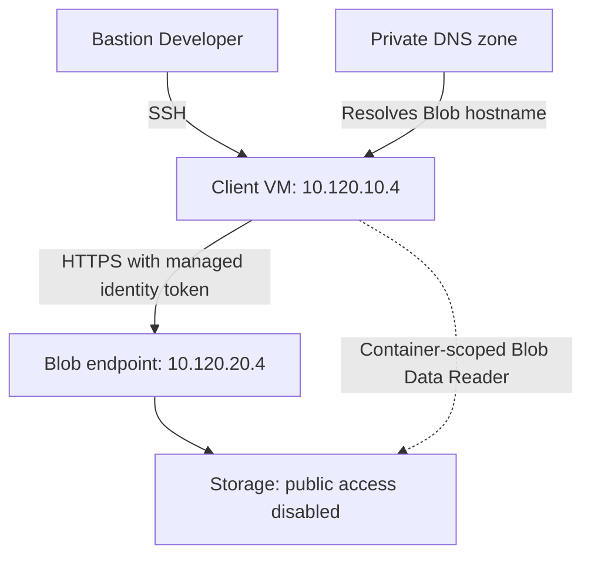

# Lab 12 — Private access and administrator entry

 

MRTG needed a workload to read a private document without storing a Storage account key, while keeping the client VM off the public internet. This exercise compared a Storage service endpoint with a Blob private endpoint, kept data authorization scoped to one container, and verified administrator SSH entry through Bastion Developer.

**Result:** the VM read the synthetic blob with HTTP 200 before and after the private endpoint transition. The final read used private DNS with public network access disabled; the home administrator's portal request received 403. The lab resource group was removed after testing. The October 24–31 cost view showed **USD 1.74 posted usage**, subject to delayed reporting.

## Environment and decisions

| Component | Configuration |
|---|---|
| Resource group / region | `rg-mrtg-lab12-private-access` / Central US |
| VNet | `vnet-mrtg-lab12-private`, `10.120.0.0/16`, Azure-provided DNS |
| Client subnet | `snet-client`, `10.120.10.0/24`; private subnet; Microsoft.Storage service endpoint enabled during the first test |
| Endpoint subnet | `snet-private-endpoints`, `10.120.20.0/24`; private endpoint network policies disabled |
| VM | `vm-mrtg-lab12-client`, Ubuntu 24.04 LTS, Standard_B2ts_v2, Standard SSD OS disk; private IP `10.120.10.4`; no public IP |
| VM network security | NIC NSG `vm-mrtg-lab12-client-nsg`; default inbound rules; no custom public SSH allow rule |
| Administrator entry | Bastion Developer `vnet-mrtg-lab12-private-bastion`; SSH as `azureuser` using a local private key |
| Storage | `stmrtglab121025`, Standard GPv2, LRS, Hot; shared-key and anonymous blob access disabled; default Entra authentication |
| Test data | Private container `lab12-evidence`; blob `lab12-test.txt`, 42 bytes |
| Workload identity | System-assigned VM managed identity, Storage Blob Data Reader at container scope |
| Private endpoint | `pe-mrtg-lab12-blob`, target subresource `blob`; NIC `nic-pe-mrtg-lab12-blob`; dynamic private IP `10.120.20.4` |
| Private DNS | `privatelink.blob.core.windows.net`, default endpoint DNS zone group |
| Tags | Environment=Lab; Project=MRTG-AZ104-Administration; Lab=Lab-12; Owner=MRTG-Cloud-Operations |

No paid Entra/Microsoft 365 license or trial was used. The deployed Bastion tier was Developer, not the paid Standard option shown elsewhere in the portal. No NAT gateway or VM public IP was deployed. Azure resource usage remains separate from identity licensing.

The final tested path, before cleanup:



## Work performed

1. Created the tagged resource group, VNet and two private subnets. Deployed the storage account with secure transfer, TLS 1.2, Microsoft-managed encryption and shared-key access disabled.
2. Assigned the administrator Storage Blob Data Contributor at account scope, created the private container, and uploaded/read the synthetic document through Entra authentication.
3. Enabled Microsoft.Storage on the client subnet and restricted the account's public endpoint to that subnet. No home-IP allow rule or network exception was added. The home portal container request returned 403.
4. Deployed the client VM with a system-assigned identity and no public IP. Connected through Bastion Developer and checked hostname, username and private IP. Assigned Storage Blob Data Reader to the VM identity on the test container.
5. Used Python's standard library to obtain a Storage access token from IMDS and read the blob over HTTPS. The service-endpoint-stage request returned HTTP 200. DNS at this stage returned an Azure public service IP, `57.150.192.97`.
6. Created the Blob private endpoint in the endpoint subnet with private DNS integration. The endpoint showed Succeeded and Approved. Its DNS configuration mapped the storage account to `10.120.20.4`.
7. Flushed the VM DNS cache and repeated `nslookup` against the normal Blob hostname. It followed the `privatelink` alias and returned `10.120.20.4`.
8. Disabled storage public network access and repeated the same managed-identity read from the VM. It returned HTTP 200 and the expected text. The home portal continued to return 403.
9. Captured the 11-resource inventory, deleted the resource group, checked its absence in the filtered group list, and reviewed posted costs.

## Observed access boundaries

| Test | Observation | What it establishes |
|---|---|---|
| Administrator baseline upload/read | Synthetic blob uploaded and opened | Administrator had working data access before network restriction |
| Home portal after selected-network restriction | 403 with network/firewall explanation | The home request was rejected under the configured network boundary |
| Bastion SSH entry | Hostname, `azureuser` and `10.120.10.4` displayed | Administrator entry worked without a VM public IP |
| Managed identity through service endpoint | HTTP 200 and expected blob contents | Identity-based data read worked during the selected-subnet stage |
| DNS before private endpoint | Azure public service IP | A service endpoint did not assign a private IP to Storage |
| Private endpoint and DNS | Approved endpoint; VM resolved normal Blob hostname to `10.120.20.4` | Private endpoint provisioning and client DNS resolution worked |
| Managed identity after public access disabled | HTTP 200 and expected contents | Blob read remained available through the private endpoint |
| Home portal after private endpoint transition | 403 | External portal data access remained blocked |
| Cleanup | No matching lab resource group | Resource-group cleanup was checked after deletion |

The test document contained only:

```text
MRTG Lab 12 - Private storage access test.
```

## Validation commands

The VM ran `hostname`, `whoami`, `hostname -I`, and:

```bash
sudo resolvectl flush-caches
nslookup stmrtglab121025.blob.core.windows.net
```

Both blob-read tests used this flow. The token remained in memory and was not printed or saved in evidence. No account key or SAS was used.

```python
import json
import urllib.request
import urllib.error

client = urllib.request.build_opener(urllib.request.ProxyHandler({}))
token_url = (
    "http://169.254.169.254/metadata/identity/oauth2/token"
    "?api-version=2018-02-01&resource=https%3A%2F%2Fstorage.azure.com%2F"
)
blob_url = (
    "https://stmrtglab121025.blob.core.windows.net/"
    "lab12-evidence/lab12-test.txt"
)
try:
    request = urllib.request.Request(token_url, headers={"Metadata": "true"})
    with client.open(request, timeout=15) as response:
        token = json.load(response)["access_token"]
    request = urllib.request.Request(blob_url, headers={
        "Authorization": "Bearer " + token,
        "x-ms-version": "2023-11-03"
    })
    with client.open(request, timeout=30) as response:
        print("Blob read HTTP status:", response.status)
        print(response.read().decode())
except urllib.error.HTTPError as error:
    print("HTTP status:", error.code)
    print("Storage error:", error.headers.get("x-ms-error-code", "Not provided"))
except urllib.error.URLError as error:
    print("Connection error:", error.reason)
```

## Troubleshooting and lessons

An initial multi-line Bastion paste joined commands to the prompt instead of executing `nslookup`. Running cache flush and lookup separately produced a usable DNS result. The malformed paste is excluded from success evidence.

Ubuntu's welcome screen reported an update-check connection failure. General internet egress was not configured, and no package installation was required for the Python test. Storage access did not establish general internet access.

Network reachability and identity permissions are separate checks. A private endpoint did not replace the VM's data role, and the administrator's inherited Owner role did not bypass the storage network boundary. The service endpoint retained public DNS addressing; the private endpoint introduced a private destination IP through DNS integration.

## Cleanup and costs

The pre-cleanup list contained 11 resources: SSH key resource, endpoint NIC, private endpoint, private DNS zone, storage account, VM, VM NSG, VM NIC, OS disk, VNet and Bastion. The entire lab resource group was deleted; the refreshed, correctly scoped search showed no matching group. This capture does not inventory unrelated resource groups. Private SSH key material is excluded from the repository.

| Posted service cost | USD |
|---|---:|
| Virtual Machines | 1.33 |
| Storage | 0.41 |
| Bandwidth | 0.00 |
| **Displayed total** | **1.74** |

The review covered October 24–31, 2026 at billing-account scope, grouped by resource group; Lab 12 was the displayed series. This is a posted-usage snapshot, not a final invoice or verified cash charge. Private endpoint/DNS charges were not separately visible in this capture and may appear later. The budget and credits were not revalidated. VM creation estimates were monthly rates, not the lab's actual total.

## Evidence limits

The deployed role and successful read were verified. Write denial, cross-container denial, identity-role removal enforcement, VPN connectivity, paid Bastion features, and production hardening were not tested. The public-access-disabled screenshot shows the selected configuration; the subsequent private read and home denial corroborate the final behavior. Resource-group deletion does not establish permanent erasure of every recoverable storage item.

Results are based on reviewed operator-supplied screenshots. Thirteen reviewed screenshots are published in the gallery. The service-endpoint read and cost-review captures were reviewed for the written results but are retained outside the public gallery. Configuration-review captures establish intended settings; runtime tests carry the functional conclusions. These are synthetic lab results, not a regulatory-compliance attestation.

## References

- [Storage private endpoints and DNS](https://learn.microsoft.com/en-us/azure/storage/common/storage-private-endpoints)
- [Storage virtual-network access rules](https://learn.microsoft.com/en-us/azure/storage/common/storage-network-security-virtual-networks)
- [Assign Azure roles for Blob data access](https://learn.microsoft.com/en-us/azure/storage/blobs/assign-azure-role-data-access)
- [Linux VM managed identity and Storage access](https://learn.microsoft.com/en-us/entra/identity/managed-identities-azure-resources/tutorial-linux-managed-identities-vm-access)
- [Deploy and connect with Bastion in the portal](https://learn.microsoft.com/en-us/azure/bastion/quickstart-host-portal)

[Evidence gallery](screenshots/README.md) · [All labs](../../docs/progress.md) · [Architecture](../../docs/architecture.md) · [Cost ledger](../../docs/cost-ledger.md)
