# Lab 12 evidence gallery

55 reviewed screenshots document private VM networking, Bastion entry, managed identity, service and private endpoint reads, DNS, network restrictions, cleanup and posted costs. Corrected copies mask account identifiers, the home public IP and tenant domain. No private SSH keys or access token values are displayed.

## Client vm networking verified

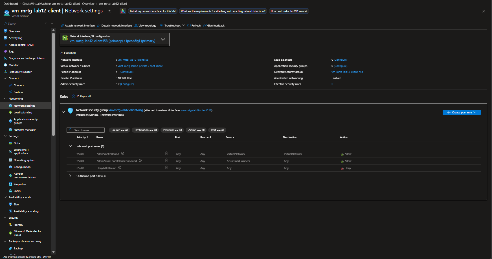

## Bastion private vm connected

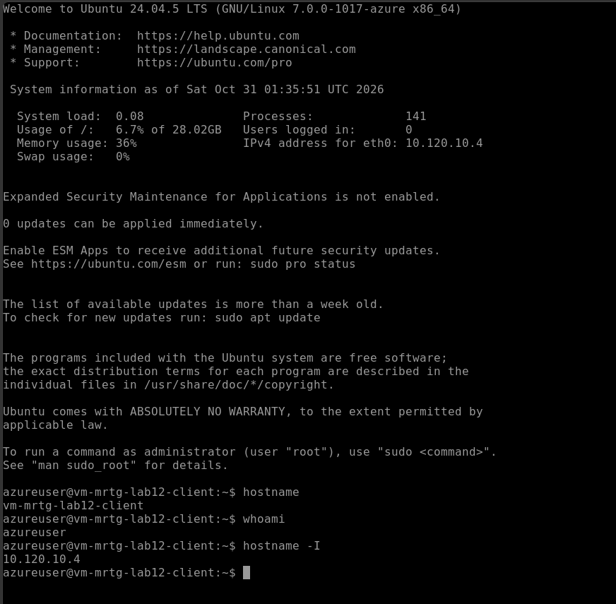

## Client blob reader role review

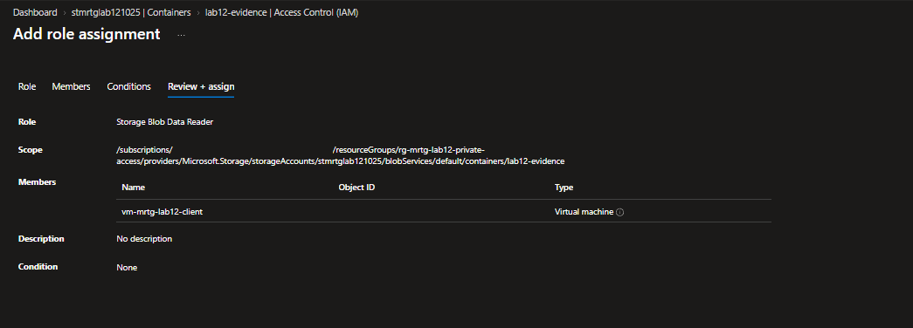

## Client blob reader role assigned

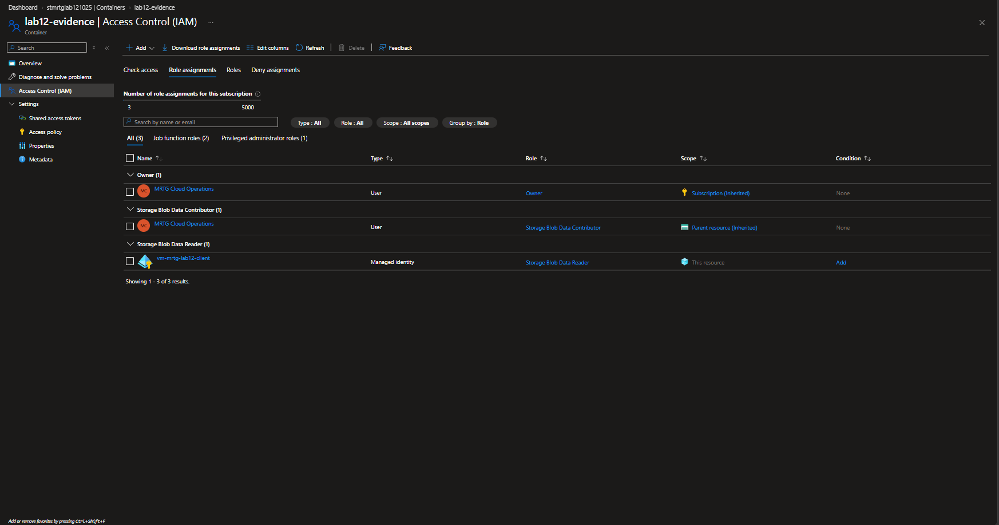

## Service endpoint blob read success

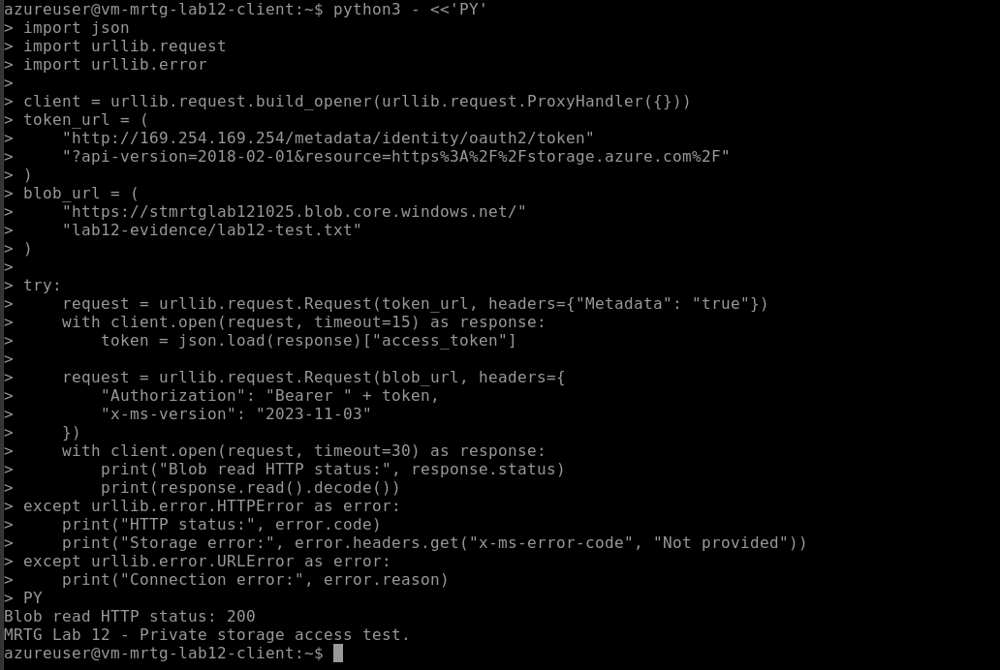

## Storage public dns baseline

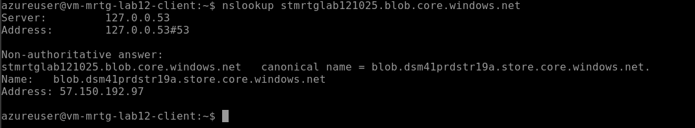

## Blob private endpoint approved

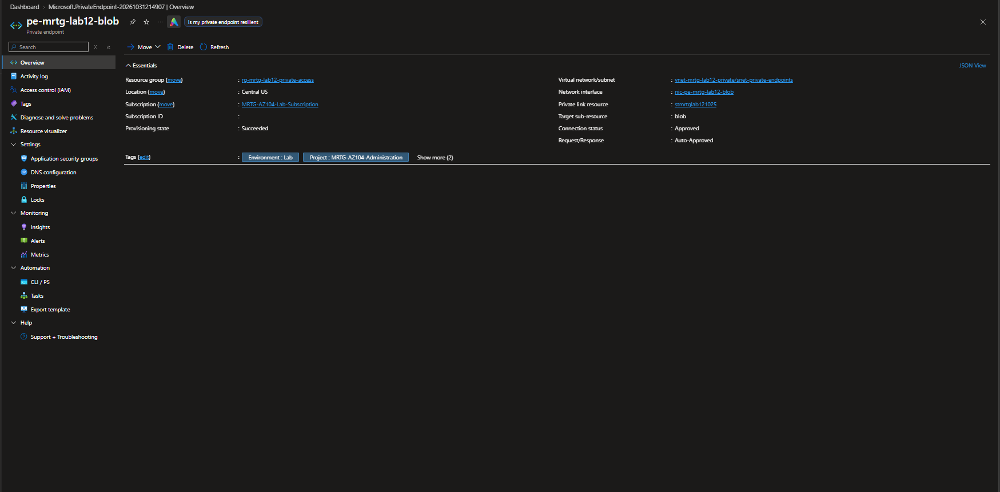

## Blob private endpoint dns verified

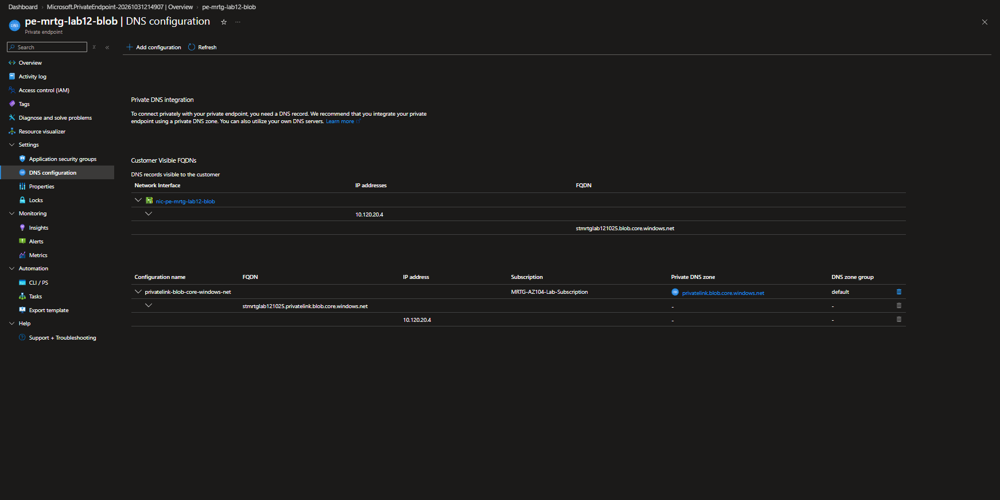

## Storage private dns resolution

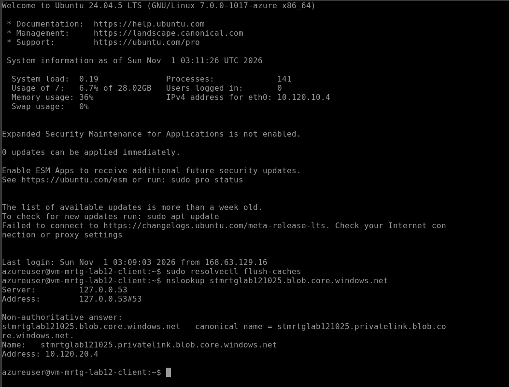

## Storage public network access disabled

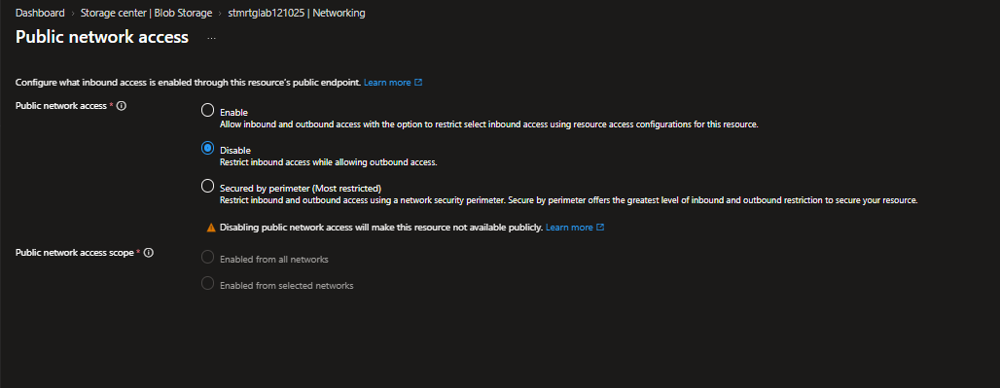

## Private endpoint blob read success

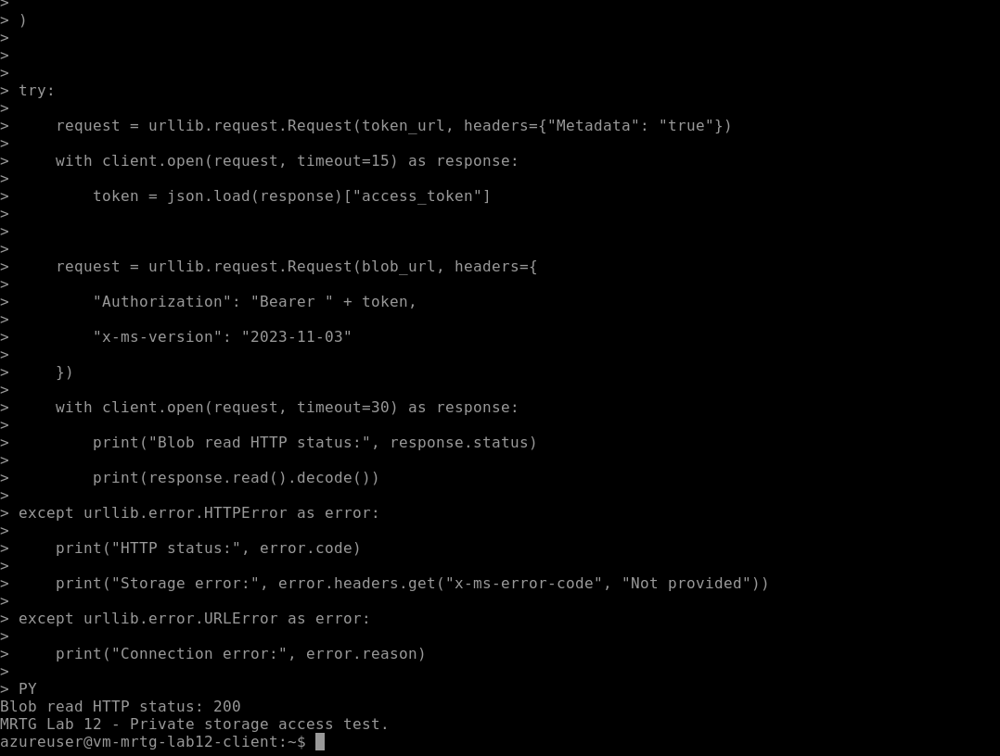

## Admin public access denied after private endpoint

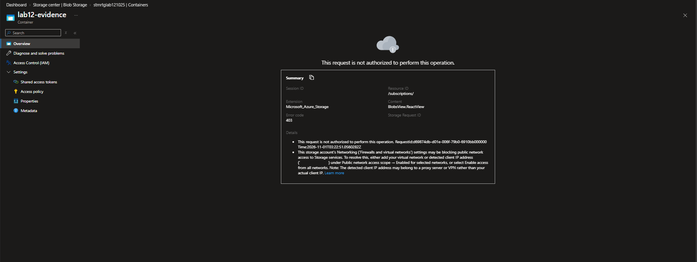

## Resources before cleanup

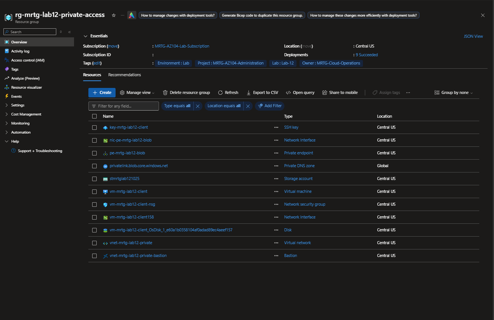

## Resource group cleanup

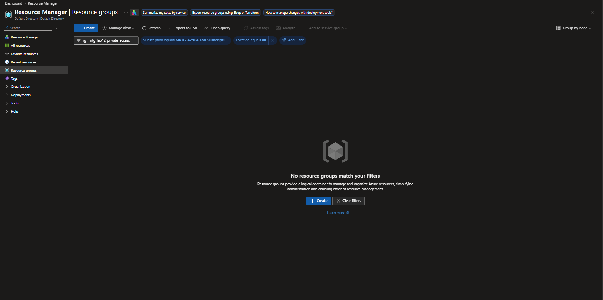

## Final cost review

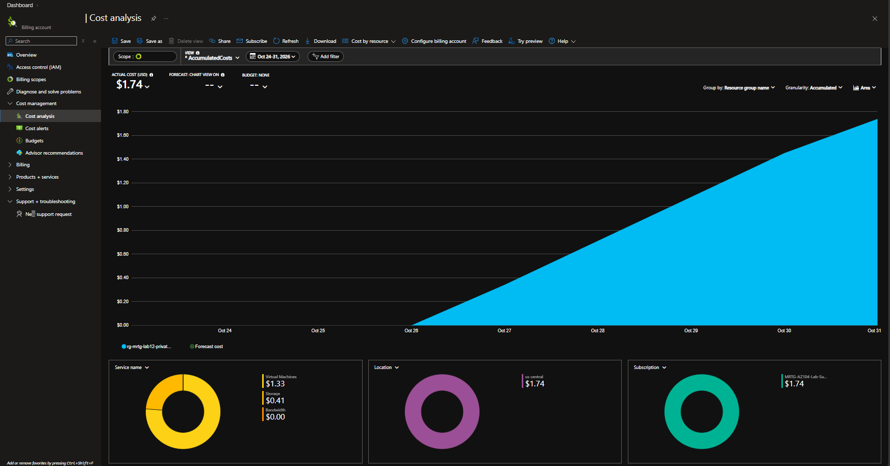

## Additional setup and baseline evidence

These captures show intermediate settings and reviews. Storage initially allowed public network access before the selected-subnet stage and final public-access disablement. The Bastion options screen displays a dedicated Standard offer; the tested connection used Developer. The VM review renders the NSG field as a dash; the deployed networking screenshot establishes the attached NSG.

- [bastion access options](lab12-bastion-access-options.png)
- [blob private endpoint networking](lab12-blob-private-endpoint-networking.png)
- [storage account networking baseline](lab12-storage-account-networking-baseline.png)
- [client vm management configuration](lab12-client-vm-management-configuration.png)
- [admin public access denied](lab12-admin-public-access-denied.png)
- [client vm basics](lab12-client-vm-basics.png)
- [vnet review](lab12-vnet-review.png)
- [storage account review security networking](lab12-storage-account-review-security-networking.png)
- [client vm disk configuration](lab12-client-vm-disk-configuration.png)
- [storage account security](lab12-storage-account-security.png)
- [storage account encryption](lab12-storage-account-encryption.png)
- [client vm deployment complete](lab12-client-vm-deployment-complete.png)
- [storage account advanced features](lab12-storage-account-advanced-features.png)
- [resource group created](lab12-resource-group-created.png)
- [deployed subnets verified](lab12-deployed-subnets-verified.png)
- [client vm tags](lab12-client-vm-tags.png)
- [bastion ssh connection configuration](lab12-bastion-ssh-connection-configuration.png)
- [resource group review](lab12-resource-group-review.png)
- [blob private endpoint tags](lab12-blob-private-endpoint-tags.png)
- [blob private endpoint resource](lab12-blob-private-endpoint-resource.png)
- [blob private endpoint deployment complete](lab12-blob-private-endpoint-deployment-complete.png)
- [storage account review](lab12-storage-account-review.png)
- [blob private endpoint basics](lab12-blob-private-endpoint-basics.png)
- [storage account deployment complete](lab12-storage-account-deployment-complete.png)
- [vnet deployment complete](lab12-vnet-deployment-complete.png)
- [admin blob data role review](lab12-admin-blob-data-role-review.png)
- [storage account data protection](lab12-storage-account-data-protection.png)
- [blob private endpoint review](lab12-blob-private-endpoint-review.png)
- [blob private endpoint dns configuration](lab12-blob-private-endpoint-dns-configuration.png)
- [client vm networking configuration](lab12-client-vm-networking-configuration.png)
- [private container created](lab12-private-container-created.png)
- [client vm advanced configuration](lab12-client-vm-advanced-configuration.png)
- [client vm review networking](lab12-client-vm-review-networking.png)
- [storage account basics](lab12-storage-account-basics.png)
- [client vm review](lab12-client-vm-review.png)
- [test blob uploaded](lab12-test-blob-uploaded.png)
- [client storage service endpoint enabled](lab12-client-storage-service-endpoint-enabled.png)
- [client vm monitoring configuration](lab12-client-vm-monitoring-configuration.png)
- [admin blob read baseline](lab12-admin-blob-read-baseline.png)

- [storage selected network access (sanitized)](lab12-storage-selected-network-access.png)

## Source reconciliation

All 55 supplied screenshots are published: 15 already present byte-for-byte and 40 added. The selected-network capture uses the supplied sanitized replacement with the home public IP hidden.

[Lab 12 results](../README.md)
