# Lab 13 evidence

Reviewed screenshots of work performed on November 1, 2026. Subscription/object IDs are masked in the applicable capture. The initial mismatch is retained alongside the successful retry; its cause was not established.

## 01 — Resource group review and tags

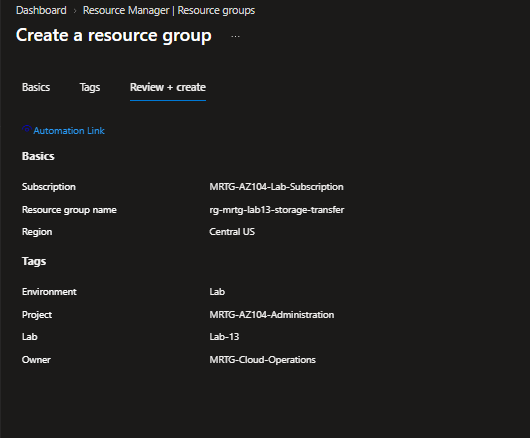

## 02 — Standard LRS storage account in Central US

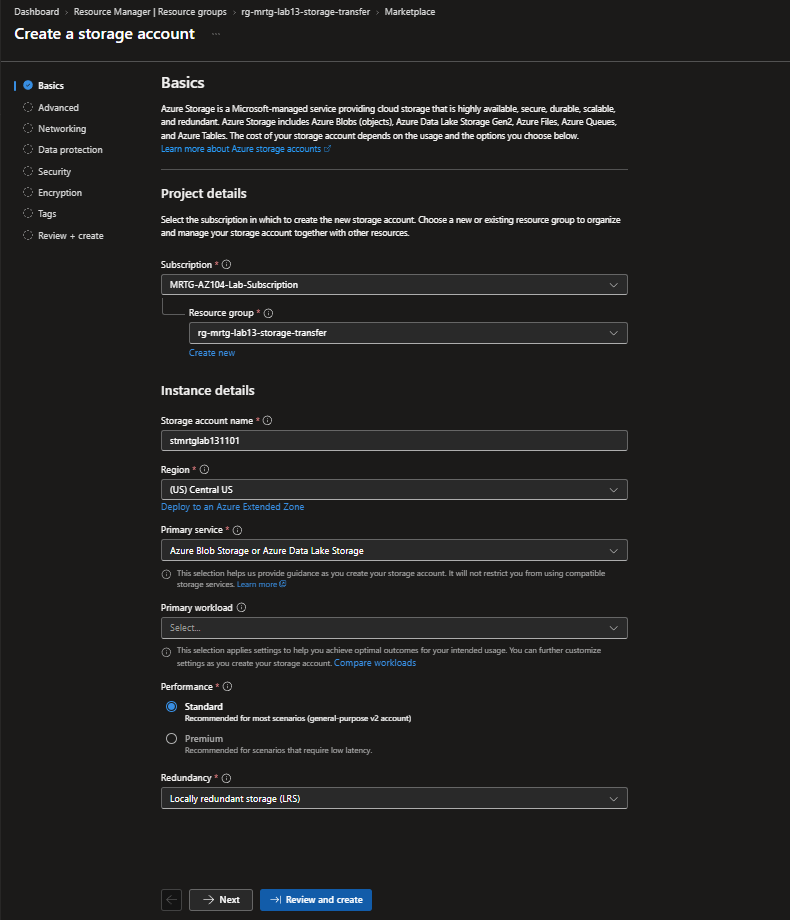

## 03 — Hot access tier and advanced options

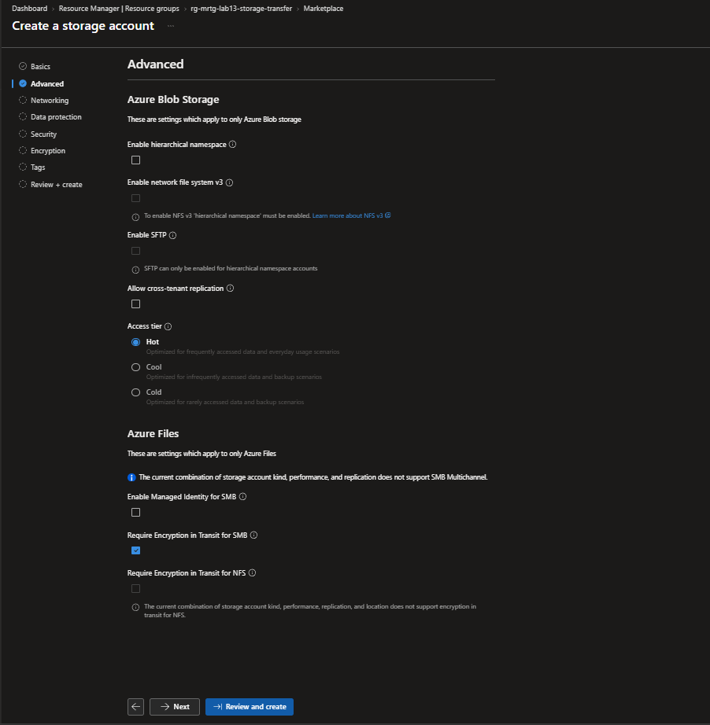

## 04 — Public endpoint enabled for workstation transfers

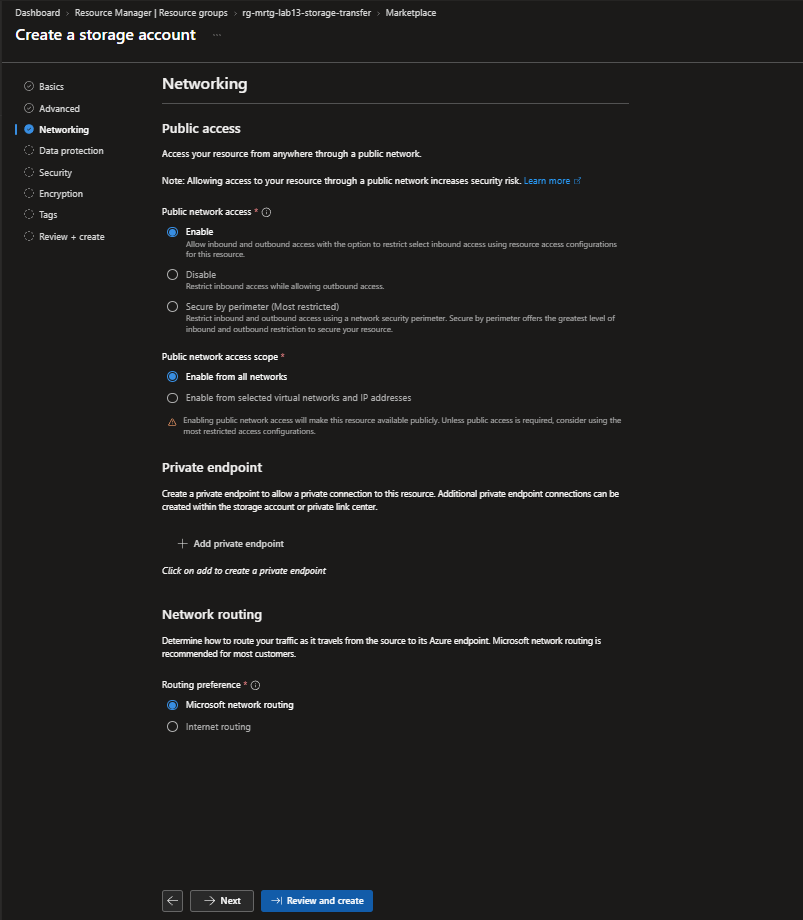

## 05 — Seven-day soft delete settings

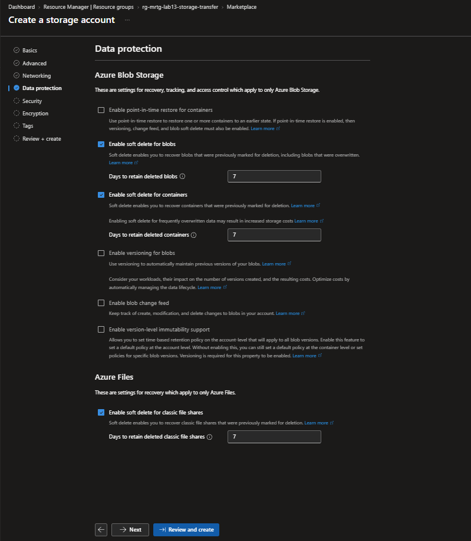

## 06 — Entra default authorization; account keys and anonymous access disabled

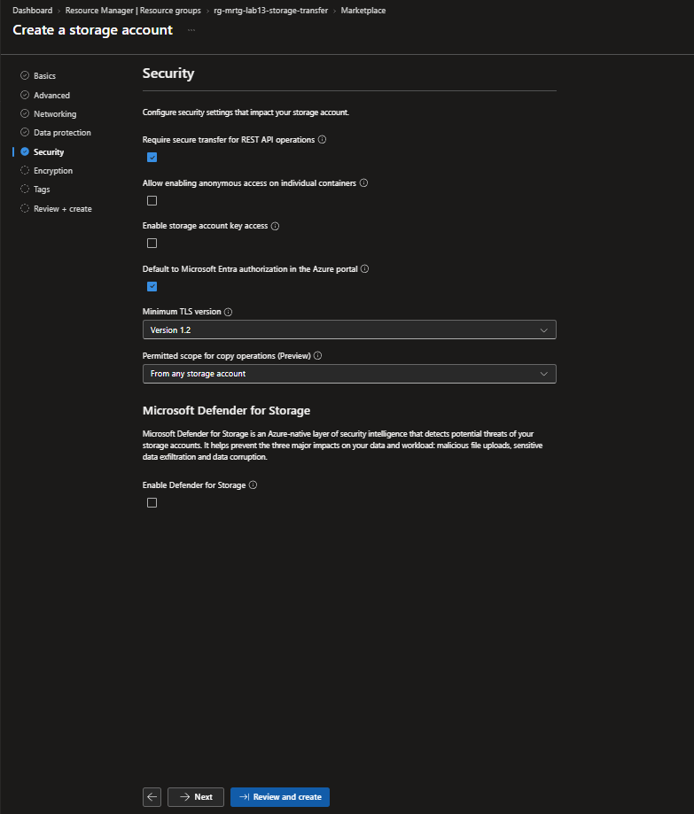

## 07 — Microsoft-managed encryption keys

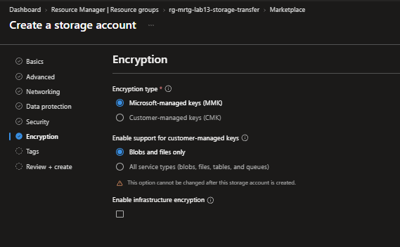

## 08 — Lab ownership and project tags

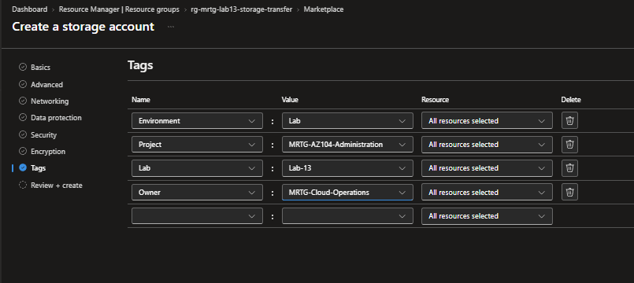

## 09 — Storage account configuration review

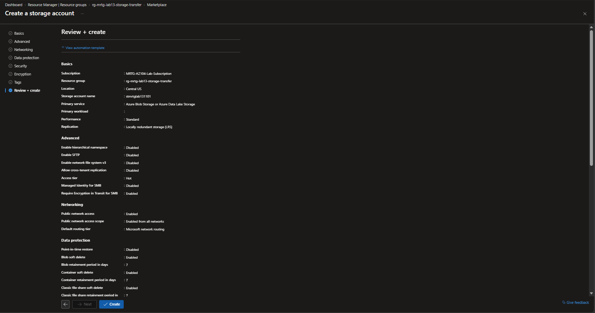

## 10 — Security, encryption and tags in the lower review pane

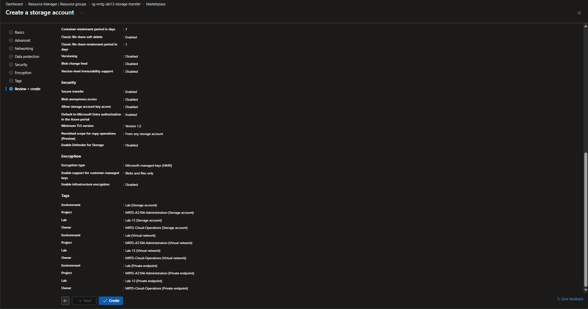

## 11 — Storage deployment completed

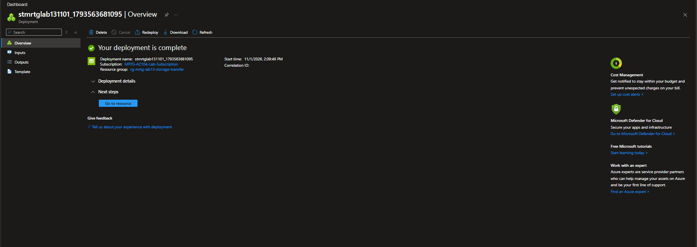

## 12 — Administrator data role review; subscription and object IDs masked

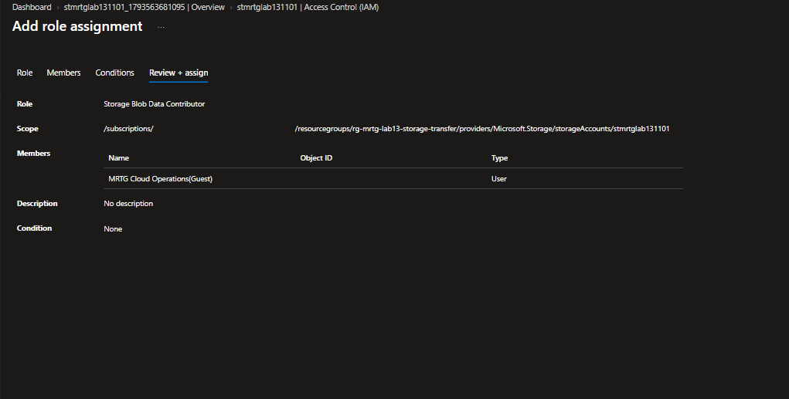

## 13 — Private lab13-transfer container

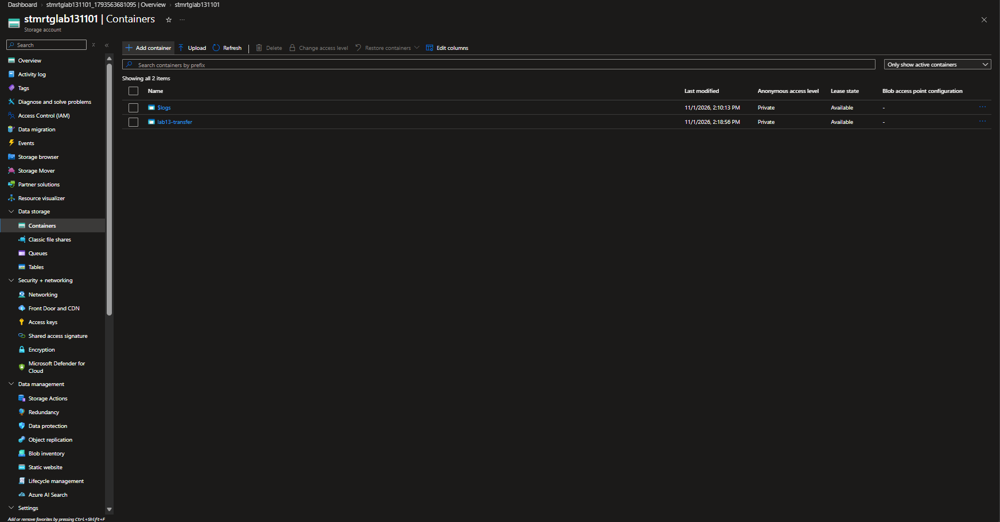

## 14 — Three blobs uploaded using Microsoft Entra user authentication

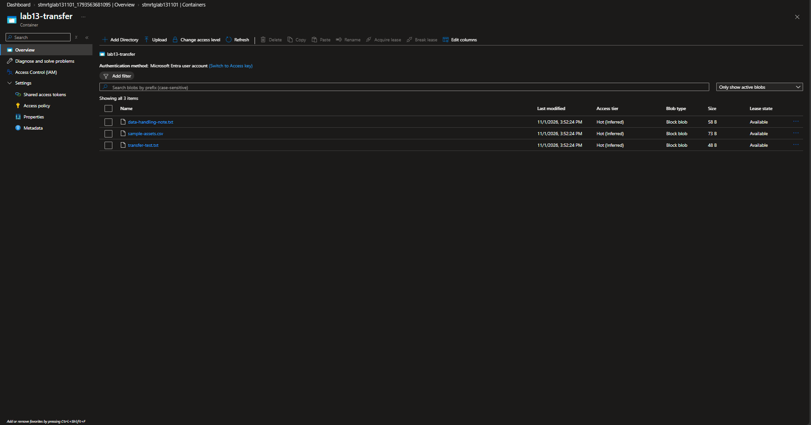

## 15 — Initial comparison: two PASS results and one CSV mismatch

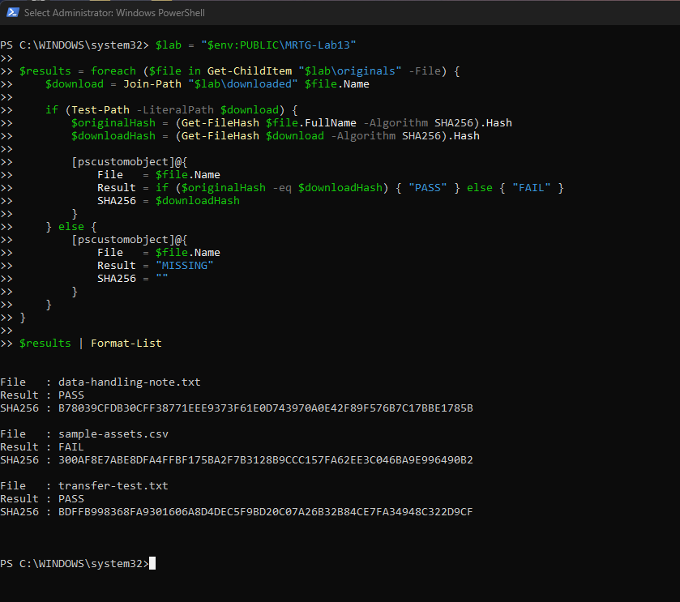

## 16 — Fresh CSV download matches the original SHA-256 hash

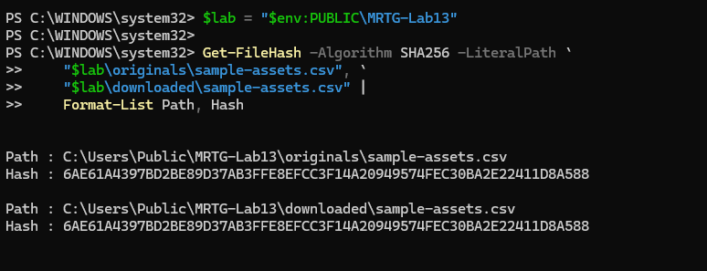

## 17 — Final comparison: all three files match

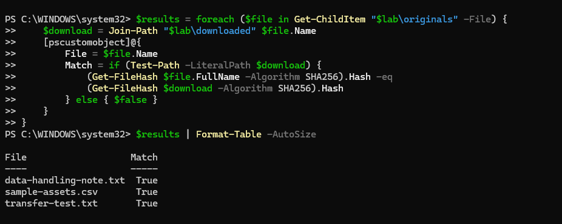

## 18 — One storage account before resource group deletion; subscription ID masked

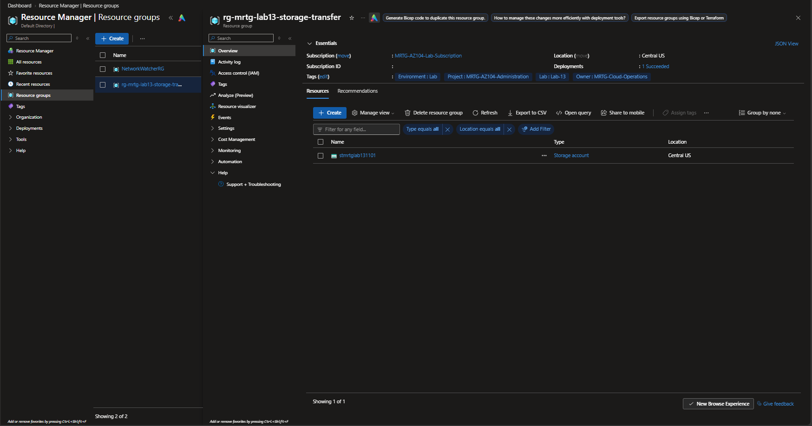

## 19 — No matching Lab 13 resource group after cleanup; tenant domain masked

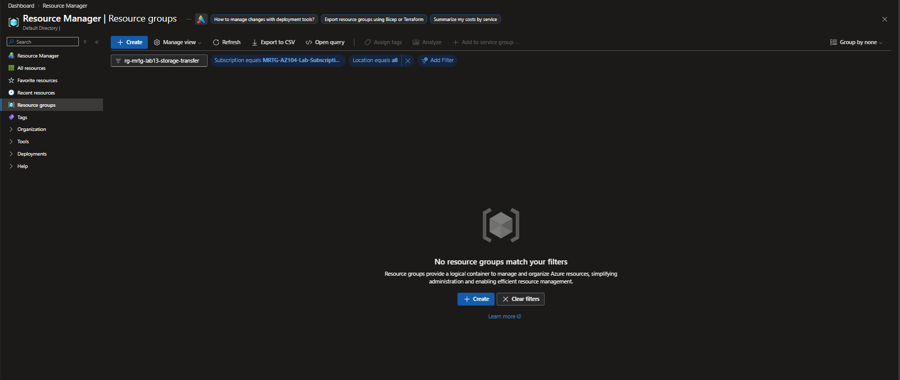

