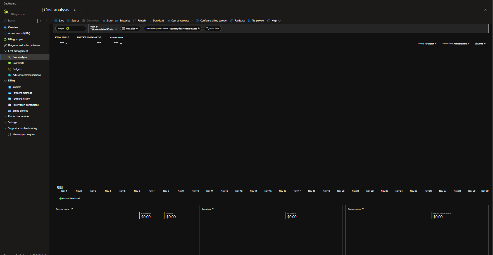

# Lab 14 — Data access boundaries

 

## Status and evidence

All 37 reviewed screenshots are published in the [evidence gallery](screenshots/README.md), covering configuration, scoped access, SAS tests, key rotation, cleanup, and the November 3 cost review. Evidence limits remain stated below.

## Business problem

MRTG needs a reader to access approved documents without reading a restricted container or changing stored data. Temporary sharing and credential revocation must also be tested, including what happens to an old storage key after rotation.

## Environment

- Disposable resource group: `rg-mrtg-lab14-data-access`.
- Containers: `lab14-documents` and `lab14-restricted`.
- Synthetic blobs: `document-test.txt` and `restricted-test.txt`.
- Test identity: MRTG Lab14 Reader.
- Microsoft Entra authentication used for portal data access.
- Anonymous blob access disabled; secure transfer enabled; minimum TLS 1.2.
- Shared Key access temporarily enabled for the rotation exercise, then disabled again.

## Work performed

### 1. Separate resource visibility from blob access

The test user received Reader at storage-account scope. The user could navigate to the account but could not list the document container's data using Microsoft Entra authentication.

Storage Blob Data Reader was then assigned at the scope ending in:

```text
/blobServices/default/containers/lab14-documents
```

The test user could list the document blob and open its properties. Access to the restricted container was denied. An attempted upload to the document container was also denied.

### 2. Test a read-only user delegation SAS

A user delegation SAS was configured for the document blob with Read permission and HTTPS only. The document content loaded in an InPrivate browser window.

A separate HTTP test returned:

```text
GET HTTP: 200
PUT HTTP: 403
Azure error: AuthorizationPermissionMismatch
```

The PUT included `If-None-Match: *` to avoid overwriting an existing blob. The observed authorization failure demonstrates that this SAS did not permit the attempted write.

### 3. Revoke delegation keys and retest

The lab included the following Cloud Shell command:

```bash
az storage account revoke-delegation-keys \
  --name <lab-storage-account> \
  --resource-group rg-mrtg-lab14-data-access
```

A subsequent test of the original SAS recorded:

```text
GET HTTP: 403
Checked UTC: 2026-11-03 00:52:53Z
Azure error: AuthenticationFailed
```

The configured expiry shown in the portal was November 2 at 7:07 PM, UTC−06:00 (November 3 at 01:07 UTC). The failed request was recorded before that expiry.

**Evidence limit:** The screenshots show the revocation command and a failed original-SAS request, but do not include a timestamped revocation response establishing their exact order. The 403 demonstrates denial; the error alone does not uniquely prove revocation was its cause.

### 4. Rotate a storage account key

Shared Key access was temporarily enabled in the disposable account. The current key1 was entered using a hidden shell prompt and used to query the document blob. The command returned `document-test.txt`.

After key1 rotation, the same command using the saved old key failed authentication. The replacement key1 was entered through another hidden prompt; the command succeeded again.

| Credential state | Observed result |
|---|---|
| Original key1 before rotation | Blob query succeeded |
| Saved original key1 after rotation | Authentication failed |
| Replacement key1 | Blob query succeeded |

Keys and connection strings are intentionally omitted from this record. The final configuration screenshot showed **Allow storage account key access: Disabled**, with a successful update notification.

## Validation summary

| Test | Observed result |
|---|---|
| Account Reader alone lists blob data | Denied |
| Container-scoped Blob Data Reader lists approved blob | Succeeded; blob properties visible |
| Same user lists restricted container | Denied |
| Same user uploads to approved container | Denied |
| Read-only SAS GET | HTTP 200 |
| Read-only SAS PUT | HTTP 403, AuthorizationPermissionMismatch |
| Original SAS retest before configured expiry | HTTP 403, AuthenticationFailed; attribution limit noted above |
| Old key after rotation | Authentication failed |
| Replacement key | Blob query succeeded |
| Final Shared Key configuration | Disabled |

## Troubleshooting

The initial Windows PowerShell 5.1 HTTP test failed because `System.Net.Http.HttpClient` was unavailable in that session. Loading the assembly with `Add-Type -AssemblyName System.Net.Http` allowed client creation. The GET/PUT capture shows completed requests, followed by a separately entered `finally` block; it is not proof of successful disposal through that block. The later original-SAS retest kept `try`, `catch`, and `finally` together.

A later document-container screenshot also showed an authorization denial after earlier successful listing. The intervening role state was not captured, so this is not attributed to a specific permission change.

## IAM and operational lessons

- Resource visibility and access to stored data were tested separately.
- Container scope limited the reader's demonstrated access to the approved data boundary.
- Both allowed and denied operations were tested; visible portal buttons were not treated as proof of permission.
- SAS permission tests, delegation-key revocation, and account-key rotation were separate exercises.
- The old-key failure and replacement-key success provided a recovery check after rotation.

## Cleanup and evidence limits

Cleanup screenshots showed no matching resource group under the selected subscription/filter and an active-user list containing only the administrator, with the test reader absent. These are portal-state observations, not a deletion audit trail or proof of permanent directory deletion.

Remaining validation limits:
- Recheck the final cost total when available; the November 3 review below is not a zero-cost confirmation.
- If stronger revocation evidence is needed, capture a timestamped before/after sequence in a future disposable test.

## Cost review — November 3, 2026

Cost Analysis reviewed November 3, 2026 for November 2026, filtered to this lab's resource group. Storage and Bandwidth tiles each display USD 0.00; location and subscription tiles also display USD 0.00. The Actual cost headline displays `--`, so this capture does not establish a numeric final total or zero invoiced cost. Reporting may change as charges arrive.



## Outcome

The session demonstrated scoped blob access, denied writes and cross-container reads, read-only temporary sharing, and account-key rotation with successful use of the replacement key. The full reviewed screenshot package is published; causal attribution for the SAS denial and the final cost total remain limited as described above.

[All labs](../../docs/progress.md)
