# Lab 15 — Recover an accidental document deletion

 

## Outcome

Recovered a soft-deleted blob and restored original content after an accidental overwrite. Fresh downloads from both recovery tests matched the original SHA-256 hash. Work was performed November 4–5, 2026; the follow-up cost review was captured November 6.

## Business scenario

An MRTG employee deletes a document, then later overwrites its contents. The administrator must recover the correct document and verify its integrity. A separate lifecycle rule defines when eligible lab blobs should move to Cool storage.

## Environment and access

| Setting | Configuration |
|---|---|
| Resource group | `rg-mrtg-lab15-recovery` |
| Storage account | `stmrtglab151103` |
| Region and storage | Central US; Standard, locally redundant storage (LRS), Hot |
| Container | `lab15-recovery`; private |
| Authentication | Microsoft Entra user account in the portal |
| Security | Secure transfer required; TLS 1.2; anonymous access and account-key access disabled |
| Network | Public network access enabled from all networks; Microsoft network routing |
| Initial recovery protection | Blob and container soft delete enabled for 7 days; versioning initially disabled |
| Later recovery protection | Blob versioning enabled; keep all versions |
| Tags | Environment: Lab; Project: MRTG-AZ104-Administration; Lab: Lab-15; Owner: MRTG-Cloud-Operations |

Storage Blob Data Contributor was selected at storage-account scope in the role-assignment review. That review alone does not prove assignment completion; subsequent Entra-authenticated blob operations demonstrate usable access. This lab did not test another user's permissions or least-privilege denial boundaries.

## Recovery tests

| Test | Work performed | Observed result |
|---|---|---|
| Original baseline | Created and uploaded `recovery-test.txt` containing `MRTG Lab 15 - Original document, version 1.` | Original blob shown as 48 bytes |
| Soft-delete recovery | Deleted the blob, displayed deleted blobs, then restored it | Deleted state showed 6 days remaining; blob returned to active listing |
| Integrity after undelete | Downloaded recovered file into `Lab15\Recovered` and compared SHA-256 with the untouched local original | `Match : True` |
| Version recovery | Enabled versioning, uploaded the unchanged original again, then overwrote it with version-2 text | Changed content and prior versions captured |
| Restore original version | Made the selected prior original version current | Portal displayed original version-1 content |
| Integrity after version restore | Downloaded into `Lab15\VersionRecovered` and compared SHA-256 | `Match : True` |

The original and both recovered copies produced:

```text
4C6BD6F436B0EFEC109B2A30B7A63F47A4BF8192D7017A701B8CF184941876F9
```

The original local file was retained as the comparison baseline. The two recovery downloads used separate folders. Matching hashes validate the recovered bytes, beyond simply seeing a filename in the portal.

## Lifecycle configuration

The exported [lifecycle policy](configuration/lab15-lifecycle-policy.json) records the enabled rule `lab15-cool-after-30-days`:

- Applies to block blobs with prefix `lab15-recovery/`.
- Moves base blobs to Cool after more than 30 days since modification.
- Contains no deletion action.

The saved JSON screenshot and exported file establish configuration. **The 30-day tier transition was not observed:** the disposable lab was cleaned up before that condition elapsed. Version cleanup was not configured by this rule.

## Cost review and cleanup

The November 6 review, filtered to `rg-mrtg-lab15-recovery` for November 2026, showed **actual cost below USD 0.01**, Storage below USD 0.01, and Bandwidth USD 0.00. This is a reported snapshot, not a finalized invoice or verified cash payment.

After cleanup on November 5, the subscription resource-group list showed only `NetworkWatcherRG`; the Lab 15 group was absent. This supports resource-group cleanup at capture time. NetworkWatcherRG contents and budget settings were not inspected in this exercise.

## Lessons and evidence limits

- Recovery must be tested and the restored content verified.
- Soft-delete recovery and recovery from an overwritten version were separate tests.
- A saved lifecycle policy does not prove that its scheduled action ran.
- Point-in-time restore, Azure Backup, container recovery, and regional disaster recovery were not tested.
- This was a disposable public-endpoint lab using authenticated access, not a production network design.

## Evidence

[Complete screenshot gallery](screenshots/README.md): all 28 reviewed source screenshots are published, including setup, access review, baseline hashes, recovery, lifecycle configuration, cleanup and both cost snapshots.


### storage account review

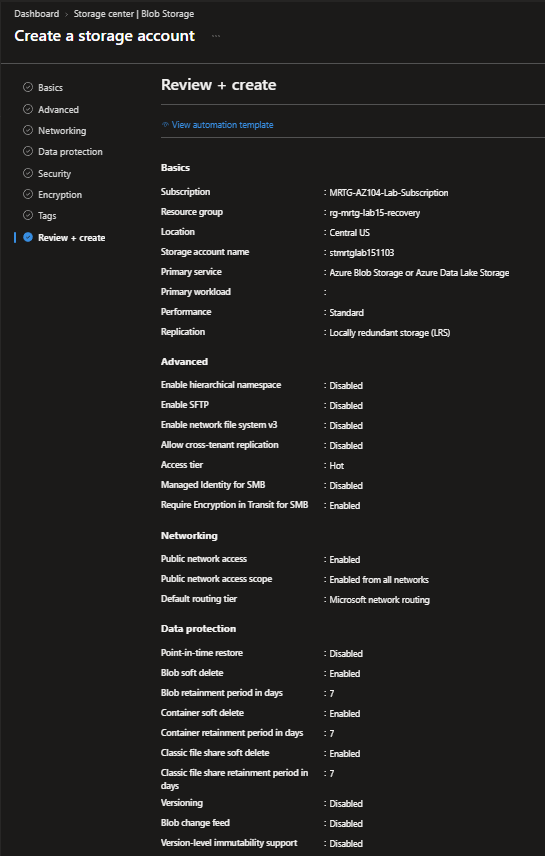

### storage account security

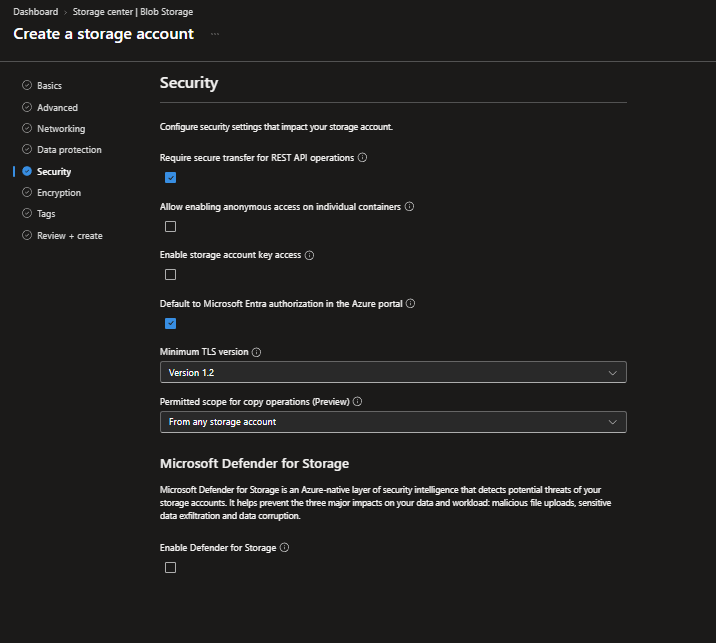

### original blob uploaded

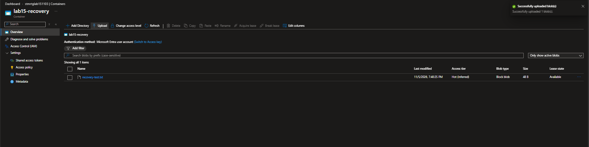

### blob soft deleted

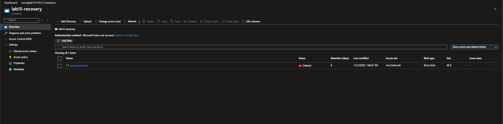

### blob restored

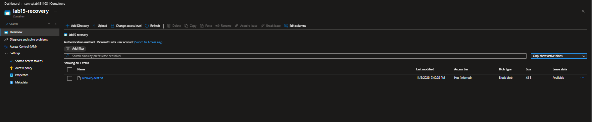

### soft delete recovery hash match

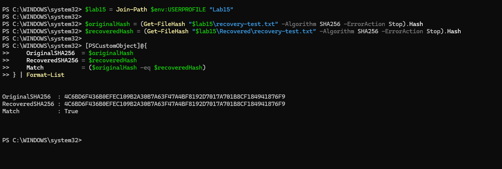

### blob versioning enabled

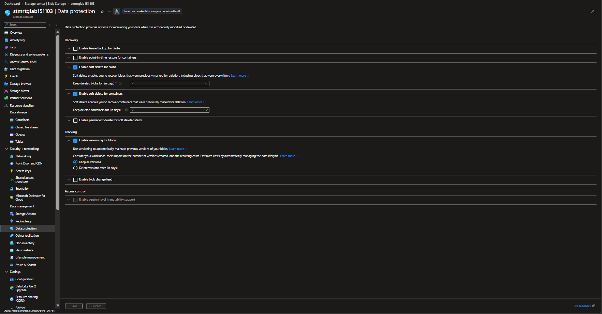

### blob overwritten content


### blob version history

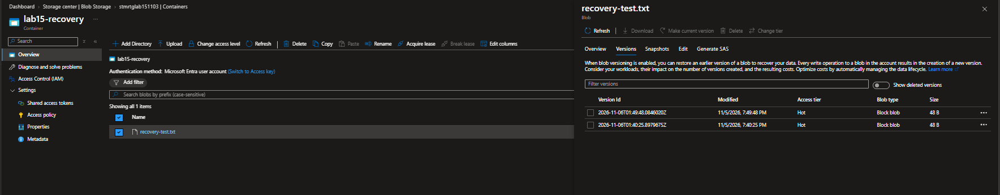

### original version restored

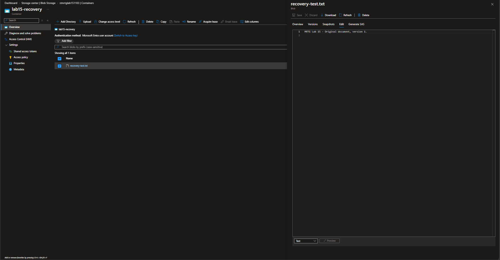

### version recovery hash match

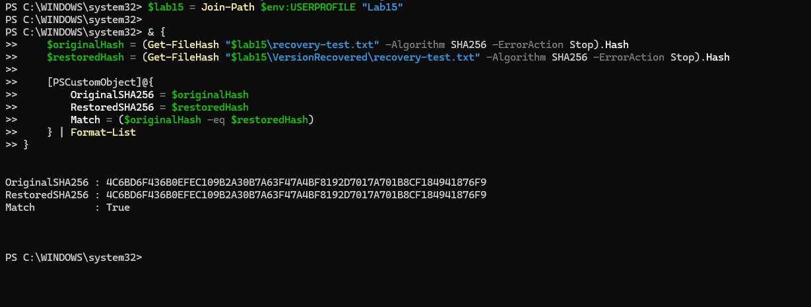

### lifecycle policy json

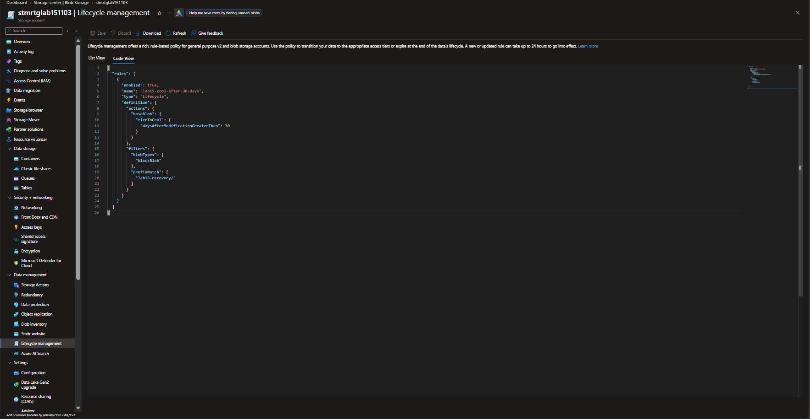

### resource group cleanup

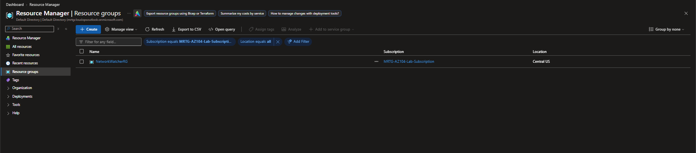

### cost review 2026 11 06

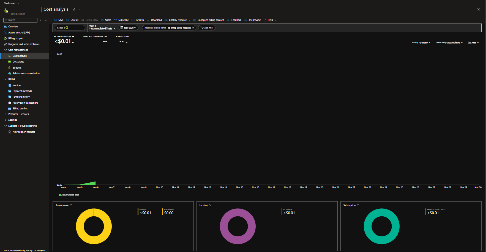

[All labs](../../docs/progress.md)
