# Lab 15 evidence gallery

20 reviewed screenshots are published. Eight additional reviewed setup captures remain pending publication after automatic review flagged the lab subscription display name. The initial data-protection capture shows versioning disabled; versioning was enabled later for the overwrite test. The November 5 cost snapshot is separate from the November 6 follow-up. The lifecycle configuration does not prove a tier transition occurred.

## admin blob data role review

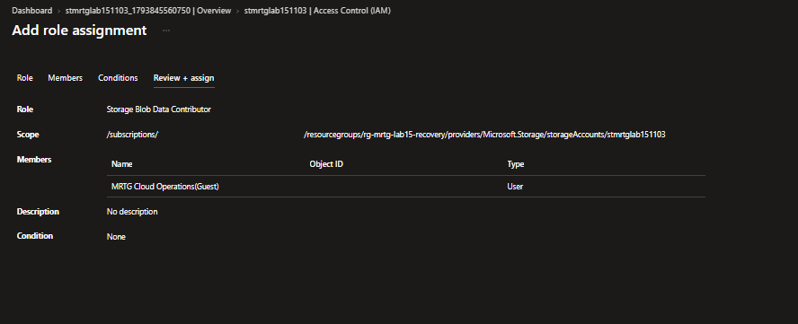

## blob overwritten content

## blob restored

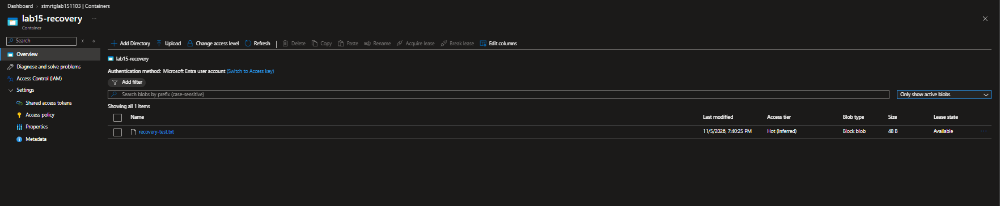

## blob soft deleted

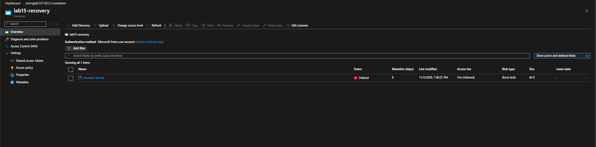

## blob version history

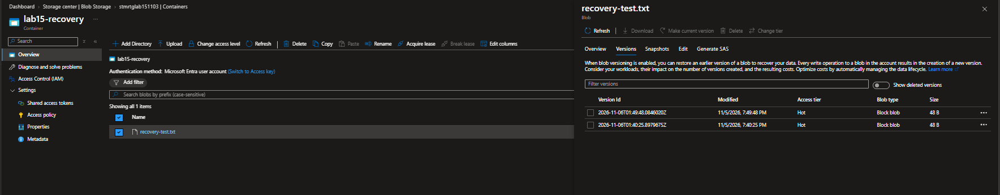

## blob versioning enabled

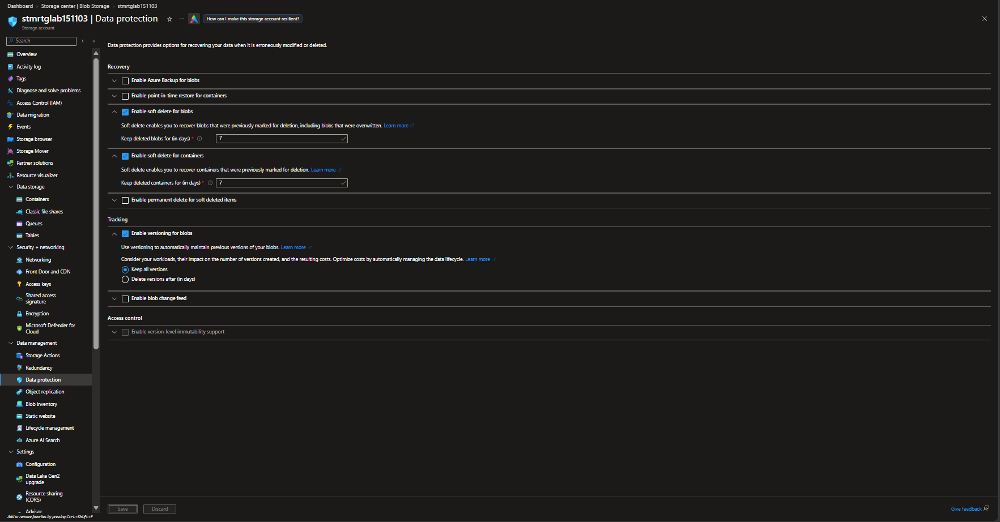

## cost review 2026 11 05

## cost review 2026 11 06

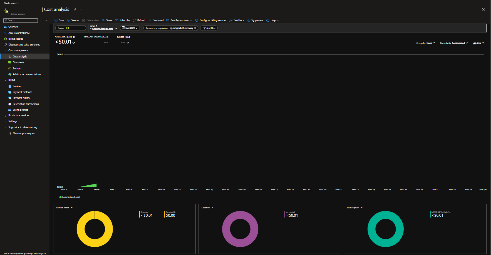

## initial data protection

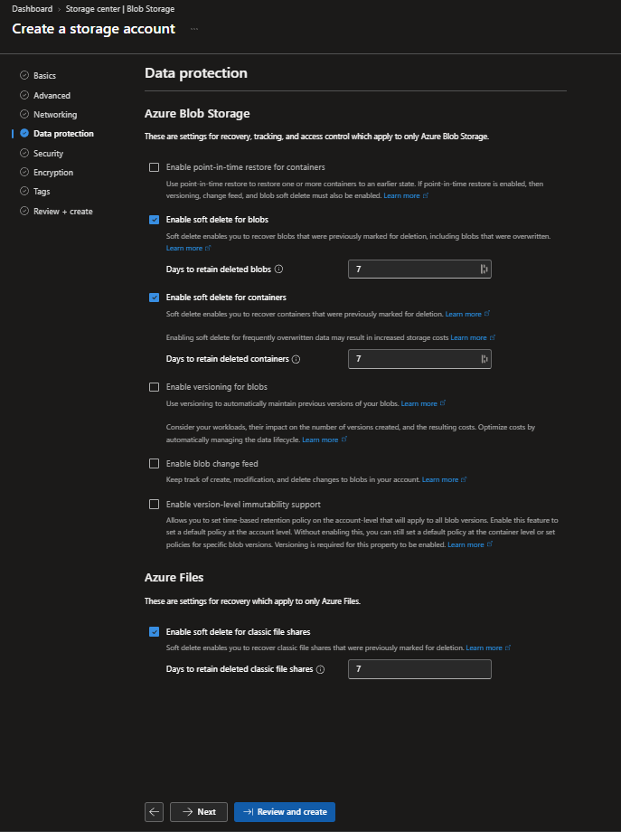

## lifecycle policy json

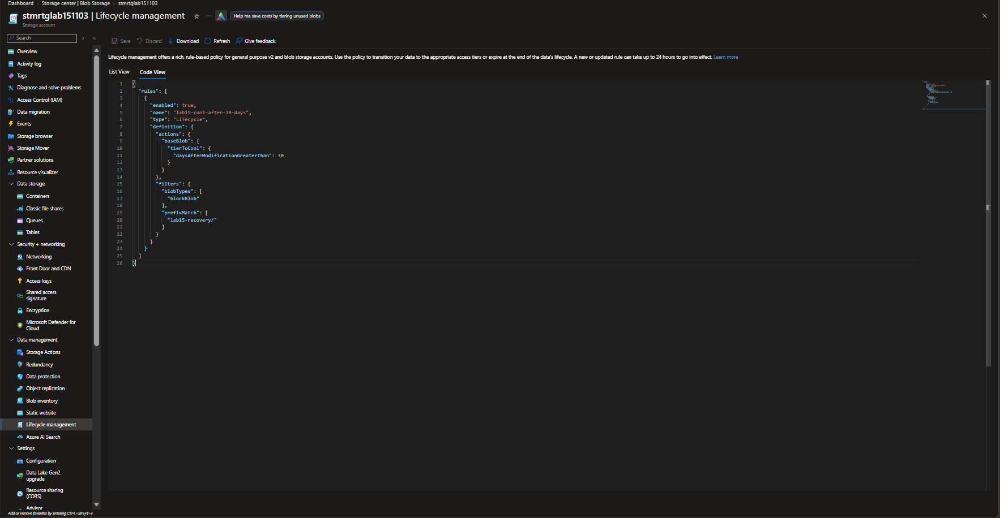

## original blob uploaded

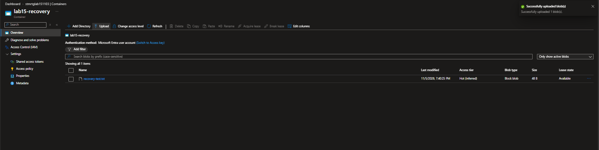

## original blob version

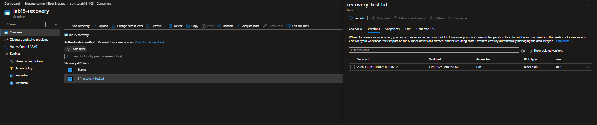

## original file sha256

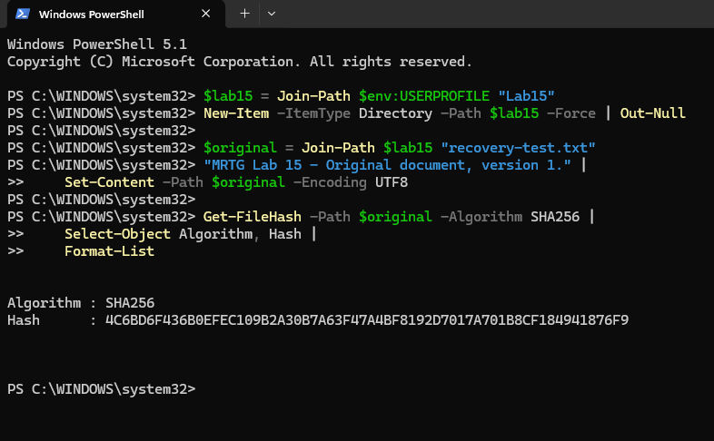

## original version restored

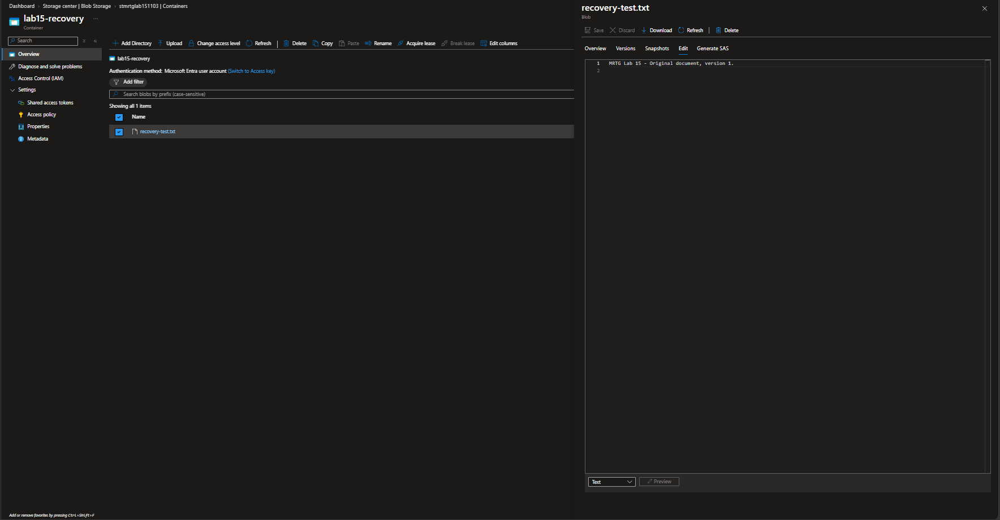

## recovery container created

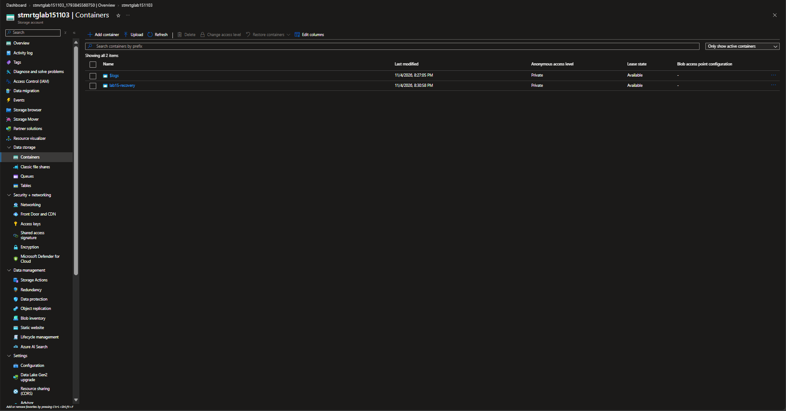

## resource group cleanup

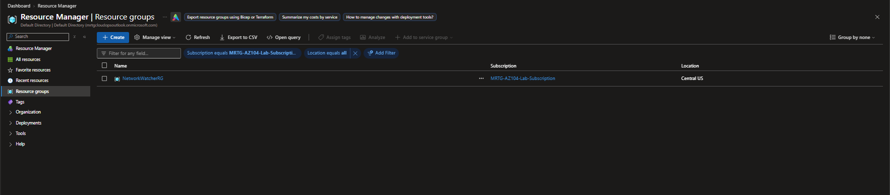

## soft delete recovery hash match

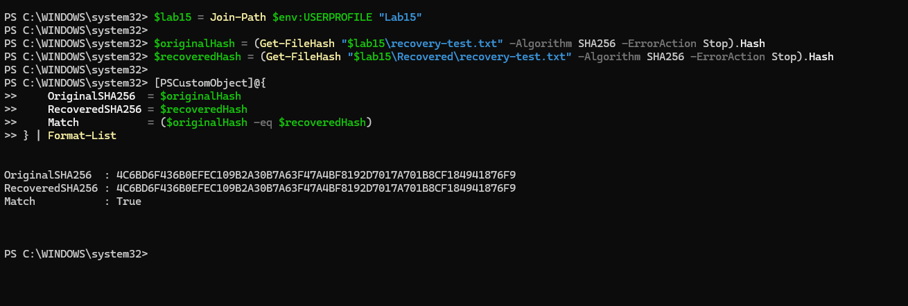

## storage account review

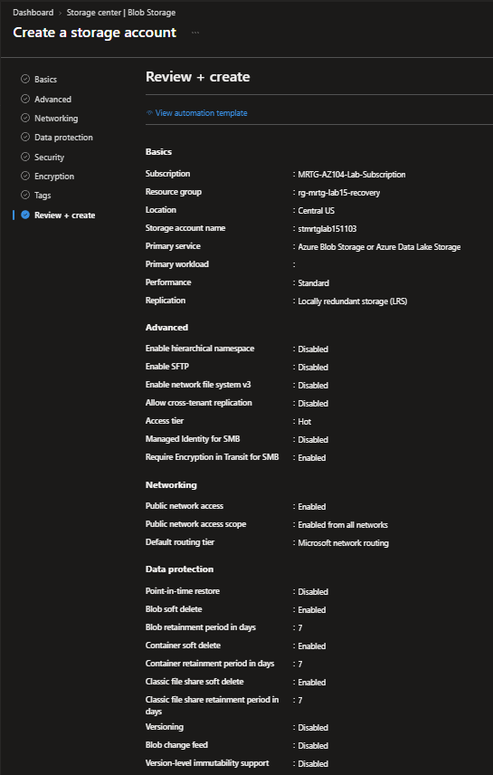

## storage account security

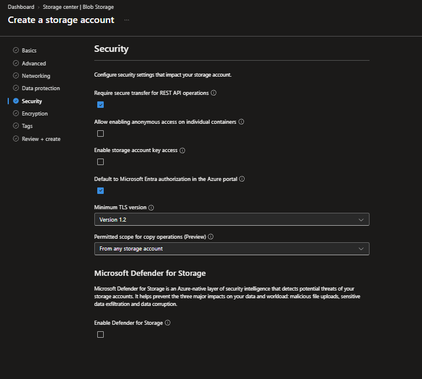

## version recovery hash match

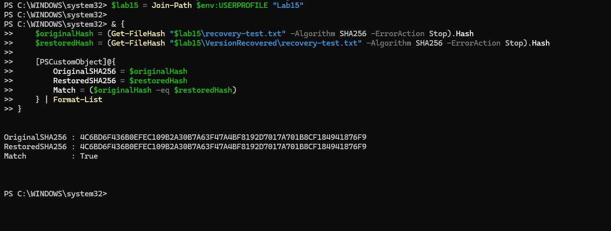

## Pending publication

- `lab15-resource-group-review.png`
- `lab15-storage-account-advanced.png`
- `lab15-storage-account-basics.png`
- `lab15-storage-account-deployment-complete.png`
- `lab15-storage-account-encryption.png`
- `lab15-storage-account-networking.png`
- `lab15-storage-account-review-security-tags.png`
- `lab15-storage-account-tags.png`

[Lab results](../README.md)
