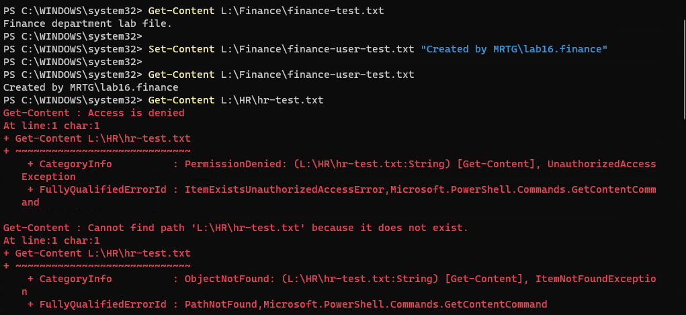
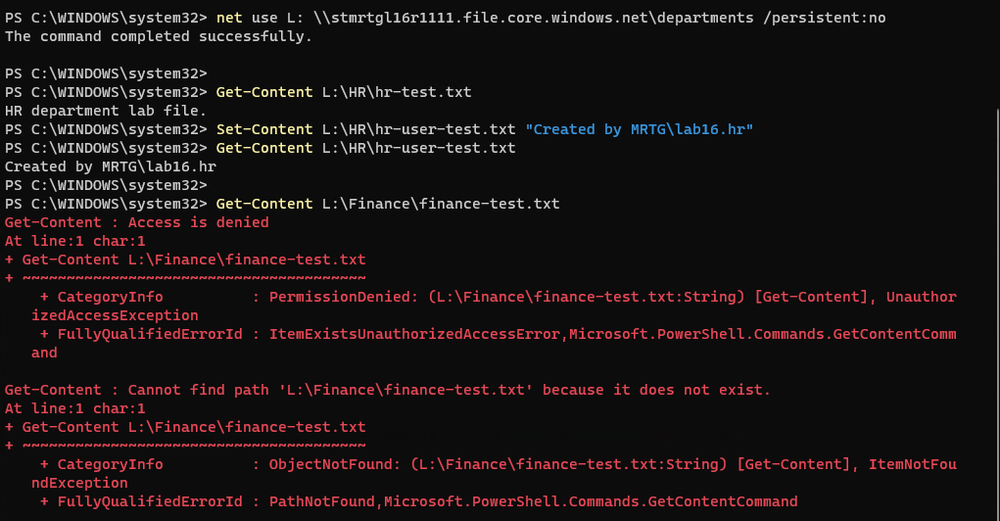

# Lab 16 — Department file access and the AD bridge

 

[Portfolio](../../README.md) · [All labs](../../docs/progress.md) · [Evidence gallery](screenshots/README.md)

## Outcome

Validated departmental Azure Files access using local AD DS identities over a certificate-authenticated point-to-site VPN and a file private endpoint. Finance and HR each read and created a file in their own folder; reading the other department's known file returned Access denied. Both users obtained AES-256 Kerberos service tickets for Azure Files from MRTG-DC02. Azure resources, the temporary client hosts entry, and the storage-account AD computer object were removed afterward.

An earlier deployment separately demonstrated deleted-file recovery from an Azure Files share snapshot. Its direct public SMB connection failed, so its recovery evidence and original limitation are retained as the first phase, not presented as successful identity-based access.

## Business problem

MRTG needs recoverable department files and a group-based boundary between Finance and HR. The exercise separates four questions: can the client reach storage, can the user authenticate, what can that identity access, and can an administrator recover a deleted document?

## Environment and decisions

| Setting | Tested configuration or boundary |
|---|---|
| Resource group and region | `rg-mrtg-lab16-files`; Central US; removed after each deployment |
| Initial storage account | `stmrtgl16f7c92a`; administrative snapshot/recovery phase on November 7 |
| Rebuilt storage account | `stmrtgl16r1111`; Standard LRS, StorageV2, HDD/pay-as-you-go; public network access disabled |
| Share and folders | SMB `departments`; `Finance` and `HR` |
| Local domain and client | `mrtg.local`, NetBIOS `MRTG`; Hyper-V CLIENT01 at `192.168.10.20` |
| Domain controllers | MRTG-DC01 `192.168.10.10`; MRTG-DC02 `192.168.10.11` |
| Test identities and groups | `MRTG\lab16.finance` via `GG-Lab16-Finance`; `MRTG\lab16.hr` via `GG-Lab16-HR` |
| Azure VNet | `vnet-mrtg-lab16-files`; `10.160.0.0/16` |
| Subnets | `snet-private-endpoints` `10.160.1.0/24`; `GatewaySubnet` `10.160.255.0/26` |
| Gateway | `vpngw-mrtg-lab16`; VpnGw1AZ, route-based; OpenVPN SSL, Azure certificate authentication |
| VPN pool and observed client IP | `172.30.240.0/24`; `172.30.240.2` in the captured sessions |
| Private endpoint | `pe-mrtg-lab16-file`; target `file`; private IP `10.160.1.4` |
| DNS | Azure zone `privatelink.file.core.windows.net` integrated with endpoint; CLIENT01 used a temporary hosts entry for the normal storage FQDN |
| AD DS registration | AzFilesHybrid 0.3.2; computer `stmrtgl16r1111` in `OU=Lab16-AzureFiles,DC=mrtg,DC=local` |
| Share-level permission | Default `StorageFileDataSmbShareContributor` for authenticated identities; no department-specific Azure RBAC assignment |
| Folder permissions | Department group Modify on its own folder; root Read/Execute only; administrative/system Full Control retained |
| Administrative bootstrap | Storage key used to establish ACLs; department tests used signed-in domain identities without explicit key credentials |
| Licensing boundary | No new paid Entra/Microsoft 365 user license or trial; no Entra synchronization or managed-domain deployment |

The VPN certificate admits a client to the tunnel. The AD Kerberos identity authenticates SMB, and Windows folder ACLs enforce the department boundary. The default share permission is broader than department-specific share assignments. This lab tested that design without synchronizing identities to Entra ID; it does not demonstrate individual/group Azure RBAC enforcement at the share.

## Work performed

1. Established Finance/HR users and groups, inspected membership and domain replication, and verified separate domain sign-ins.
2. In the initial November 7 deployment, uploaded a 60-byte Finance document through the portal using access-key authentication. Created a share snapshot, deleted the live file, restored it, and visually checked its original text. Direct TCP 445 failed from both CLIENT01 and the physical host while TCP 443 succeeded. Removed the first Azure deployment.
3. Repaired CLIENT01's secure channel and verified trust against both domain controllers before the rebuild.
4. Rebuilt networking with nonoverlapping Azure and VPN ranges; generated a lab root certificate and separate Admin, Finance, and HR client certificates. Uploaded only the root public certificate to the gateway and imported each user's PFX/profile in that user's context.
5. Connected Azure VPN Client, created the file private endpoint, and disabled storage public network access. Used a temporary CLIENT01 hosts entry mapping `stmrtgl16r1111.file.core.windows.net` to `10.160.1.4`; verified SMB over the VPN.
6. Registered the rebuilt storage account with AD DS using AzFilesHybrid. Corrected the Azure NetBIOS domain property to `MRTG` and read back the AD properties and default share permission. The setup session also checked the CIFS SPN and AES256 computer-account configuration; no separate screenshot of that intermediate check is included.
7. Mounted as administrator for ACL setup. Removed broad inherited user access, granted department groups root Read/Execute, and granted each department Modify on its own folder. Retained domain administrator, built-in administrator, and SYSTEM access.
8. Added the department groups to CLIENT01's local Remote Desktop Users group for VM remote/enhanced-session sign-in. This is a client logon permission, separate from file access. The addition was observed during the session but has no dedicated screenshot in this package.
9. Signed in separately as Finance and HR, connected each VPN profile, mounted the normal storage UNC using the signed-in Windows identity, ran own-folder read/write and cross-folder read tests, and captured each CIFS Kerberos ticket.
10. Deleted the rebuilt Azure group, removed the hosts override and flushed DNS, deleted the retired storage AD computer object, and verified a zero remaining-object count. The operator confirmed removal of all three Azure VPN Client profiles.

## Validation results

| Test | Observed result | Evidence or limit |
|---|---|---|
| Domain prerequisites | Department groups/sign-ins verified; replication summary showed zero failures for displayed DCs | Point-in-time local AD observations |
| Secure-channel repair | Repair returned True; subsequent checks against both DCs returned True | Rebuild prerequisite, not an Azure authorization test |
| Original share snapshot recovery | Deleted file returned to live share as 60 B; original text visible | Administrative recovery; no captured SHA-256 comparison |
| Initial direct public SMB | TCP 445 failed from guest and host; HTTPS succeeded | Historical connectivity failure, not a permission denial |
| Private endpoint configuration | `file` endpoint integrated with Azure private DNS zone at `10.160.1.4` | CLIENT01 used a hosts override; hybrid DNS forwarding was not validated |
| Finance connectivity | `whoami` = `mrtg\lab16.finance`; TCP 445 True to `10.160.1.4` via VPN from `172.30.240.2` | Captured identity and network path |
| HR connectivity | `whoami` = `mrtg\lab16.hr`; same private endpoint/port succeeded via VPN | Separate user session |
| Finance own-folder access | Read seed file; created and read `finance-user-test.txt` | No explicit storage key supplied for user mount |
| Finance cross-folder read | Reading `HR\hr-test.txt` returned Access denied | Known seed file; cross-folder write/delete were not separately tested |
| HR own-folder access | Read seed file; created and read `hr-user-test.txt` | Successful `net use` shown |
| HR cross-folder read | Reading `Finance\finance-test.txt` returned Access denied | Cross-folder write/delete and ACL modification were not separately tested |
| Kerberos | Each user had `cifs/stmrtgl16r1111.file.core.windows.net` ticket; AES-256-CTS-HMAC-SHA1-96; KDC MRTG-DC02 | Ticket metadata, not exported ticket material; no claim about SMB encryption algorithm |
| Azure cleanup | No matching lab resource group in selected subscription after deletion | Historical filtered-list evidence, not a subscription-wide cost audit |
| Hosts cleanup | DNS flush succeeded; storage-name search in hosts returned no output | CLIENT01 override removed |
| Storage AD-object cleanup | Removal confirmed; remaining matching computer count = 0 | Test users/groups, VMs and OU retained |

## Troubleshooting and lessons

An early hostname typo caused DNS failure; correcting it exposed a separate TCP 445 problem. Host and guest probes both failed on the direct public path. The prior investigation found the observed behavior consistent with the provider's published SMB restrictions, but no packet capture identified the exact dropping device. The later VPN/private-endpoint path succeeded; it does not prove the precise cause of the original failure.

Domain trust, user profile state, and VPN client state required separate checks. CLIENT01's secure channel was repaired before the final domain tests. User-specific PFX files and VPN XML profiles had to be available in the appropriate session. Adding department groups to Remote Desktop Users allowed client sign-in without making the users local administrators.

The first AD property readback reported the wrong NetBIOS value. Reading the real domain properties and updating the storage registration corrected it to `MRTG`. Successful user Kerberos tickets and file tests provide stronger evidence than a configuration form alone.

The cross-department PowerShell reads printed Access denied followed by a secondary Cannot find path message. The access-denied result is the relevant boundary observation; it does not mean the known file was absent. TCP reachability was verified first so a network failure would not be mislabeled authorization enforcement.

This exercise used the normal `file.core.windows.net` hostname so the CIFS service name matched. A hosts override was a bounded lab workaround, not a demonstrated hybrid DNS design. Default share permission plus folder ACLs met the tested design; a future deployment should separately assess identity synchronization, narrower share assignments, delegated administration, certificate lifecycle, and DNS forwarding.

References: [AD DS registration](https://learn.microsoft.com/en-us/azure/storage/files/storage-files-identity-ad-ds-enable), [share permissions and default permissions](https://learn.microsoft.com/en-us/azure/storage/files/storage-files-identity-assign-share-level-permissions), and [Windows file permissions](https://learn.microsoft.com/en-us/azure/storage/files/storage-files-identity-configure-file-level-permissions).

## Cleanup and costs

The initial Azure group was deleted November 7, 2026 (America/Chicago). The November 8 cost capture applies only to that earlier deployment: breakdown tiles displayed `<0.01`, Actual cost was `--`, and currency was not visible. This is not the rebuild's cost or a final charge.

The rebuilt environment was removed November 12, 2026 (America/Chicago). The matching resource group was absent from the selected subscription; CLIENT01's hosts entry was removed, DNS flushed, and the storage-account AD computer object deleted with a zero remaining-object count. Azure deletion does not remove local AD objects automatically. All three VPN profiles were removed per operator confirmation. Exported PFX deletion was instructed but not independently verified; installed user/root certificates, the local OU, department users/groups, Remote Desktop Users membership and Hyper-V VMs are not claimed removed. No VM shutdown evidence was retained.

The rebuild provisioned a metered VpnGw1AZ gateway, public IP, private endpoint and storage, including an overnight pause. Disconnecting a VPN client does not delete its gateway.

The **November 13, 2026** billing-account Cost analysis review, filtered to `rg-mrtg-lab16-files` for **November 2026**, showed **Actual cost USD 5.88**. This resource-group/month view can include both deployments; it does not isolate the rebuild's charge.

| Service | Displayed cost (USD) |
|---|---|
| VPN Gateway | 5.48 |
| Virtual Network | 0.39 |
| Azure DNS | 0.02 |
| Storage | <0.01 |
| Bandwidth | 0.00 |

Service figures are independently rounded and need not sum exactly to the displayed total. The VPN gateway accounts for approximately 93% of that total. This is a posted usage snapshot, not a final invoice or verified cash payment; delayed charges remain possible. No numeric predeployment session estimate or subscription-wide orphan audit was collected. The selected view showed Budget: None, which does not independently establish the state of the subscription budget configured in Lab 01. The supplied cost screenshot was reviewed but is withheld from the public gallery pending removal of the billing-account name. See the [cost ledger](../../docs/cost-ledger.md).

## Evidence and limits

**71 published screenshots:** [complete chronological evidence gallery](screenshots/README.md). The gallery labels the original recovery/connectivity phase separately from the successful rebuild and cleanup. Setup reviews show intended configuration; final readbacks and user operations establish the tested behavior. The submitted endpoint review has the subscription ID removed. No PFX, private key, password, storage key, or VPN XML is published.

The evidence demonstrates the two tested users' own-folder read/create/readback and cross-department read denial. It does not establish every ACL operation, revocation, share-specific Azure RBAC, Entra identity synchronization, production DNS, root-certificate removal, production hardening, regulatory compliance, or a final invoice. Snapshot recovery belongs to the first deployment and was not repeated on the rebuilt storage account.

---

[← Lab 15](../lab-15-recover-an-accidental-document-deletion/README.md) · [All labs](../../docs/progress.md) · [Lab 17 →](../lab-17-replication-and-storage-incident-drill/README.md)
