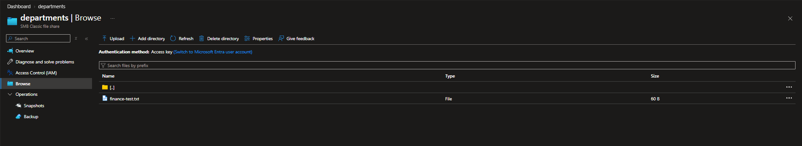

# Lab 16 — Department file access and the AD bridge

 

[Portfolio](../../README.md) · [All labs](../../docs/progress.md) · [Evidence gallery](screenshots/README.md)

## Outcome

Recovered a deleted Azure Files document from a share snapshot and verified its original text after restoration. Local AD users, department groups, domain sign-ins, and client trust were verified. **Azure Files AD DS authentication was not enabled, and Finance/HR authorization was not tested:** TCP 445 connectivity failed from both the Hyper-V client and physical host. The Azure resource group was deleted after testing.

## Business problem

MRTG needs recoverable departmental files and group-based access that separates Finance from HR. Recovery and authorization are separate requirements: successfully restoring a file with administrative access does not establish department isolation.

## Environment and decisions

| Setting | Recorded configuration or boundary |
|---|---|
| Azure resource group | `rg-mrtg-lab16-files`; Central US |
| Storage account | `stmrtgl16f7c92a` |
| Share | `departments`; SMB; Transaction optimized in creation review |
| Directories and test document | `Finance`, `HR`; `Finance/finance-test.txt` |
| Local environment | Hyper-V; domain `mrtg.local`; CLIENT01 at `192.168.10.20` |
| Domain controller and DNS | MRTG-DC01 at `192.168.10.10`; replication review also lists MRTG-DC02 |
| Test identities | `lab16.finance`, `lab16.hr` |
| Department security groups | `GG-Lab16-Finance`, `GG-Lab16-HR` |
| Actual file-operation authentication | Portal access key; not a department user's SMB session |
| Azure Files identity sources | AD DS, Microsoft Entra Domain Services, and Microsoft Entra Kerberos all disabled in captured state |
| Network review | Selected public networks; operator confirmed current public IPv4 matched the allowlist |
| Licensing and scope | No new paid user-license purchase or trial; Azure storage charges considered separately |

The creation-form screenshots record proposed settings. They do not independently prove every setting remained unchanged after deployment. Local AD membership does not establish synchronization to Entra ID, an Azure Files domain registration, share-level permissions, or directory ACLs.

## Work performed

1. Created synthetic Finance and HR domain users and groups; inspected group membership and replication, then signed in under both identities on the client.
2. Verified client domain membership, secure-channel health, domain DNS, and general network reachability.
3. Deployed the temporary storage account, created the `departments` share and department directories, and uploaded a 60-byte Finance test file.
4. Created a share snapshot, deleted the live Finance file, restored it from the snapshot, and checked both the live listing and original text.
5. Investigated SMB failure from the client and physical host, compared HTTPS reachability, and reviewed storage network restrictions and identity settings.
6. Closed the exercise with a documented authorization limitation and deleted the Azure lab resource group. VPN/private endpoint connectivity was deferred to a separate extension.

## Validation results

| Test | Observed result | Evidence or limitation |
|---|---|---|
| Department identities and groups | Finance/HR users and groups visible; membership output and successful domain identity/group-token checks captured | Does not demonstrate access to Azure Files |
| Domain replication review | `repadmin /replsummary` showed zero failures for the displayed DCs | Point-in-time observation |
| Client domain membership and trust | CLIENT01 joined to `mrtg.local`; `Test-ComputerSecureChannel` returned True | Local domain trust only |
| Network and DNS baseline | Domain controller resolved; client HTTPS probe succeeded | Separate from SMB reachability |
| File-share creation | Finance and HR folders and uploaded Finance file visible | Portal used access-key authentication |
| Snapshot recovery | Snapshot created, live document deleted, file restored to live listing as 60 B | Snapshot recovery, not Azure Backup |
| Restored content | Browser showed `Lab 16 Finance recovery test.` and `Version 1 - original content.` | Visual text check; no SHA-256 comparison captured |
| SMB connectivity | TCP 445 failed from CLIENT01 and physical host; host retry after VPN disconnection also failed during the session | Connectivity failure, not an authorization denial |
| HTTPS to storage | Host TCP 443 succeeded to the same storage hostname | TCP reachability does not prove authenticated data access |
| Azure Files identity configuration | All three identity sources disabled | AD DS integration not configured |
| Finance/HR allowed and denied operations | Not performed | No SMB mount, share-level role enforcement, or directory ACL test |
| Azure cleanup | Successful resource-group deletion notification; only NetworkWatcherRG in displayed list | Local VMs and AD objects are outside this deletion |

## Troubleshooting and lessons

An early command omitted the lowercase `l` before `16` in the storage name and failed DNS resolution. Correcting the hostname resolved it to `20.60.244.238`; the subsequent TCP 445 failures were a different issue. Command-entry errors were corrected before interpreting results.

The client used domain DNS at `192.168.10.10`; public DNS resolution and HTTPS probes worked. The physical host also failed TCP 445, including after VPN disconnection. The operator confirmed the storage allowlist matched the current public IPv4 address. These observations narrow the failure beyond a guest-only problem but do not locate the exact dropping device.

AT&T's [published network practices](https://about.att.com/sites/broadband/network) list TCP 445 blocked in both directions. That policy is consistent with the results and is the likely upstream blocker; no packet capture or provider-side trace was collected. Microsoft's [Azure Files troubleshooting guidance](https://learn.microsoft.com/en-us/troubleshoot/azure/azure-storage/files/connectivity/files-troubleshoot-smb-connectivity) describes VPN/private endpoint connectivity as a supported alternative for blocked SMB paths. That alternative was not deployed here.

Authentication and authorization testing must follow working connectivity. Creating department groups and folders alone does not enforce isolation. Access-key recovery proves the recovery operation, not least-privilege department access.

## Cleanup and costs

On **November 7, 2026 (America/Chicago)**, Azure confirmed deletion of `rg-mrtg-lab16-files`; the displayed resource-group list retained only `NetworkWatcherRG`. This removed the lab storage account and its share/snapshots. NetworkWatcherRG contents and subscription budget were not inspected.

The local Hyper-V environment and AD test identities were not removed by Azure cleanup. VM shutdown was requested but is not evidenced in the package; local object deletion is not claimed.

**No Lab 16 cost-analysis capture or final billed total was supplied.** Storage, transactions, and snapshot usage may produce delayed charges. Cleanup is verified; zero cost is not claimed. See the [cost ledger](../../docs/cost-ledger.md).

## Evidence and limits

**34 published screenshots:** [complete evidence gallery](screenshots/README.md). Setup captures, successful tests, failed probes, and unconfigured features are distinguished in the gallery.

The sanitized pre-cleanup inventory and successful deletion captures are published. Subscription ID, physical host name, and correlation ID were removed from the affected screenshots. The content-verification screenshot contains no visible SAS query string. No permissions matrix enforcement, identity synchronization, Azure Files AD DS registration, VPN/private endpoint deployment, or production/compliance claim is made.

---

[← Lab 15](../lab-15-recover-an-accidental-document-deletion/README.md) · [All labs](../../docs/progress.md) · [Lab 17 →](../lab-17-replication-and-storage-incident-drill/README.md)
