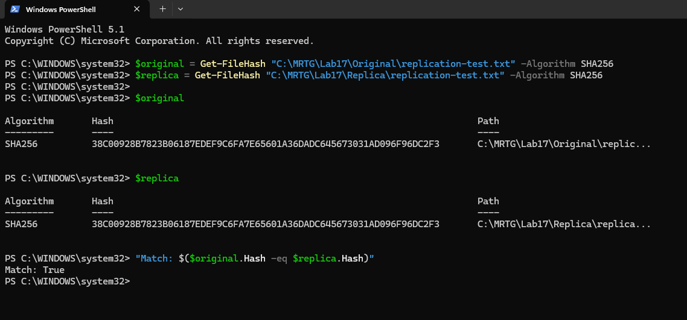

# Lab 17 — Replication and storage incident drill

 

[Portfolio](../../README.md) · [All labs](../../docs/progress.md) · [Evidence gallery](screenshots/README.md)

## Outcome

Replicated one synthetic block blob between two disposable storage accounts. Source replication status showed Complete. Independent SHA-256 comparisons confirmed that the initial replica and the fresh download after access restoration matched the original file.

## Business problem

Practice verifying a copied document and diagnosing a controlled access failure without confusing a network denial with an identity-permission failure.

## Environment and decisions

Two storage accounts in one region supported a temporary training exercise. This was a same-region replication test. It did not establish cross-region disaster recovery or application failover.

## Work performed

Created the accounts and containers, configured a replication rule for new objects, uploaded a synthetic document, and checked the automatically copied destination file. Applied a temporary network restriction, observed denied access, restored access, and downloaded the file again.

## Validation results

- Source object replication status: Complete.
- Initial downloaded replica: SHA-256 matched the independent original; the terminal printed Match: True.
- Controlled network restriction: fresh destination request returned 403.
- Restored access: destination listing and properties loaded successfully.
- Fresh download after restoration: displayed SHA-256 matched the original. The final Boolean comparison command was typed, but its output was not captured.

## Troubleshooting and lessons

Replication is asynchronous. The network restriction tested workstation access; no additional upload tested replication behavior during the restriction. A 403 response alone does not establish its cause. This exercise does not demonstrate a least-privilege authorization boundary.

## Cleanup and costs

Azure confirmed deletion of the temporary lab resource group. The redacted cost-review screenshot is included in the evidence gallery. Its displayed amounts are a dated snapshot, not a final invoice.

## Evidence and limits

[41 reviewed screenshots](screenshots/README.md) document setup, inherited access, replication configuration, source completion status, initial and post-recovery hash comparisons, the controlled network fault, restored access, cleanup, and the redacted cost review. Subscription IDs, administrator object IDs, deployment correlation IDs, billing identity, and diagnostic identifiers are removed where applicable.

The test covered one synthetic blob. Overwrites, deletions, prefix filters, cross-region recovery, and production hardening were not validated.

---

[← Lab 16](../lab-16-department-file-access-and-the-ad-bridge/README.md) · [All labs](../../docs/progress.md) · [Lab 18 →](../lab-18-reproducible-mrtg-deployment/README.md)
