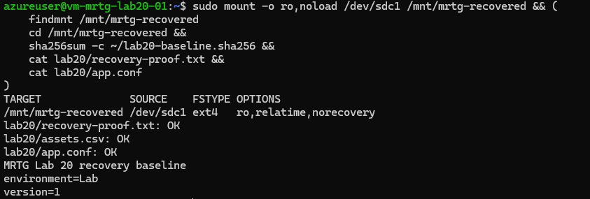

# Lab 20 — Disk recovery and relocation

 

[Portfolio](../../README.md) · [All labs](../../docs/progress.md) · [Evidence gallery](screenshots/README.md)

## Outcome

**Validated November 14, 2026 (America/Chicago):** recovered a deleted file and an overwritten configuration from an incremental managed-disk snapshot. All three synthetic files matched the unchanged original SHA-256 baseline. The restored disk was unmounted, detached, moved to a second resource group, reattached to the same VM and mounted read-only; all three hashes passed again.

The reviewed final portal list contained no groups matching `rg-mrtg-lab20` in the selected subscription. Local private-key deletion returned `Test-Path=False`. November 15 posted usage was USD 0.03 for both groups combined; final billed charges remain unverified. Thirty-eight screenshots are published, including the author-supplied redacted VM-review, cleanup-list and cost-review images.

## Business problem

MRTG needs recoverable data and a repeatable way to verify recovery before returning a disk to service. Snapshot deployment alone does not establish recoverability. This exercise records original file bytes, introduces a controlled deletion and overwrite, and tests a restored filesystem against the unchanged baseline.

The move separates organizational relocation from recovery: the disk changed resource-group scope while remaining in Central US. This was not a regional migration or disaster-recovery test.

## Environment and decisions

| Component | Tested configuration |
|---|---|
| Context | Existing `MRTG-AZ104-Lab-Subscription` and administrator; Central US |
| Groups | `rg-mrtg-lab20-source` and `rg-mrtg-lab20-recovery` |
| Tags | Environment `Lab`; Project `MRTG-AZ104-Administration`; Lab `Lab-20`; Owner `MRTG-Cloud-Operations` |
| Network | `vnet-mrtg-lab20`, `10.200.0.0/16`; private `snet-vm`, `10.200.10.0/24`; default outbound access disabled |
| NSG | `nsg-mrtg-lab20-vm`, subnet-associated; saved `Allow-SSH-MyIP`, priority 100, TCP 22 to `10.200.10.0/24`; source value redacted; default rules retained; no NIC NSG |
| VM | `vm-mrtg-lab20-01`; Canonical Ubuntu 22.04 LTS, x64 Gen2; `Standard_B2ts_v2`, 2 vCPU / 1 GiB nominal RAM; private IP `10.200.10.4` |
| Entry and OS security | Temporary Standard static public IP `pip-mrtg-lab20-ssh`; RSA key for local `azureuser`; Trusted Launch, Secure Boot and vTPM enabled; accelerated networking on |
| OS disk | 30 GiB Standard SSD LRS; platform-managed encryption; SCSI controller |
| Original data disk | `disk-mrtg-lab20-data01`, 4 GiB Standard SSD LRS, LUN 0, caching None; `/dev/sdb1`, ext4 label `MRTG-LAB20`, mounted at `/mnt/mrtg-data` |
| Snapshot | `snap-mrtg-lab20-baseline`; Incremental, Standard_ZRS; platform-managed encryption, DenyAll; completion 100, Succeeded and Available |
| Restored disk | `disk-mrtg-lab20-restored01`, 4 GiB Standard SSD LRS, no zone, platform-managed encryption, DenyAll; LUN 1 mapped to `/dev/sdc` before and after relocation |
| Recovery mount | `/dev/sdc1` at `/mnt/mrtg-recovered`, `ro,noload`; readback `ro,relatime,norecovery` |
| Other settings | Managed boot diagnostics on; managed identity, Entra OS login, alerts, guest diagnostics, application health, backup and Site Recovery off; no Bastion, NAT gateway or load balancer |

The snapshot form locked storage selection to Standard_ZRS, superseding the initial LRS plan. Snapshot ZRS and restored-disk Standard SSD LRS are distinct settings. The data-disk snapshot page displayed Gen 1 metadata; this does not establish OS recovery or contradict the VM's live Gen2 readback.

No data-disk fstab entry was added. Both copies retained filesystem UUID `41ecefc3-3ed0-4b16-9ab1-20c72a5bb8d4`. LUN-to-device mapping and explicit partition paths distinguished them; UUID-based selection would be ambiguous while both were attached.

## Work performed

1. Created the groups and private-subnet VNet. Saved the SSH rule and associated the NSG before VM deployment. The live VM overview showed Running, agent Ready, Canonical publisher and the expected private IP.
2. Used VM Agent Run Command to check the hostname, active SSH service and ED25519 SHA-256 host fingerprint. The operator compared that fingerprint with the SSH prompt. Windows OpenSSH initially rejected the downloaded key because another local account could access it; restricting the file ACL to the current account resolved the error. The submitted ZIP includes the server fingerprint and successful guest session, not the client comparison or ACL-repair captures.
3. Attached the 4 GiB disk, confirmed LUN 0 pointed to `/dev/sdb`, then created GPT and ext4. Mounted `/dev/sdb1` and assigned directory ownership to `azureuser`.
4. Created three synthetic files under `lab20/`. Saved their SHA-256 manifest as `~/lab20-baseline.sha256` on the separate OS disk. All three initial comparisons passed.
5. Ran `sync`, unmounted the data filesystem and confirmed no mountpoint. Created the incremental snapshot and kept the filesystem unmounted until snapshot completion reached 100 with Succeeded and Available states.
6. Remounted the original disk, changed `app.conf` to version 2 and deleted `recovery-proof.txt`. The unchanged manifest detected one missing file, one mismatch and one unchanged CSV.
7. Restored a new managed disk from the snapshot into the source group, attached it at LUN 1 and identified `/dev/sdc1` without formatting. Mounted read-only with journal replay disabled. All three hashes passed, the deleted proof text returned and `app.conf` contained version 1.
8. Unmounted and detached the restored disk. Its overview showed Unattached in the source group. Moved only that disk to the recovery group; the later overview showed its new group, unchanged Central US location, completion 100, Succeeded and DenyAll. No separate move validation or activity-log capture was supplied.
9. Reattached the moved disk to the original VM at LUN 1. Rechecked the device mapping, mounted read-only and repeated all three passing hashes and content checks.
10. Unmounted both data filesystems. The operator detached the relocated disk and deleted both groups; a reviewed final filtered portal list showed no Lab 20 groups. Removed the downloaded Windows private-key path and verified False.

## Validation results

| Check | Observed result | Evidence |
|---|---|---|
| Deployment and SSH | VM Running, agent Ready; expected guest user and hostname | [VM](screenshots/lab20-vm-deployment-verified.png), [service/host key](screenshots/lab20-ssh-service-and-host-fingerprint.png), [SSH](screenshots/lab20-ssh-session-verified.png) |
| Network | Saved TCP 22 rule and subnet association; source value redacted | [Rule](screenshots/lab20-ssh-rule-saved.png), [association](screenshots/lab20-nsg-subnet-associated.png); no independent source-value or denied-source test |
| Disk and baseline | LUN 0 → sdb, ext4 mounted; all three original checks OK | [Device](screenshots/lab20-data-disk-device-identified.png), [mount](screenshots/lab20-data-disk-formatted-and-mounted.png), [baseline](screenshots/lab20-files-and-checksum-baseline.png) |
| Snapshot | Unmounted source; Incremental, Standard_ZRS, DenyAll, completion 100 and Succeeded | [Unmount](screenshots/lab20-data-filesystem-unmounted.png), [snapshot](screenshots/lab20-baseline-snapshot-created.png) |
| Incident | Proof missing, app.conf mismatch, CSV OK | [Expected failures](screenshots/lab20-original-data-loss-and-change-detected.png) |
| Recovery | Three hashes OK; proof present; version=1; read-only mount | [Recovery](screenshots/lab20-snapshot-recovery-integrity-verified.png) |
| Relocation | Unattached in source group, then recovery group; Central US retained | [Before](screenshots/lab20-restored-disk-detached-before-move.png), [after](screenshots/lab20-restored-disk-resource-group-move-verified.png) |
| Post-move integrity | LUN 1 → sdc; three hashes OK and original content after reattachment | [Mapping](screenshots/lab20-relocated-disk-reattached-and-identified.png), [retest](screenshots/lab20-post-relocation-integrity-verified.png) |
| Cleanup | Both data partitions unmounted; local key path False; no matching groups in reviewed portal list | [Unmounts](screenshots/lab20-data-filesystems-unmounted-for-cleanup.png), [key removal](screenshots/lab20-local-private-key-removal-verified.png); [group absence](screenshots/lab20-resource-groups-cleanup-verified.png) |



The synthetic contents, including final newlines, were:

```text
recovery-proof.txt: MRTG Lab 20 recovery baseline\n
assets.csv: asset,department\nVM20,Operations\n
app.conf: environment=Lab\nversion=1\n
```

Publication independently recomputed these fixture hashes against the captured baseline. No Azure operation was repeated during documentation.

## Troubleshooting and lessons

- **Execution context:** initial whoami/hostname commands ran in Windows before SSH succeeded. The eventual guest prompt and output establish the corrected context.
- **Private-key permissions:** the client rejected an overly broad local ACL before authentication. Restricting the key ACL resolved the operator's error; it was not an NSG failure. The submitted gallery does not independently show that correction or the client host-key comparison.
- **Preserve the baseline:** the manifest remained on the OS disk and was not regenerated after the incident. The unchanged CSV was a positive control alongside the expected deletion and overwrite failures.
- **Identify disk copies explicitly:** restored filesystem UUIDs matched. LUN mappings distinguished the disks. The recovered copy was not formatted or assigned a new UUID.
- **Unmount before detach:** the pre-move and final captures show unmounted data partitions. Recovery inspection used ro,noload to avoid writes and journal replay.
- **Separate scope from data:** the portal established new group placement; hashes after reattachment established retained file content. Neither check alone proves both outcomes.

## Cleanup and costs

Both data filesystems were unmounted. The final detach and group deletions were operator-performed; separate deletion-operation captures were not supplied. A reviewed portal view in the selected lab subscription, filtered to `rg-mrtg-lab20`, showed no matching groups. The author-supplied redacted [cleanup image](screenshots/lab20-resource-groups-cleanup-verified.png) is published. This supports absence of the two named lab groups, not an audit of all subscription resources. NetworkWatcherRG, the subscription, directory and budget were outside the cleanup check.

Windows Remove-Item targeted `Downloads/key-mrtg-lab20.pem`; Test-Path returned False. This proves absence of that path, not secure erasure or absence of every possible copy.

Portal monthly estimates showed USD 8.61 compute, USD 2.40 OS disk and USD 3.65 public IP, totaling USD 14.66 before the later data disks and snapshot. These are form estimates, not session spending. Boot-diagnostic storage, operations and other meters were not established by that total. A November 15 posted-cost review is recorded below; no remaining-credit balance or final invoice was supplied. See the [cost ledger](../../docs/cost-ledger.md).

### Cost review — November 15, 2026

The [author-redacted cost capture](screenshots/lab20-cost-review-2026-11-15.png) shows November 2026 Actual cost of **USD 0.03**, at billing-account scope filtered to **both** `rg-mrtg-lab20-source` and `rg-mrtg-lab20-recovery`; the tooltip shows both names. Virtual Machines and Storage each display USD 0.01; Virtual Network and Bandwidth each display below USD 0.01. Location and subscription breakdowns each show USD 0.03. Rounding means the component labels need not sum exactly to the displayed total.

This is combined posted usage for the two selected groups, not separate group totals, a final invoice or verified cash spending. Credits and delayed charges remain unverified. Budget None applies to the selected view; the retained subscription budget was not revalidated. Billing identity was redacted by the author while period, filters, totals and breakdowns remain visible.

**Cost follow-up — November 22, 2026:** The [author-redacted November review](screenshots/lab20-cost-review-2026-11-22.png) shows: Actual cost USD 0.03 with both rg-mrtg-lab20-recovery and rg-mrtg-lab20-source confirmed in the filter tooltip; VMs USD 0.01, Storage USD 0.01, Virtual Network and Bandwidth each below USD 0.01. This dated review preserves the earlier captures; no final invoice, applied credits or cash cost is verified. The selected-view Budget None does not establish absence of the subscription budget, which was separately revalidated in Lab 26.

## Evidence and limits

[Complete published gallery](screenshots/README.md): **37 PNGs**: 34 unchanged images from the ZIP, two author-supplied redacted replacements for the upper VM review and final group-list captures, and the November 15 author-redacted cost review. All published bytes are preserved as supplied. Setup selections, live readbacks, failures and tests are distinguished in the gallery.

- Recovery covers three synthetic files on a manually quiesced ext4 data disk. No database consistency, bootable OS restore, Backup vault, scheduled retention, regional failover, cross-subscription or full application recovery was tested. ZRS configuration alone is not proof of zone-failure recovery.
- The original disk remained attached with changed data while the restored copy was inspected. Recovery created a new disk; it did not roll back the original in place.
- Move evidence is before/after group placement, reattachment and hashes. No separate move log, resource-ID export, role-assignment comparison or minimum-permission test was retained.
- The operator selected My IP, but the saved rule's redacted source prevents independent verification of that value. External-source denial and all effective rules were not tested; the default VirtualNetwork allow remained.
- No paid identity license or trial was introduced. SSH used a local account; no managed identity or Entra OS login boundary was tested.
- Data-disk Delete with VM settings were requested but not independently shown. Cleanup relies on group removal, not that attachment setting. Final billing remains unverified.

[← Lab 19](../lab-19-vm-lifecycle/README.md) · [Lab 21 →](../lab-21-availability-and-scale/README.md)
