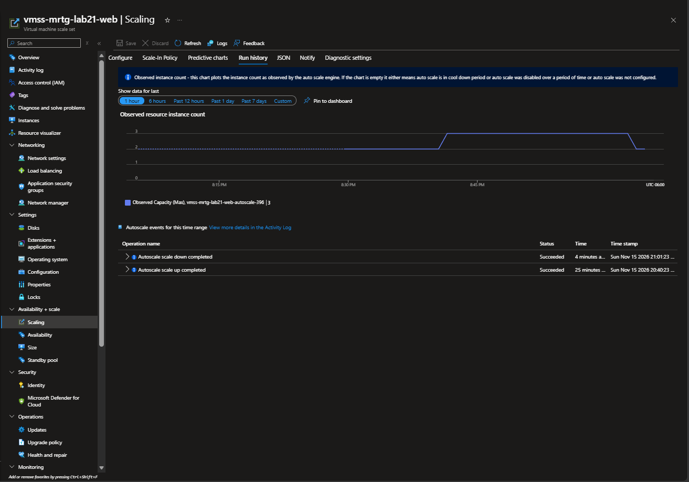

# Lab 21 — Availability and scale

 

[Portfolio](../../README.md) · [All labs](../../docs/progress.md) · [Evidence gallery](screenshots/README.md)

## Outcome

**Validated November 15, 2026 (America/Chicago):** deployed a two-instance Flexible VM Scale Set across Central US zones 1 and 2 behind a public Standard load balancer. Stopping one web service left successful sampled requests through the other backend; restarting it restored both hostnames to traffic. Manual capacity changes and CPU-driven autoscale each completed **2 → 3 → 2**. A scale-out instance bootstrapped its application automatically.

Final sampled HTTP requests succeeded through both remaining backends. The lab resource group was absent in a reviewed, author-redacted filtered cleanup capture, and the downloaded private-key path returned `False`. A November 16 review showed **USD 0.34** posted usage; final billing remains unverified. This was a web-service fault test, not a simulated availability-zone outage or a production availability guarantee.

## Business problem

MRTG needs an application that can continue serving requests when one backend service fails and add or remove capacity as demand changes. The exercise separates VM provisioning, application readiness, load-balancer routing and autoscale decisions, then checks the application after capacity changes.

Administration uses Azure Run Command without public SSH. Application access is restricted by a subnet NSG while the load balancer has its own explicit health-probe allowance.

## Environment and decisions

| Component | Configuration and evidence boundary |
|---|---|
| Resource group and region | `rg-mrtg-lab21-scale`, Central US; disposable deployment |
| Tags | Environment=Lab; Project=MRTG-AZ104-Administration; Lab=Lab-21; Owner=MRTG-Cloud-Operations; setup forms show selections, not a full post-deployment tag audit |
| Network | `vnet-mrtg-lab21`, `10.210.0.0/16`; private `snet-web`, `10.210.10.0/24` |
| NSG | `nsg-mrtg-lab21-web` associated with the subnet; priority 100 Allow-HTTP-MyIP TCP 80; 110 Allow-LB-Probe-HTTP from AzureLoadBalancer TCP 80; 1000 Deny-Other-Inbound; default rules retained |
| NSG limits | Allow rules target `10.210.10.0/24`; client source is redacted. No outside-source denial test or exhaustive effective-rule audit |
| Scale set | `vmss-mrtg-lab21-web`, Flexible; initial capacity 2; Standard_B2ts_v2, 2 vCPUs/1 GiB each; Ubuntu Server 22.04 LTS Gen2 x64; Trusted Launch with Secure Boot/vTPM; Spot off |
| Zones and quota | Initial instances independently shown in zones 1 and 2. Preflight: regional usage 0/16 vCPUs and standardBsv2Family 0/6; SKU restrictions empty. Three instances exhaust that family quota; quota is not an allocation guarantee |
| Storage | Image-default 30 GiB Standard SSD LRS OS disk; platform-managed key; no data disks or ephemeral OS disk |
| NICs | No instance public IP, no NIC NSG, accelerated networking on in creation form; subnet NSG supplies the network boundary |
| Load balancer | `lb-mrtg-lab21-web`, Standard/Public/Regional; `fe-web` frontend; `be-web` backend pool; TCP `rule-http` port 80 → 80 with `probe-http` |
| Outbound connectivity | Explicit `out-web`, IPv4/all protocols, fe-web → be-web; 1024 SNAT ports per instance, 4-minute idle timeout, TCP reset enabled in the outbound setup form; no NAT gateway |
| Web application | Cloud-init custom data creates `mrtg-web.service`; Python HTTP server serves a static page containing the instance hostname on port 80. Lab demonstration service, not a production web stack |
| Management and health | Manual upgrade mode; managed boot diagnostics; Entra OS login, managed identity, standby pools, application health monitoring and automatic instance repairs off in review captures |
| Autoscale | Saved setting `vmss-mrtg-lab21-web-Autoscale-396`; min 2, max 3, default 2; predictive autoscale disabled |
| Scale-out rule | Average Percentage CPU across all VMName values >70% for 5 minutes; increase by 1; 5-minute cooldown |
| Scale-in rule | Average Percentage CPU <30% for 10 minutes; decrease by 1; 5-minute cooldown; divide-by-instance-count unchecked for both rules |

## Work performed

1. Selected the subscription and checked SKU restrictions, zones and regional/family quota. Created the tagged group, VNet, private subnet and subnet NSG.
2. Created the public Standard load balancer with an initially empty backend pool, HTTP rule/probe and explicit outbound rule. Connected the scale-set NIC configuration to the existing pool.
3. Supplied cloud-init custom data for a persistent hostname web page and systemd service, then deployed two instances. Verified both Running/Succeeded and independently inspected zone placement.
4. Verified backend membership at `10.210.10.4` (zone 2) and `10.210.10.5` (zone 1). A browser request succeeded; 20 separate local curl requests returned both initial hostnames.
5. Used Run Command on the zone-1 instance to verify cloud-init done, no reported errors, active service and local HTTP. Stopped the web service and confirmed inactive/connection refused. After a wait, all 20 frontend requests returned only the other hostname.
6. Started the stopped service. The immediate local curl failed, but later frontend requests returned both hostnames. A separate local retry-capable check then passed.
7. Manually scaled from two to three. The new instance reported cloud-init done, no errors, active service and local HTTP without manual application installation. Thirty frontend requests included all three hostnames. Scaled back to two and repeated the traffic test.
8. Configured the bounded CPU autoscale policy. Saving initially failed with MissingSubscriptionRegistration for Microsoft.Insights. Registered the provider, verified Registered and saved the policy successfully.
9. On both existing instances, used systemd-run to launch all-core CPU load with RuntimeMaxSec=1200 and KillMode=control-group. Both transient units reported active. The load had a 20-minute limit; the third instance was not deliberately loaded.
10. Run history recorded successful automatic scale-up at **20:40:23** and scale-down at **21:01:23** local portal time, with observed capacity 2 → 3 → 2. Stop/status checks on both original load units showed inactive; their exact automatic-versus-manual stop timing was not measured.
11. Verified the final two VMs Running/Succeeded and 20 successful sampled responses from both remaining hostnames. Removed the resource group and downloaded key; reviewed November 16 posted cost.

## Validation results

| Test | Observed result | Evidence or limit |
|---|---|---|
| Initial deployment and placement | Two B2ts_v2 VMs Running/Succeeded, one in zone 1 and one in zone 2 | Instance list and individual zone captures; no zone outage tested |
| Initial application access | Browser page and 20 curl requests returned T8EIPL and SCSKHA hostnames | Separate connections; no throughput or fairness benchmark |
| Service failure | Zone-1 T8EIPL service inactive and localhost refused port 80; later 20 frontend requests all returned SCSKHA | Application service stopped, VM not stopped; transition duration and zero interruption not measured |
| Service recovery | Both hostnames returned through frontend; later local service active and curl passed | Initial immediate curl failure preserved |
| Manual scale-out | Three Running/Succeeded; new 049f759a instance cloud-init done, active service and local page; 30 requests included all three hostnames | Application provisioning verified on the manually added instance |
| Manual scale-in | Two Running/Succeeded; original 96a40dc7 instance removed; 30 requests returned remaining two hostnames | Application sampled after completion, not continuously during deletion |
| Provider recovery | MissingSubscriptionRegistration → Microsoft.Insights Registered → saved autoscale policy | Prerequisite corrected; not an Azure platform outage |
| Automatic scale-out | Autoscale scale up completed/Succeeded; graph rose 2 → 3 | Control-plane event plus observed count; exact CPU trace/trigger payload not exported |
| Automatic scale-in | Autoscale scale down completed/Succeeded; graph returned 3 → 2 | Both CPU load units subsequently inactive; policy remained enabled |
| Post-autoscale application | Final two VMs Running/Succeeded; 20 frontend responses returned SCSKHA and DG1WO2 hostnames, no visible request errors | Newly autoscaled backend served traffic; full bootstrap log not separately captured for it |
| Cleanup | No matching group in reviewed filtered portal list; local Downloads key path False | Author-redacted group capture published; no inventory of unrelated resources or other key copies |

## Troubleshooting and lessons

- **Provider registration:** the autoscale save failed because Microsoft.Insights was not registered. Registration was observed progressing from Registering to Registered; retrying saved the policy. Check service prerequisites before beginning a timed load test.
- **Active is not ready:** immediately after systemctl start, systemctl is-active reported active while localhost curl got connection refused. A startup/listener timing race is plausible but was not independently traced. Later frontend and local retry checks passed. Process state alone does not establish HTTP readiness.
- **Model bootstrap matters:** adding an instance produced a working application without manually configuring that guest. The screenshots show only the beginning of custom data; they do not preserve a complete model export or original cloud-init file.
- **Scale-in can replace the pair:** the manual scale-in removed an original instance; automatic scale-in left one original and the automatically added backend. Record remaining resources and verify traffic instead of assuming the newest VM is deleted.
- **Separate availability controls:** zone placement, load-balancer probes and VM repair are different mechanisms. Automatic repairs were disabled so the service-failure routing result remained observable. No automatic repair or zone balancing behavior was tested.

## Cleanup and costs

The November 15 filtered resource-group list showed no match for `rg-mrtg-lab21-scale` in the selected subscription. An author-redacted replacement is published in the gallery. Resource-group deletion was operator-performed; a separate CLI inventory of orphaned resources was not captured. Local PowerShell removed `Downloads\key-mrtg-lab21.pem`; Test-Path returned False. This proves absence at that path, not secure erasure or absence of other copies.

Microsoft.Insights registration remains a subscription prerequisite; deregistration was not claimed. Existing subscription/directory, unrelated resources and budget configuration were outside cleanup verification.

**November 16, 2026 cost review:** November 2026 accumulated Actual cost at billing-account scope filtered to `rg-mrtg-lab21-scale` was **USD 0.34**. The author supplied billing-name-redacted evidence.

| Service | Displayed usage cost |
|---|---:|
| Load Balancer | USD 0.17 |
| Virtual Machines | USD 0.09 |
| Storage | USD 0.04 |
| Virtual Network | USD 0.03 |
| Bandwidth | < USD 0.01 |

Displayed components are rounded and need not sum to the total. This is posted usage, not a final invoice or verified cash charge; credits are not assumed. Forecast was unavailable; Budget None refers to the selected view and does not establish absence of a subscription budget. See the [cost ledger](../../docs/cost-ledger.md).

**Cost follow-up — November 22, 2026:** The [author-redacted November review](screenshots/lab21-cost-review-2026-11-22.png) shows: Actual cost USD 0.34; Load Balancer USD 0.17, VMs USD 0.09, Storage USD 0.04, Virtual Network USD 0.03, Bandwidth below USD 0.01. This dated review preserves the earlier captures; no final invoice, applied credits or cash cost is verified. The selected-view Budget None does not establish absence of the subscription budget, which was separately revalidated in Lab 26.

## Evidence and limits

The [evidence gallery](screenshots/README.md) contains **34 published screenshots**, preserving supplied PNG bytes, including three author-reviewed replacements for cleanup, cost and NSG rules. Setup forms are distinguished from post-deployment observations. No original deployment template, full cloud-init export, complete effective NSG export, detailed probe configuration, CPU metric export or billing invoice is included.

HTTP checks sampled the lab from the allowed client after each phase. They do not prove production performance, TLS security, uninterrupted existing connections, external-source denial, all failure modes, zone/region disaster recovery or a production SLA. Initial placement across two zones is verified; final post-autoscale zone placement was not separately inspected. The historical public IP is not a current endpoint.

[Previous lab](../lab-20-disk-recovery-and-relocation/README.md) · [All labs](../../docs/progress.md) · [Next lab](../lab-22-container-delivery/README.md)
