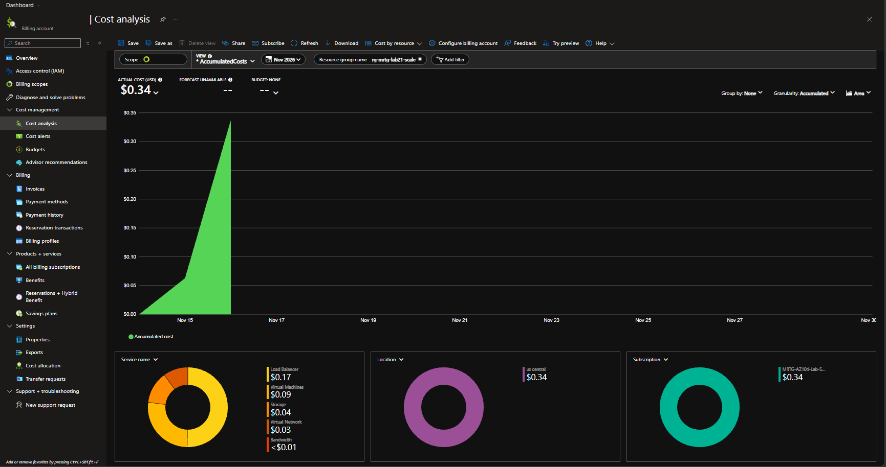

# Lab 21 evidence gallery

**34 published screenshots.**

Supplied PNG bytes are preserved unchanged, including three author-reviewed replacements for cleanup, cost and NSG rules. Tenant domain, personal source IP and billing identity are hidden in the reviewed captures. No credential or private-key contents are published. Historical Azure lab IPs and synthetic resource names are retained for interpreting the tests.

| Capture | What it establishes and limits |
|---|---|
| [lab21-autoscale-cpu-load-instance-049f759a.png](lab21-autoscale-cpu-load-instance-049f759a.png) | Run Command on 049f759a: transient all-core load active; runtime bounded at 1200 seconds. |
| [lab21-autoscale-cpu-load-instance-99ce2d52.png](lab21-autoscale-cpu-load-instance-99ce2d52.png) | Run Command on 99ce2d52: transient load active; Running as unit on stderr is informational. |
| [lab21-autoscale-cpu-load-stopped-049f759a.png](lab21-autoscale-cpu-load-stopped-049f759a.png) | Stop/status check shows inactive; does not distinguish timeout from explicit stop timing. |
| [lab21-autoscale-cpu-load-stopped-99ce2d52.png](lab21-autoscale-cpu-load-stopped-99ce2d52.png) | Second load unit inactive after stop/status check; no visible stderr. |
| [lab21-autoscale-cpu-scale-in-rule.png](lab21-autoscale-cpu-scale-in-rule.png) | CPU average <30%, 10-minute duration, decrease 1, 5-minute cooldown; rule editor capture. |
| [lab21-autoscale-cpu-scale-out-rule.png](lab21-autoscale-cpu-scale-out-rule.png) | CPU average >70%, 5-minute duration, increase 1, 5-minute cooldown; rule editor capture. |
| [lab21-autoscale-policy-saved.png](lab21-autoscale-policy-saved.png) | Saved generated policy name Autoscale-396, two rules, min/default 2, max 3; predictive off. |
| [lab21-autoscale-save-provider-registration-error.png](lab21-autoscale-save-provider-registration-error.png) | Save rejected with MissingSubscriptionRegistration for Microsoft.Insights; failed intermediate state. |
| [lab21-autoscale-scale-out-and-in-succeeded.png](lab21-autoscale-scale-out-and-in-succeeded.png) | Both autoscale events Succeeded; observed capacity 2 → 3 → 2; local timestamps 20:40:23 and 21:01:23. |
| [lab21-autoscale-scale-out-succeeded.png](lab21-autoscale-scale-out-succeeded.png) | Autoscale scale-up Succeeded, observed count rose to 3; before later scale-in. |
| [lab21-cost-review-2026-11-16.png](lab21-cost-review-2026-11-16.png) | Author-redacted November billing-account view filtered to lab group: USD 0.34 Actual; rounded service breakdown, not final invoice. |
| [lab21-lb-backend-pool-two-instances.png](lab21-lb-backend-pool-two-instances.png) | Initial two backend NIC members, private IPs 10.210.10.4/5 and zones 2/1; Running is VM state, not probe health. |
| [lab21-lb-http-after-autoscale-scale-in.png](lab21-lb-http-after-autoscale-scale-in.png) | 20 post-autoscale responses from SCSKHA and DG1WO2, no visible curl errors; sampled after completion. |
| [lab21-lb-http-after-scale-in.png](lab21-lb-http-after-scale-in.png) | 30 post-manual-scale-in responses from 1A6D22 and SCSKHA; removed T8EIPL absent. |
| [lab21-lb-http-both-backends-restored.png](lab21-lb-http-both-backends-restored.png) | 20 frontend requests include both original hostnames after service restoration. |
| [lab21-lb-http-both-backends.png](lab21-lb-http-both-backends.png) | 20 separate initial curl requests include both original hostnames; not a throughput benchmark. |
| [lab21-lb-http-first-response.png](lab21-lb-http-first-response.png) | Browser HTTP page through historical public frontend; T8EIPL hostname returned; HTTP is unencrypted. |
| [lab21-lb-http-surviving-backend-only.png](lab21-lb-http-surviving-backend-only.png) | After stopping T8EIPL web service, 20 sampled responses all from SCSKHA; failover transition not timed. |
| [lab21-lb-http-three-backends.png](lab21-lb-http-three-backends.png) | 30 frontend requests include original two and manually added 1A6D22 hostname. |
| [lab21-lb-review-configuration.png](lab21-lb-review-configuration.png) | Validation passed before deployment; Standard public regional LB, pool, probe/rules and tags visible; frontend IP to be created. |
| [lab21-local-private-key-deleted.png](lab21-local-private-key-deleted.png) | Specified Downloads PEM path removed and Test-Path False; no private key contents; other copies not checked. |
| [lab21-microsoft-insights-provider-registered.png](lab21-microsoft-insights-provider-registered.png) | CLI confirms Microsoft.Insights Registered after initial autoscale-save failure. |
| [lab21-nsg-inbound-rules.png](lab21-nsg-inbound-rules.png) | Three custom rules plus defaults; client source redacted, destination subnet and AzureLoadBalancer allowance visible. |
| [lab21-nsg-subnet-associated.png](lab21-nsg-subnet-associated.png) | NSG associated with snet-web 10.210.10.0/24 in vnet-mrtg-lab21. |
| [lab21-resource-group-deleted.png](lab21-resource-group-deleted.png) | Author-redacted selected-subscription list filtered to rg-mrtg-lab21-scale shows no matching group. |
| [lab21-resource-group-created.png](lab21-resource-group-created.png) | Named group overview; no matching resources yet; Essentials collapsed, so not a live region/tag audit. |
| [lab21-scale-out-instance-web-bootstrap-verified.png](lab21-scale-out-instance-web-bootstrap-verified.png) | Manually added 1A6D22 instance: cloud-init done with no reported errors, service active, local HTTP works. |
| [lab21-subscription-sku-and-quota-check.png](lab21-subscription-sku-and-quota-check.png) | Subscription Enabled; B2ts_v2 restrictions empty and zones listed; regional 0/16 and Bsv2 family 0/6 vCPUs; capacity not guaranteed. |
| [lab21-vmss-advanced-cloud-init.png](lab21-vmss-advanced-cloud-init.png) | Custom data populated with cloud-config/systemd service beginning; full script is outside visible textarea; not a complete export. |
| [lab21-vmss-advanced-placement-settings.png](lab21-vmss-advanced-placement-settings.png) | User data off; no dedicated host/proximity group or capacity reservation selected. |
| [lab21-vmss-basics-configuration.png](lab21-vmss-basics-configuration.png) | Intermediate Basics form shows Standard B2s v2; superseded by final review and running B2ts_v2 instances. |
| [lab21-vmss-health-configuration.png](lab21-vmss-health-configuration.png) | Application health monitoring and automatic repair/zone balancing off in creation form. |
| [lab21-vmss-instance-zone-1.png](lab21-vmss-instance-zone-1.png) | Original instance 96a40dc7 Running in Central US Zone 1; no zone outage tested. |

The intermediate Basics screenshot is not the final VM size. Final review and deployed instance lists show Standard_B2ts_v2. The first restart check is intentionally retained despite its failed immediate curl; the later local and frontend checks establish recovery. Autoscale events and sampled traffic do not prove zero downtime, a zone outage, external-source denial, or final billing.

[Lab results](../README.md) · [Portfolio](../../../README.md)

## Cost follow-up — November 22, 2026

November 2026 billing-account view filtered to the lab group(s). Actual cost USD 0.34; Load Balancer USD 0.17, VMs USD 0.09, Storage USD 0.04, Virtual Network USD 0.03, Bandwidth below USD 0.01. Author-redacted billing identity; original amounts, date range and filters retained. Posted/displayed values are not final invoiced or cash costs.

