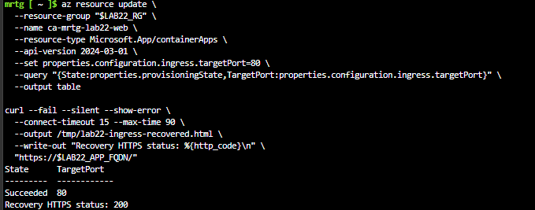

# Lab 22 — Container delivery

 

[Portfolio](../../README.md) · [All labs](../../docs/progress.md) · [Evidence gallery](screenshots/README.md) · [Deployment templates](templates/README.md)

## Outcome

**Validated November 17–19, 2026 (America/Chicago):** delivered Microsoft's sample web image through a Basic Azure Container Registry to Azure Container Instances (ACI) and Azure Container Apps. A user-assigned managed identity had **AcrPull at registry scope**, and the registry admin account was disabled. ACI returned HTTP 200; Container Apps returned HTTPS 200 with matching latest/ready revision names.

A controlled Container Apps ingress change from port **80 to 8081** produced **HTTP 503**. Restoring port **80** returned **HTTP 200**. The lab resource group was subsequently absent (`az group exists` returned `false`). November 19 posted usage was **USD 0.28**, not a final invoice.

## Business problem

MRTG needs to deliver a container image consistently across managed hosting services without embedding registry passwords. The exercise separates image storage, pull authorization, provisioning, revision readiness and application reachability. A successful control-plane update is not sufficient evidence of a working application.

## Environment and decisions

| Component | Configuration and evidence boundary |
|---|---|
| Resource scope | `rg-mrtg-lab22-containers`, Central US; temporary lab |
| Providers | Microsoft.ContainerRegistry, Microsoft.ContainerInstance, Microsoft.App and Microsoft.OperationalInsights Registered; ManagedIdentity was already Registered in the initial session |
| Registry | Basic `acrmrtglab222f7dde1e`; admin disabled; explicit RBAC permission mode in creation command; authenticated image delivery through a public registry endpoint, not Private Link |
| Image | Imported `mcr.microsoft.com/azuredocs/aci-helloworld:latest` as `mrtg-web:v1`; no local image build or source-code modification |
| Identity | User-assigned `id-mrtg-lab22-pull`; AcrPull scoped to this registry; registry-wide, not repository-specific authorization |
| ACI | `aci-mrtg-lab22-web`; Linux, 1 vCPU, 1.5 GiB, public TCP 80, Always restart policy; same identity attached and selected for ACR pull |
| Container Apps environment | `cae-mrtg-lab22`; Consumption workload profile, zoneRedundant=false; live logging destination and Log Analytics configuration both null |
| Container App | `ca-mrtg-lab22-web`; same image and identity; external ingress, target port 80, allowInsecure=false; Single revision mode; 0.25 vCPU / 0.5 GiB; configured min 0 / max 1 replicas |
| Tags | Environment=Lab, Project=MRTG-AZ104-Administration, Lab=Lab-22; ACI tags separately applied and read back |
| Templates | Original environment and app ARM JSON use API 2024-03-01; prerequisite group, registry, image, identity and role assignment are not created by these two templates |

## Work performed

1. Checked the selected subscription and resource providers; registered the four missing providers and confirmed their Registered states.
2. Created the resource group and Basic registry with admin credentials disabled. Imported Microsoft's existing sample image, then listed tag `v1` and its digest.
3. Created a user-assigned identity and assigned AcrPull at registry scope. A role-assignment list returned AcrPull / ServicePrincipal.
4. Deployed ACI using `--assign-identity` and `--acr-identity`. Verified Succeeded, Running, zero restarts and HTTP 200 with sample HTML. Applied resource tags separately and stopped the group; Stopped was captured before the overnight pause.
5. The Container Apps extension requested unsupported API 2025-10-02-preview. A later resource list showed the registry, identity and ACI, with no environment. The session reported Azure CLI 2.91.0 and containerapp extension 1.3.0b6.
6. Used an ARM environment template pinned to API 2024-03-01. A first template with logging destination string `none` failed preflight. Removed appLogsConfiguration, validated, deployed and read back Succeeded, Consumption and null logging fields.
7. Deployed the app ARM template with the existing registry server as its parameter. Verified matching latest/ready revisions and HTTPS 200 from the sample image.
8. Changed only ingress targetPort to 8081; the update reported Succeeded, but the request returned 503. Restored targetPort=80 and verified HTTPS 200.
9. Generated template SHA-256 hashes in Cloud Shell. Initial downloads failed; copying files into the home directory and using the full download paths succeeded. Uploaded templates matched the captured hashes byte for byte.
10. Verified group absence and reviewed posted cost after cleanup.

## Validation results

| Test | Observed result | Evidence / limit |
|---|---|---|
| Registry creation | Succeeded, Basic, AdminEnabled=False | Creation result; no registry anonymous-pull or network-denial test |
| Image delivery | `mrtg-web` tag `v1` resolves to a SHA-256 digest | Tag is mutable; deployments use `:v1`, not a digest-pinned reference |
| Pull role | AcrPull / ServicePrincipal at selected registry scope | No push-denial, other-registry denial or post-revocation pull test |
| ACI application | Succeeded / Running / restart count 0; HTTP 200 and HTML | Deployment command uses managed identity; no independent registry authentication audit log |
| ACI cost control | Tags read back; group Stopped | Before later group removal; stop does not delete the registry |
| Environment recovery | Stable API deployment Succeeded; Consumption profile and logging fields read back | Initial CLI preview API failed; disabling persistent logging limits retained diagnostics |
| Container Apps application | Matching latest/ready revision names; HTTPS 200 and HTML | Replica bounds configured; scale-to-zero and autoscale execution not measured |
| Ingress fault | targetPort=8081; update Succeeded; HTTP 503 | Controlled routing fault, not an image-pull failure or container crash |
| Ingress recovery | targetPort=80; update Succeeded; HTTPS 200 | Sampled after correction; no continuous availability or recovery-time measurement |
| Template preservation | Both uploaded JSON hashes match Cloud Shell hashes | Exact submitted artifacts retained; no full independent rebuild performed |
| Cleanup | ResourceGroupNotFound on delete attempt, then group-existence result false | Establishes group absence; does not establish when an earlier deletion completed or audit unrelated/platform-managed groups |

## Troubleshooting and lessons

- **Command support:** the first ACI command rejected `--tags` before deployment. Removing it allowed creation; generic tag update supplied and verified tags afterward.
- **Query fields:** an initial image query mislabeled tag metadata and returned null Tags. `az acr repository show-tags --detail` verified the actual `v1` tag/digest. Role creation output also lacked a role name; listing the assignment verified AcrPull.
- **API compatibility:** the beta extension's selected preview API was rejected. Stable-version ARM deployment resolved that request issue. This is not evidence that registry authentication failed.
- **Logging serialization:** the initial ARM string `none` failed validation despite the CLI exposing a none option. Omitting the property succeeded; live destination and Log Analytics settings were null. The successful template is archived unchanged.
- **Provisioning versus reachability:** a Succeeded ingress update still produced 503 when targeting the wrong port. Restore the listening-port mapping rather than changing identity permissions for this symptom.
- **Ephemeral files:** failed download attempts did not preserve the templates. Full home-directory paths worked; both final artifacts were checked against the captured hashes.

## Cleanup and costs

The November 19 cleanup capture shows a delete attempt returning ResourceGroupNotFound for `rg-mrtg-lab22-containers`, followed by `az group exists` returning `false`. The group was absent at verification time. The retained templates are local evidence, not running infrastructure. Provider registrations remain; unrelated subscription resources, platform-managed infrastructure groups and budget settings were not independently inventoried after deletion.

The author-redacted November 19 cost capture selects **November 2026**, accumulated Actual cost at billing-account scope filtered to this lab group:

| Item | Displayed cost |
|---|---:|
| Actual total | USD 0.28 |
| Container Registry | USD 0.28 |
| Container Instances | < USD 0.01 |
| Container Apps | No separate service line displayed; charge not independently established |

Rounded components need not sum to the total. This posted snapshot can change as reporting catches up; it is not a final invoice, verified cash charge or proof that Container Apps was free. Budget None describes the selected view, not a fresh audit of subscription budgets. See the [cost ledger](../../docs/cost-ledger.md).

## Evidence and limits

The [gallery](screenshots/README.md) publishes all **16 reviewed screenshots** supplied in the lab ZIP. The fault screenshot's `ab22-` filename was corrected to `lab22-`; PNG contents are unchanged. The cost image is the author-redacted copy. No passwords, tokens, registry admin credentials, tenant IDs or subscription IDs are included in these captures or templates. Historical lab endpoint names and the disposable ACI IP remain for interpreting results.

The [two templates and checksum file](templates/README.md) preserve the submitted working artifacts. They are deployment fragments with external prerequisites, not a complete environment rebuild. The screenshot set does not independently archive every setup command, the intermediate logging-validation error or the template hash command; those details come from the reviewed session and uploaded files. The image was imported, not built. No registry push/revocation denial, application authentication, persistent-log query, zone resilience, autoscale execution or production security/performance claim is made.

[Previous lab](../lab-21-availability-and-scale/README.md) · [All labs](../../docs/progress.md) · [Next lab](../lab-23-managed-web-application/README.md)
