# Lab 23 evidence gallery

**15 published screenshots.**

November 20–21, 2026 local execution. Setup, observed requests and cleanup are distinguished below.

## web provider registered

Microsoft.Web registration completed.

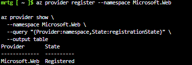

## plan regions and runtimes

F1 Linux region and Python runtime discovery; support does not establish subscription quota.

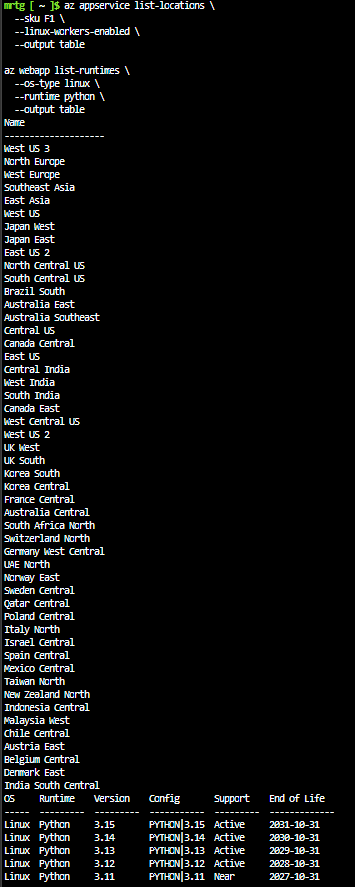

## free plan quota blocked

Central US group created; F1 deployment rejected with a zero limit.

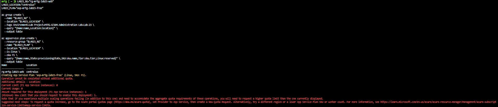

## eastus2 free plan quota blocked

East US 2 F1 deployment also rejected before support resolution.

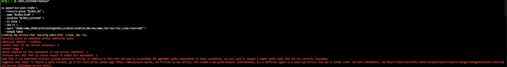

## linux free plan created

Post-resolution plan creation: East US 2, F1 Free, Linux true.

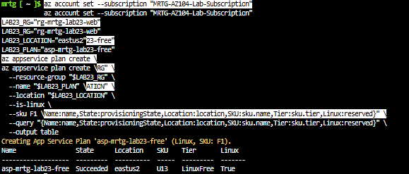

## python webapp created https only

Python web app Running with HTTPS-only true.

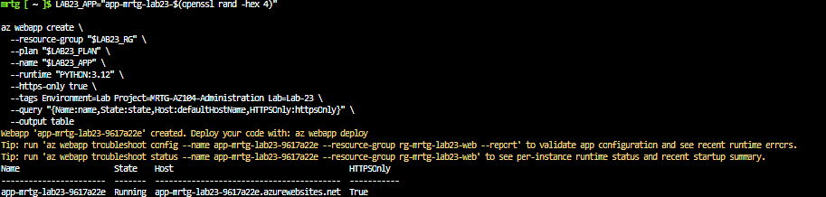

## python zip deployment succeeded

Source creation and remote ZIP deployment; build/runtime success; subscription ID redacted by author.

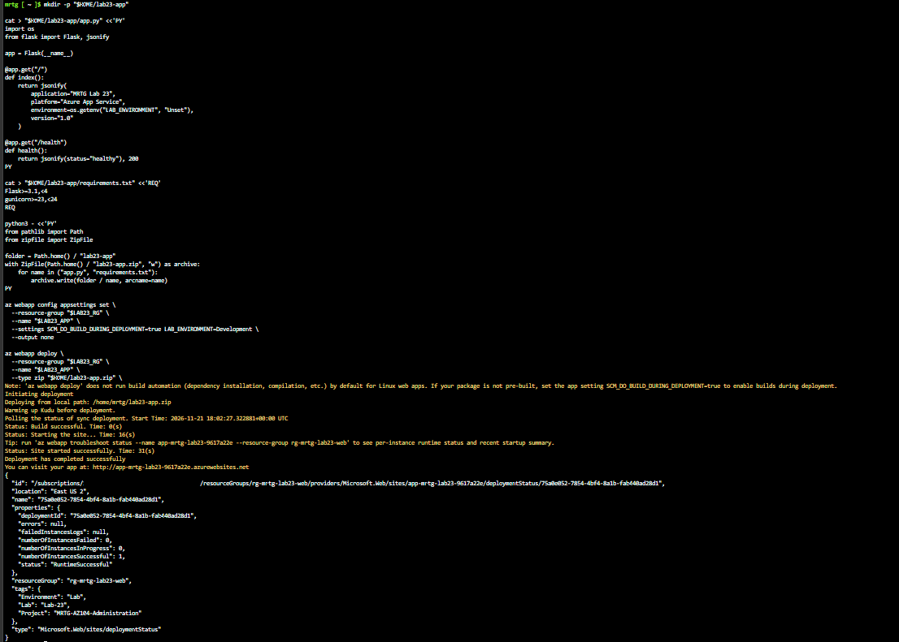

## development https health 200

Initial Development application and static health route both return 200.

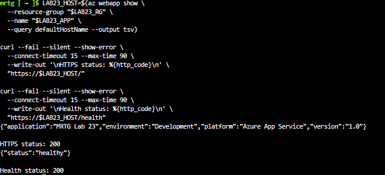

## app setting validation https 200

Saved setting and live response both Validation; HTTPS 200.

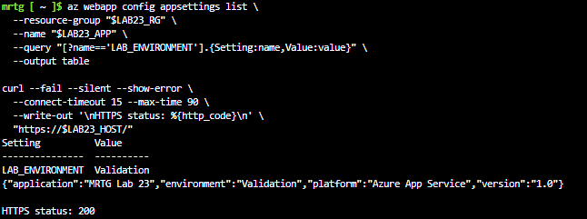

## http redirects to https 301

HTTP 301 with HTTPS Location header.

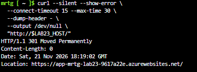

## access restriction denied 403

Saved IPv4 deny rule and observed 403.

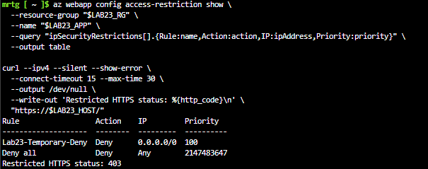

## access restriction removed recovery 200

Explicit Deny removal; Allow all restored and application 200.

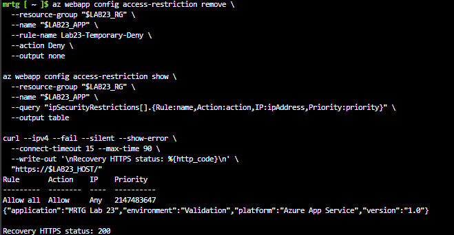

## final runtime and source hashes

Python 3.12, TLS minimum 1.2, Always On false, source/ZIP hashes.

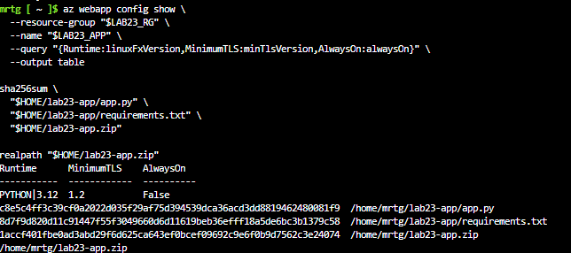

## resource group deleted

Deletion followed by az group exists=false.

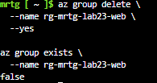

## cost filter no match

November 21 cost-filter search returns No items found; billing name redacted; broader totals are not Lab 23 cost.

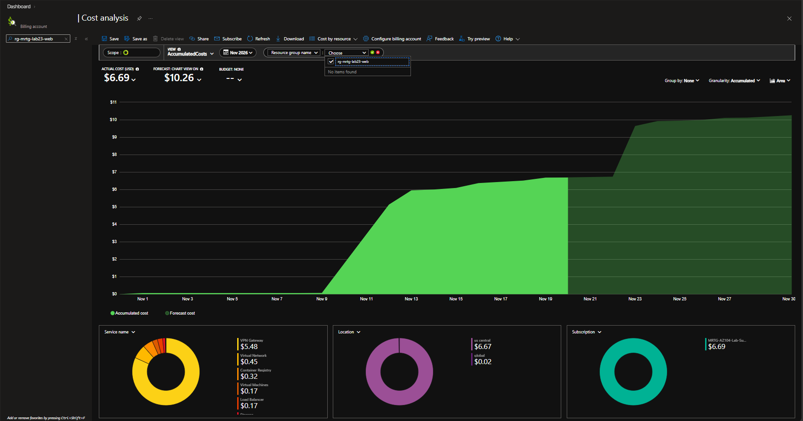

[Lab results](../README.md)
