# Lab 24 evidence gallery

**16 published screenshots.**

November 21, 2026 local execution. Initial post-swap responses and later configuration verification are separate observations. Two uploaded filenames were reversed and corrected without changing image bytes.

## eastus2 s1 quota check

Read-only S1 0/30 and Total Regional VMs 0/31 quota check.

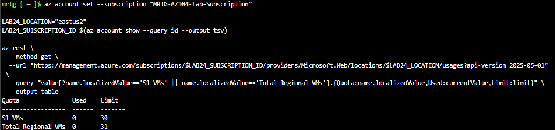

## linux s1 retail price

Microsoft retail API returned Linux S1 USD 0.095 per hour; not a billed session total.

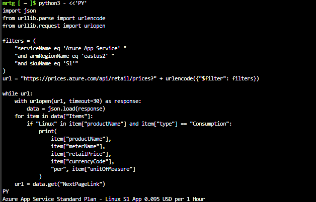

## linux s1 plan created

East US 2 plan succeeded: S1 Standard, one instance, Linux true.

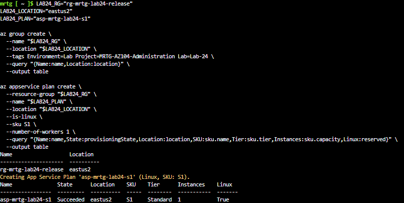

## production and staging created

Production and staging Running, both HTTPS-only true.

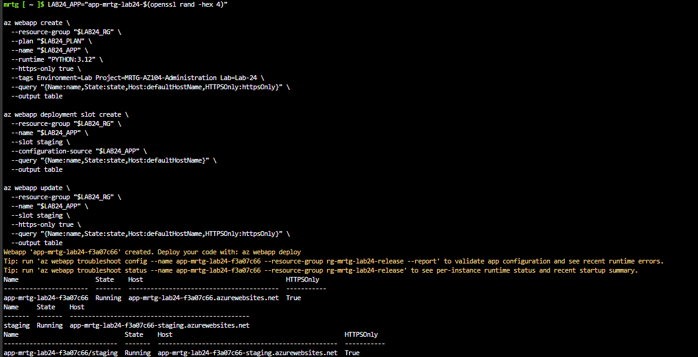

## slot specific settings verified

Production and Staging environment values both marked sticky before deployment.

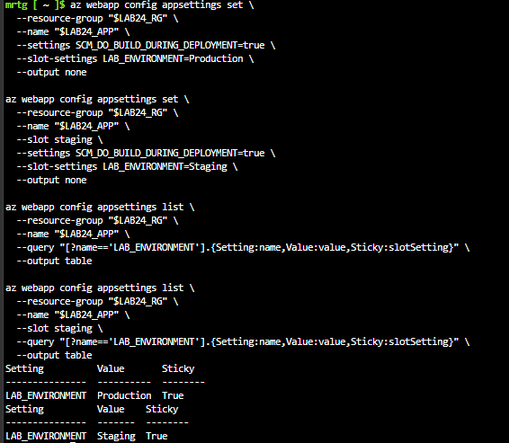

## release source and packaging

Separate v1 and v2 source trees and deployment ZIP creation.

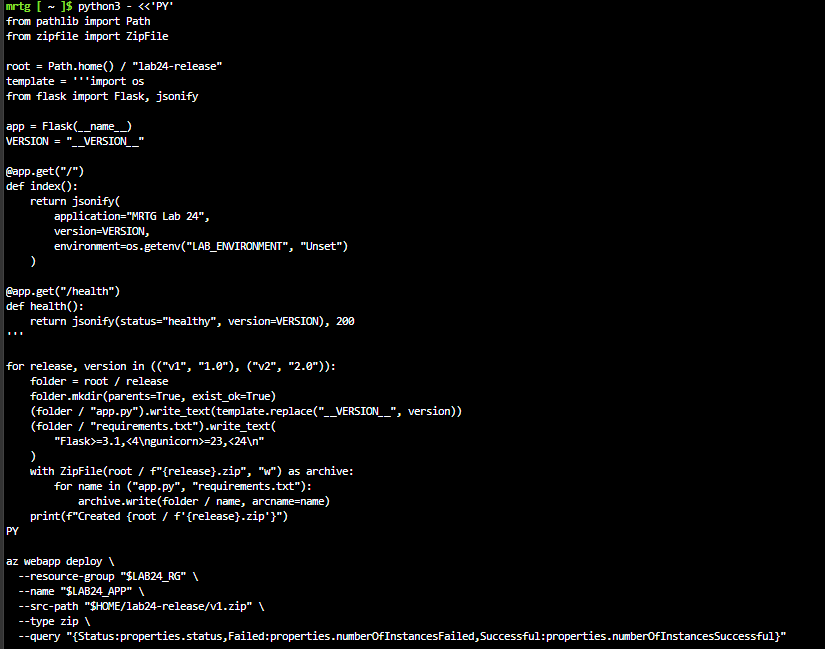

## production and staging deployments

Production RuntimeSuccessful; staging completion with null projected fields, requiring live tests.

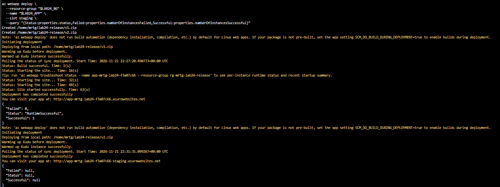

## before swap production v1 staging v2

Baseline: production v1.0/Production and staging v2.0/Staging; application and health 200.

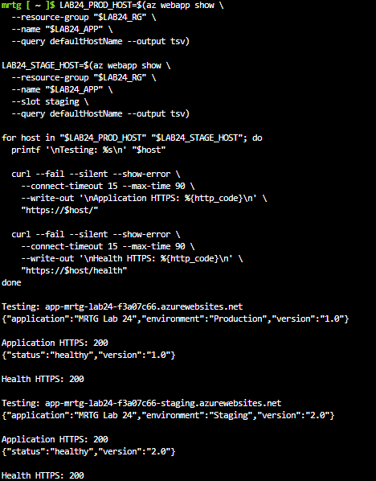

## swap production v2 initial staging response

Promotion: production v2.0/Production; staging v1.0 temporarily reports Production; all sampled endpoints 200.

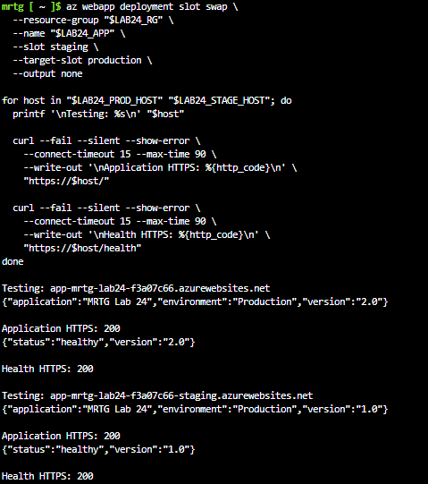

## after swap staging setting verified

Follow-up: saved Staging/True and live staging v1.0/Staging/200.

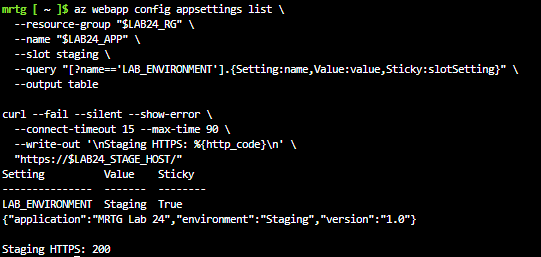

## rollback production v1 initial staging response

Rollback: production v1.0/Production; staging v2.0 temporarily reports Production; sampled endpoints 200.

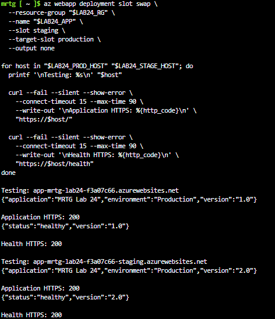

## rollback staging setting verified

Follow-up: saved Staging/True and live staging v2.0/Staging/200.

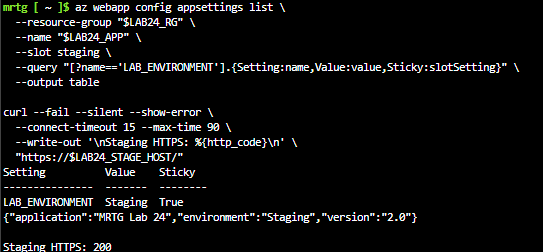

## release artifact hashes

Six release-member hashes and full bundle hash captured in Cloud Shell.

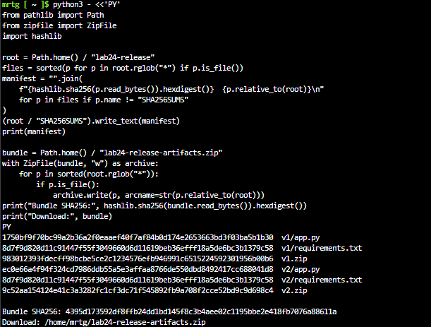

## resource group deleted

Group deletion followed by existence=false.

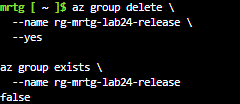

## cost filter no match

Author-redacted November 21 group search returns No items found; background totals are broader scope.

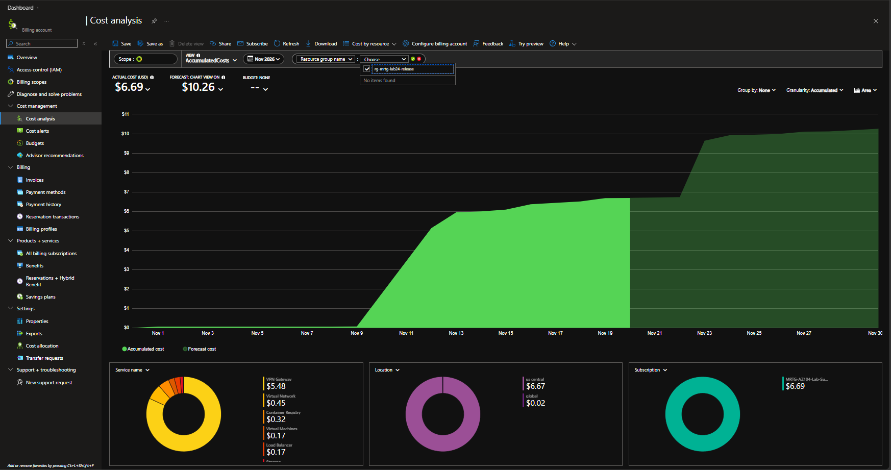

[Lab results](../README.md)

## Cost follow-up — November 22, 2026

November 2026 billing-account view filtered to the lab group(s). Actual cost USD 0.06; Azure App Service and East US 2 USD 0.06. The lab group is now available in the filter; this is attributable posted usage, not the illustrative runtime estimate. Author-redacted billing identity; original amounts, date range and filters retained. Posted/displayed values are not final invoiced or cash costs.

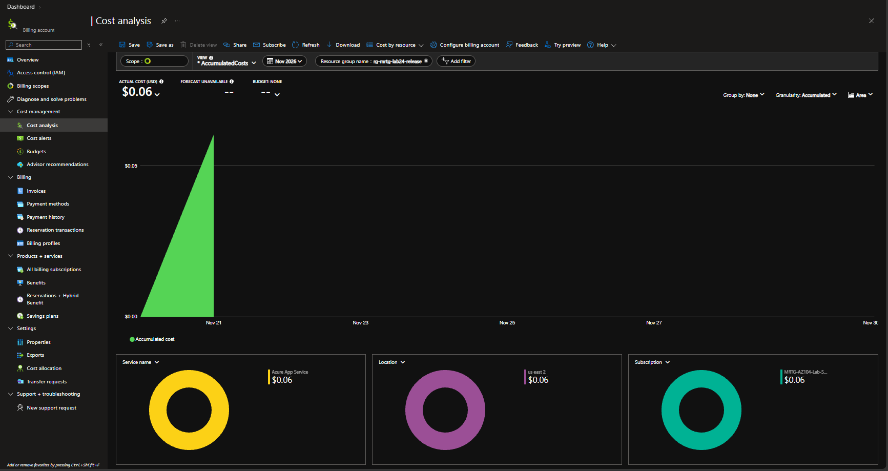
