# Lab 25 evidence gallery

**19 published screenshots.**

Executed November 21, 2026 America/Chicago; event records use November 22 UTC. Images retain the supplied bytes and filenames.

## 1. monitoring prerequisite check

Provider registration and initial empty workspace/export lists.

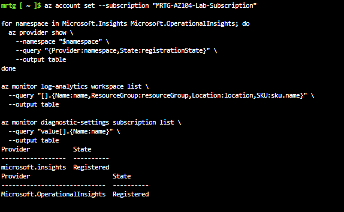

## 2. log analytics workspace created

East US 2 workspace Succeeded, PerGB2018, retention 30 days.

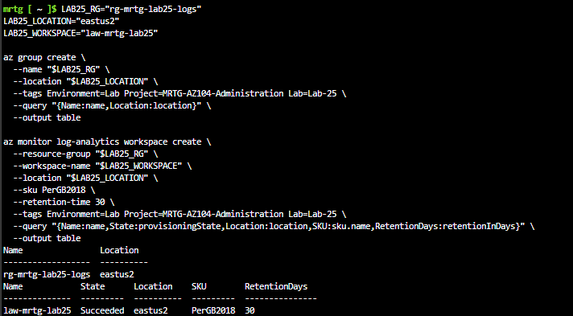

## 3. activity log export configured

Administrative export enabled; destination comparison verified the intended workspace.

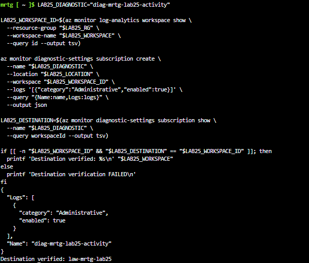

## 4. target change and lock blocked delete

Target tags and CanNotDelete lock; pasted Bash EOF error, actual ScopeLocked failure and group still present. Subscription identifiers are author-redacted.

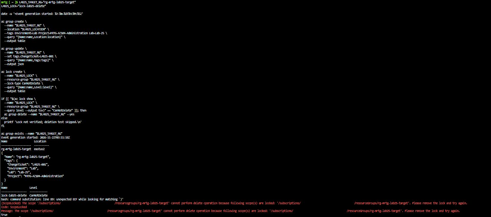

## 5. source activity log events

Native Activity Log independently records writes, lock creation and failed delete.

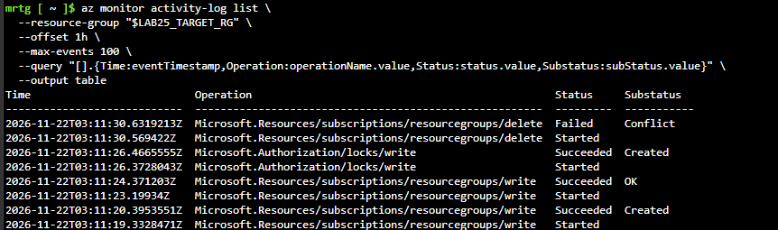

## 6. workspace initial ingestion confirmed

Workspace contained five older records before target events appeared; this is an ingestion checkpoint.

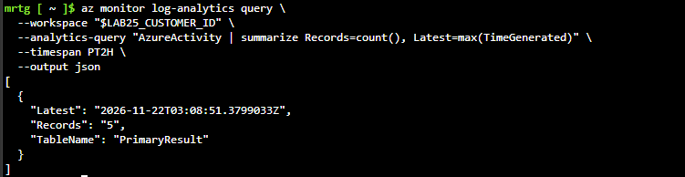

## 7. kql target event summary

Six operation/status summary rows represent eight target events.

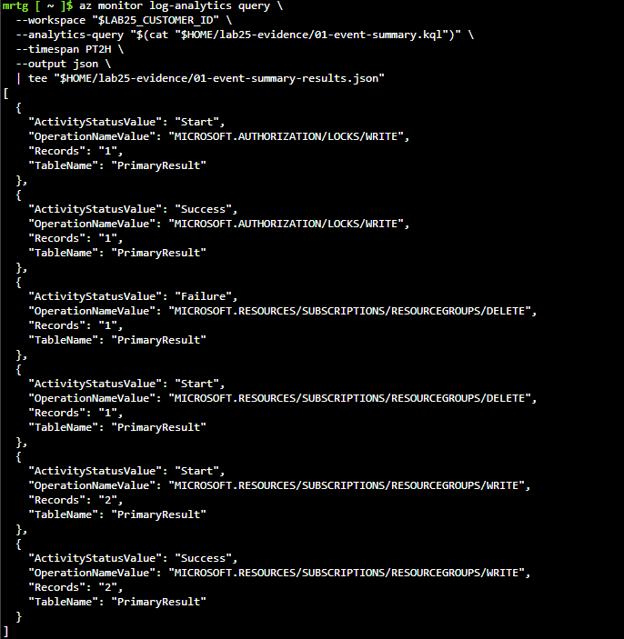

## 8. kql failed delete scopelocked

Failure detail: Conflict, ScopeLocked, timestamp, caller fingerprint and correlation ID.

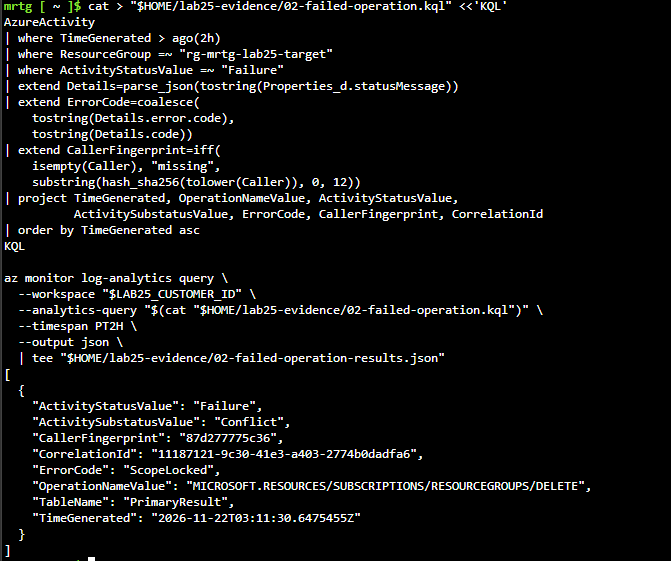

## 9. kql event timeline part1

Ordered group-write Start/Success pairs.

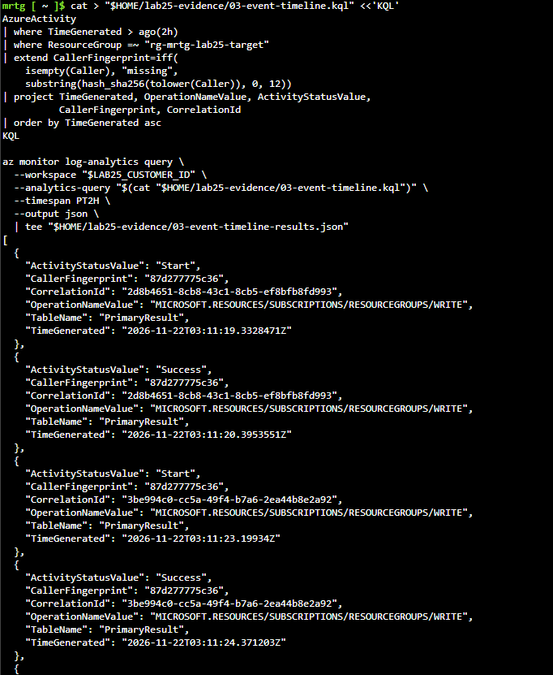

## 10. kql event timeline part2

Lock creation and delete Start/Failure pairs; CLI account fingerprint differs from Caller.

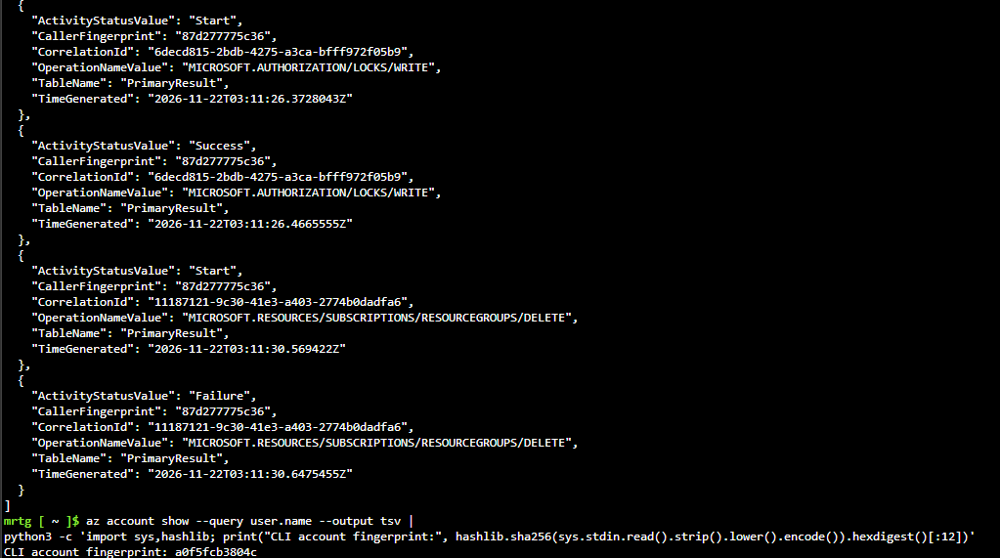

## 11. signed in object fingerprint check

Independent signed-in user object lookup produces a pseudonymized comparison value.

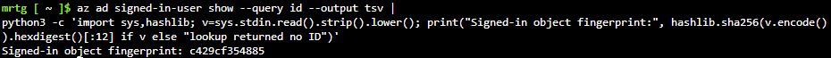

## 12. kql token object attribution verified

Failed-event token object fingerprint matches the signed-in object fingerprint.

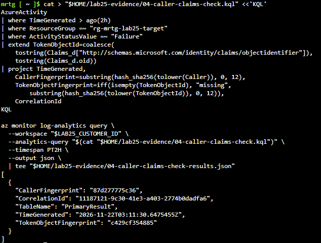

## 13. lock removed target deleted

Lock removal and group deletion commands; target existence=false.

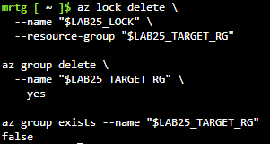

## 14. kql delete failure and recovery

Final saved recovery query contains both failed and successful deletion outcomes.

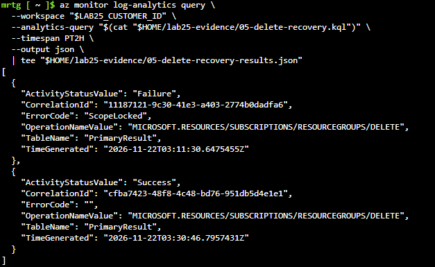

## 15. evidence bundle hashes

Manifest and original evidence bundle SHA-256 recorded before cleanup.

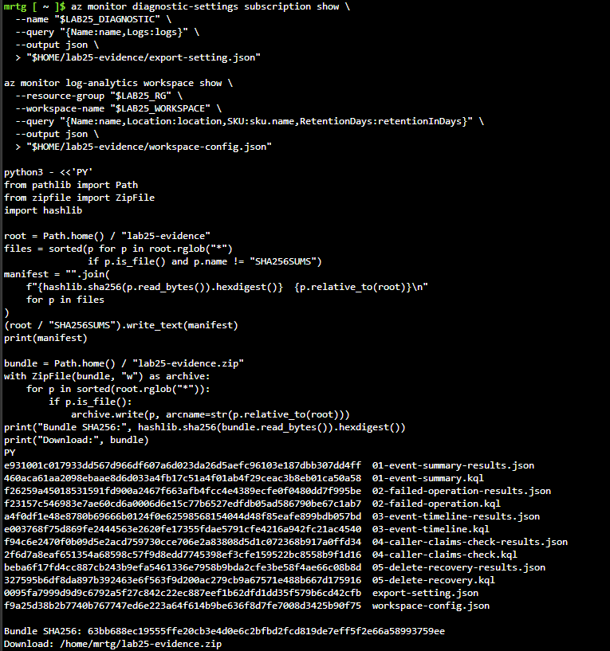

## 16. export and resource groups cleaned up

Export deletion, empty diagnostic-setting list and both group checks false.

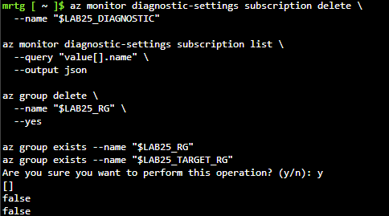

## 17. cost filter no match

Author-redacted cost review: no matching lab group; broader USD 6.69 actual and USD 9.83 forecast are not lab charges.

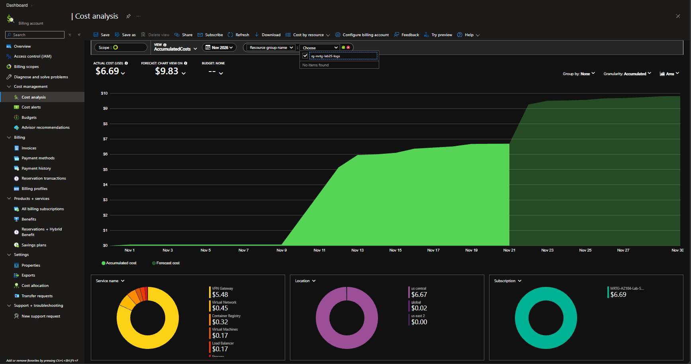

[Lab results](../README.md)

## November 23 cost-filter follow-up: rg-mrtg-lab25-logs

Search returned No items found. Cropped filter capture does not expose the full billing scope or establish zero cost. Review date comes from the author-supplied file/session context.

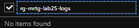

## November 23 cost-filter follow-up: rg-mrtg-lab25-target

Search returned No items found. Cropped filter capture does not expose the full billing scope or establish zero cost. Review date comes from the author-supplied file/session context.

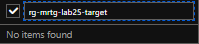
