# Lab 26 evidence gallery

**24 published screenshots.**

November 22, 2026 America/Chicago. Author-redacted originals; configuration review, sample delivery, actual alerts and cleanup observations are distinguished.

## 1. subscription budget verified

Monthly USD 10 budget; preflight subscription spend/forecast, not lab charges.

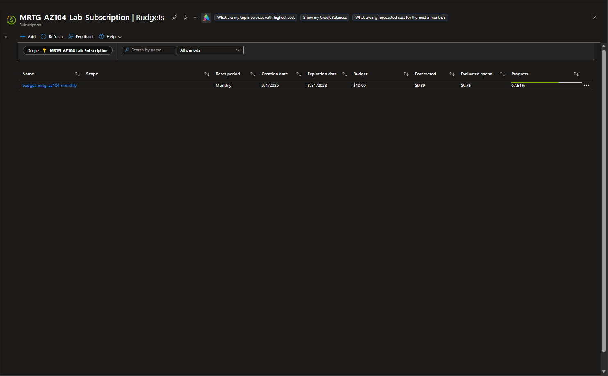

## 2. budget alert thresholds verified

Actual 50/80/100% and forecast 100%; no action group attached to budget thresholds.

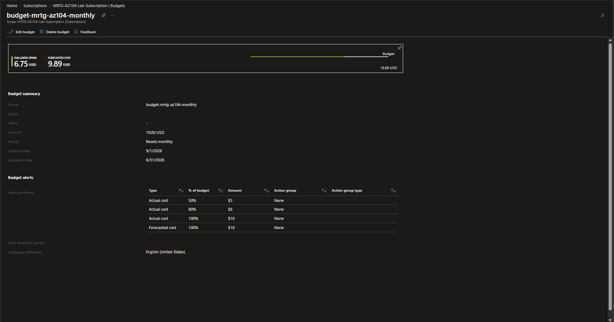

## 3. monitoring and target groups created

Both groups returned Succeeded; displayed paste is not a clean deployment script.

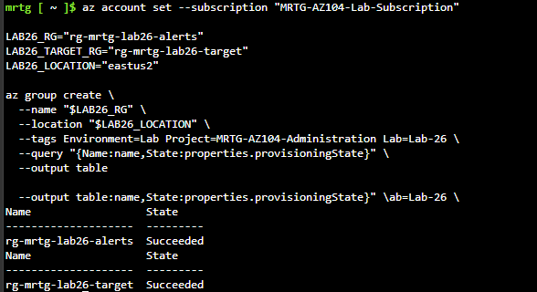

## 4. action group review

Global email action group reviewed; no automation actions; tags shown.

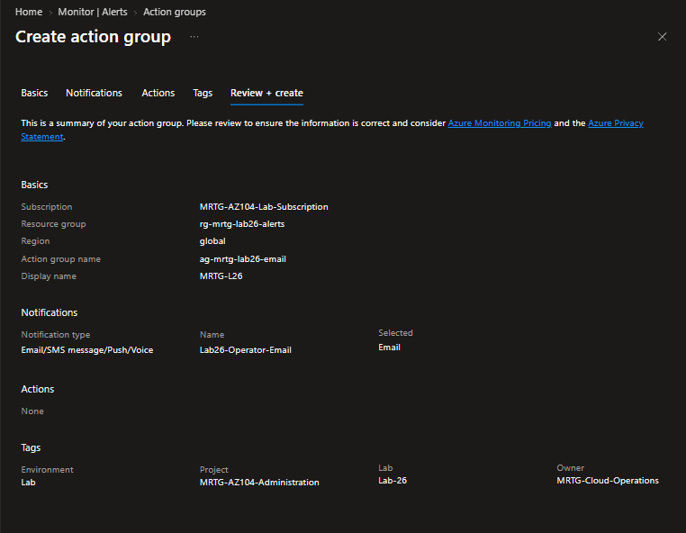

## 5. email action group created

Created group and Verified email receiver; address/ID redacted.

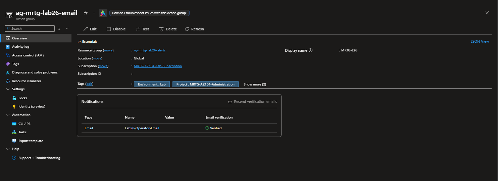

## 6. action group test succeeded

Azure test reports successful Email notification.

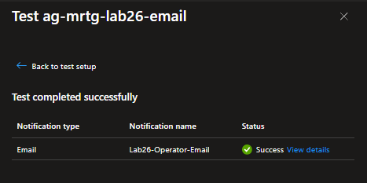

## 7. action group test email received

Received synthetic Activity Log sample; not the real target event.

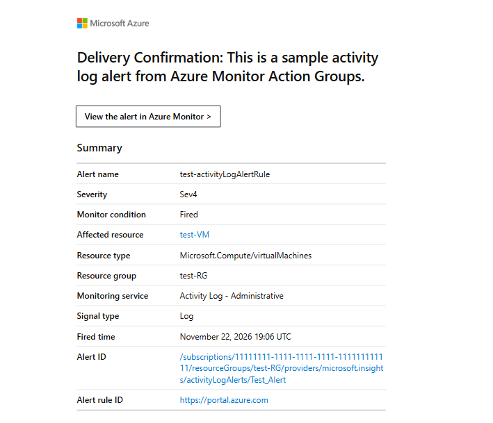

## 8. failed delete alert rule review

Target selection, Failed Administrative deletion and email group attached; enabled upon creation.

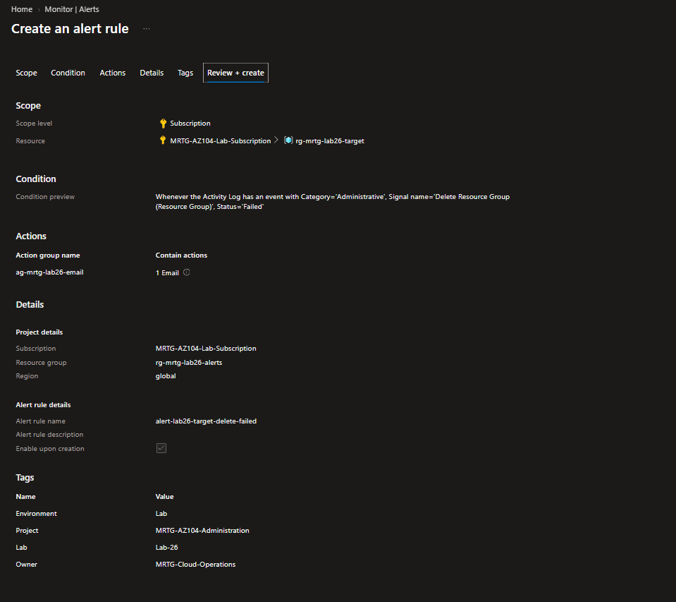

## 9. target delete lock created

CanNotDelete lock creation result.

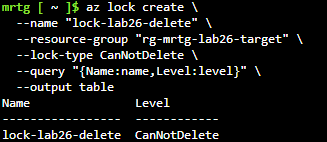

## 10. target delete blocked

Baseline 19:24:24Z attempt; ScopeLocked and true.

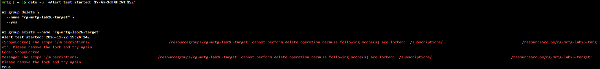

## 11. real delete alert fired

Baseline real alert, status Failed, suppression None.

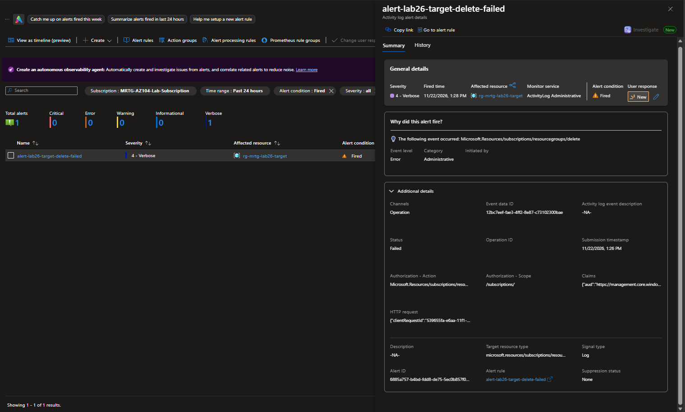

## 12. real delete alert email received

Received baseline alert email; event ID matches portal instance.

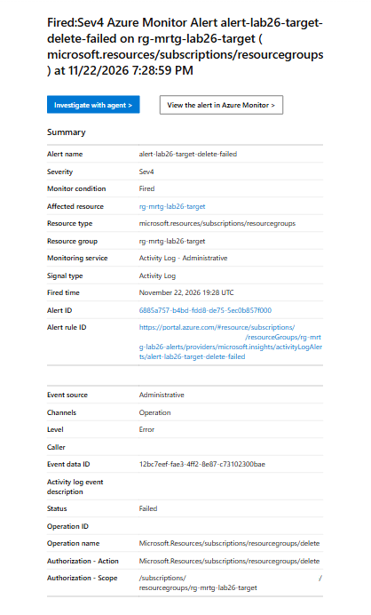

## 13. suppression processing rule review

Target scope and exact rule-name filter; Suppress notifications, Always, enabled.

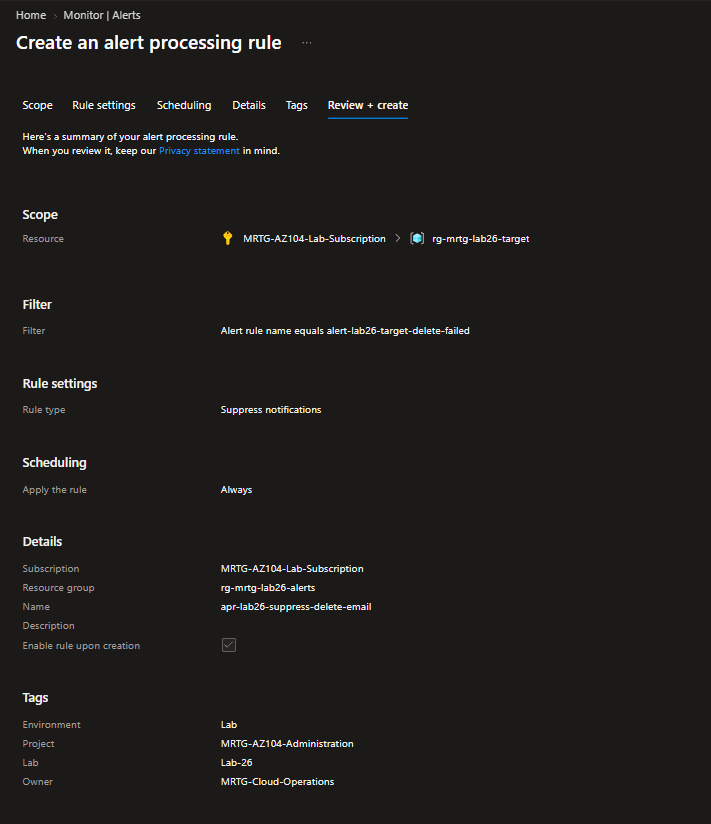

## 14. suppression test delete blocked

20:06:55Z attempt; ScopeLocked and true.

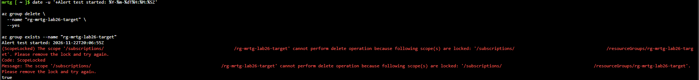

## 15. alert fired notifications suppressed

New 2:13 PM Central fired alert explicitly shows Suppressed.

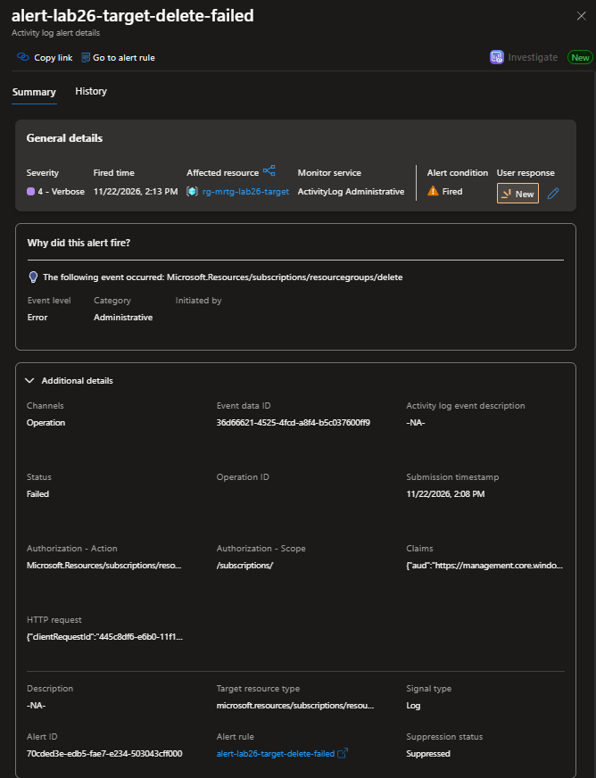

## 16. alert rule reenabled

Enabled readback after temporarily disabling the wrong rule.

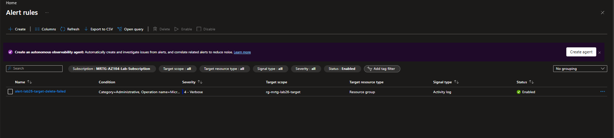

## 17. notification recovery delete blocked

20:57:14Z recovery attempt; ScopeLocked and true.

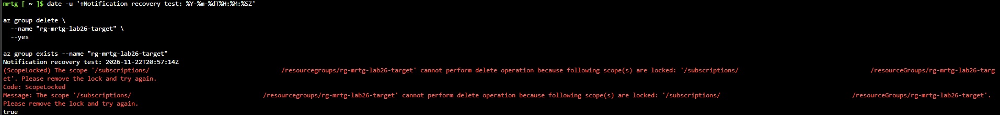

## 18. notification recovery alert fired

New 3:03 PM Central fired alert shows suppression None.

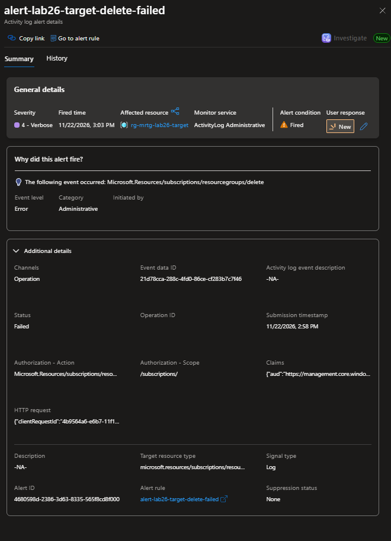

## 19. notification recovery email received

Received recovery email; structured 21:03 UTC fired time and event ID match portal.

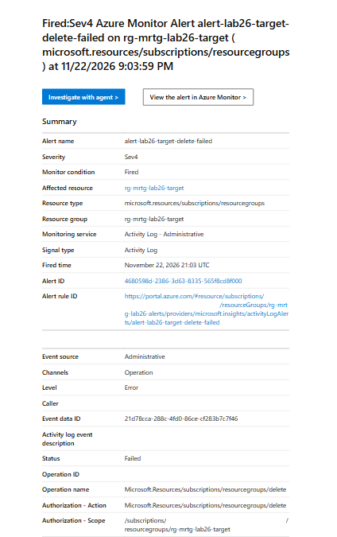

## 20. resource groups cleanup verified

Already absent ResourceGroupNotFound responses, followed by both existence checks false.

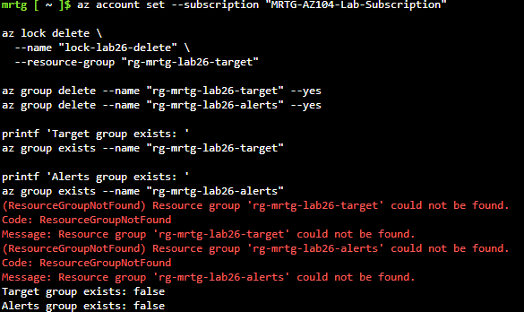

## 21. Alert rule accidentally disabled

The detection rule was briefly disabled by mistake; the existing re-enabled capture records its correction before recovery testing.

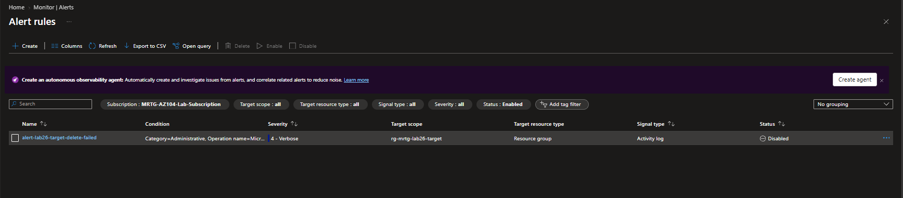

## 22. Suppression processing rule disabled

Correct processing rule Disabled before the final notification recovery test; tenant domain is author-redacted.

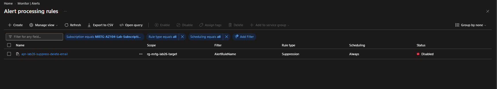

[Lab results](../README.md)

## November 23 cost-filter follow-up: rg-mrtg-lab26-target

Search returned No items found. Cropped filter capture does not expose the full billing scope or establish zero cost. Review date comes from the author-supplied file/session context.

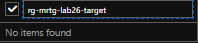

## November 23 alerts-group cost review

November 2026 filtered to rg-mrtg-lab26-alerts: Azure Monitor, Global and subscription breakdowns USD 0.00; Actual cost headline --. Displayed service values are not a confirmed final zero total. Billing name is author-redacted.

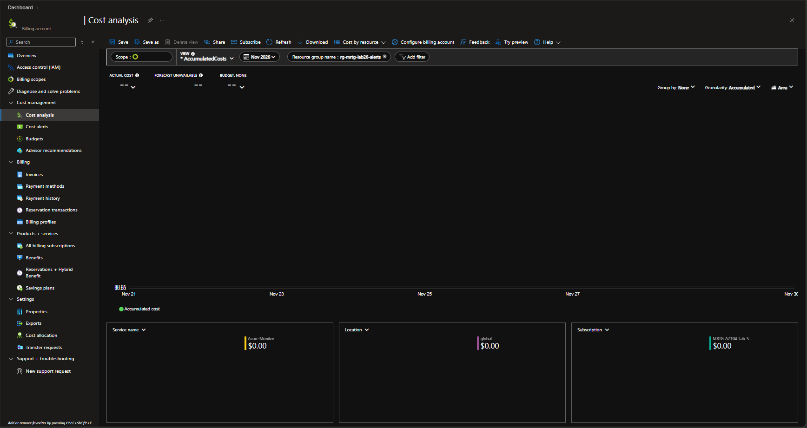
