# Lab 27 evidence gallery

**21 published screenshots.**

November 25, 2026 America/Chicago; later CLI timestamps use November 26 UTC. Reviewed author-supplied originals; the creation image masks the subscription ID. Configuration, observed outcomes and evidence limits are distinguished.

[Lab results](../README.md)

## 1. preflight subscription quota

Subscription enabled, existing Network Watcher and available regional/family quota.

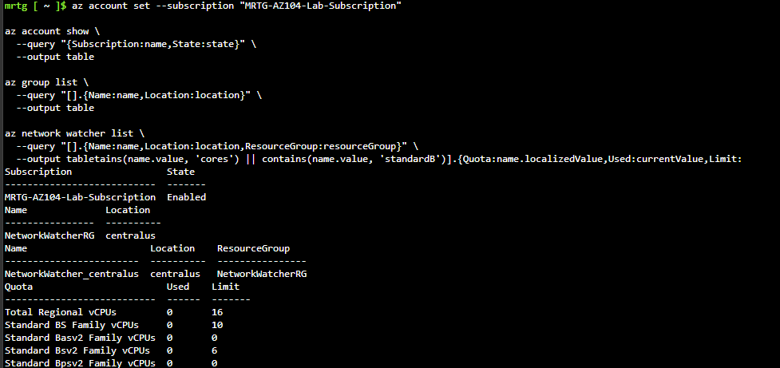

## 2. vm sku check

B2s restricted; B2s_v2 restrictions empty.

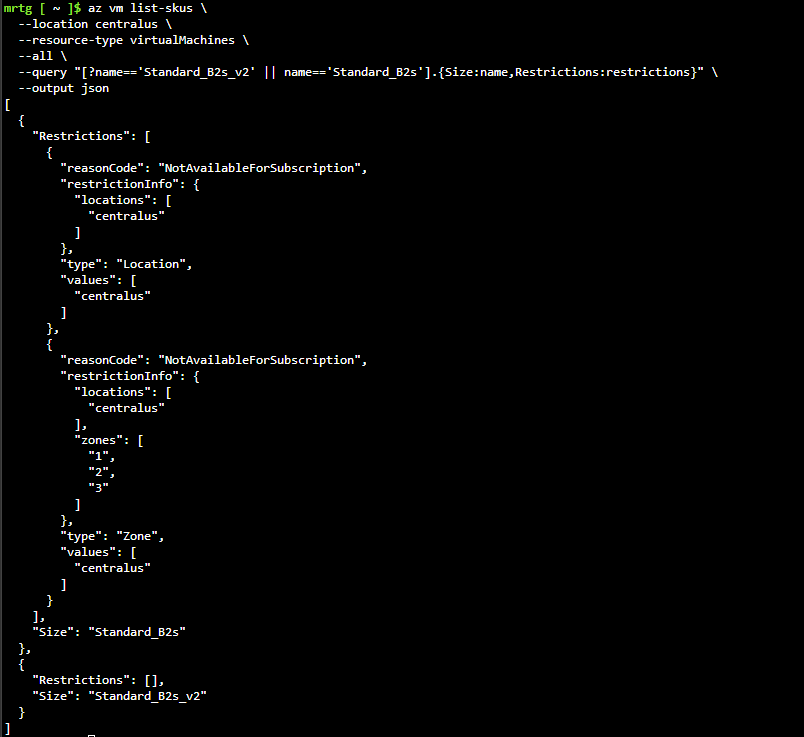

## 3. network subnets

Client and app subnet provisioning Succeeded.

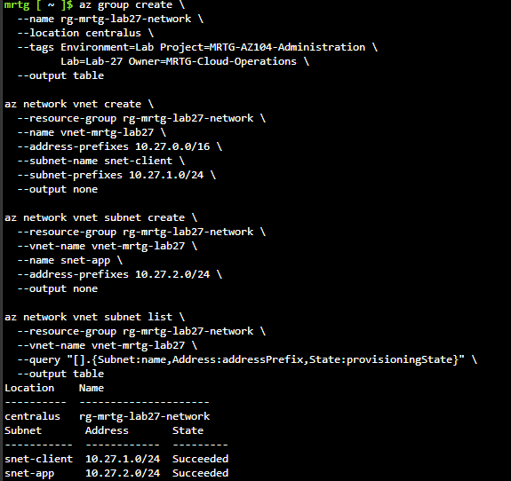

## 4. vms deployed

Both B2s_v2 VMs running at the expected private addresses; key paths contain no key material.

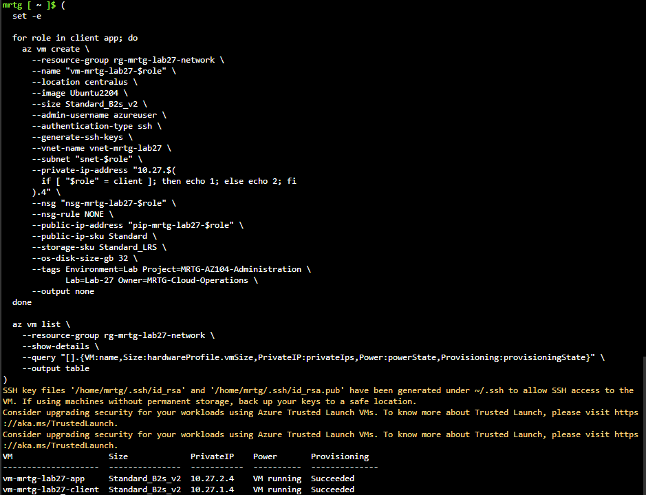

## 5. app setup command

Run Command setup script for Nginx and the synthetic application response.

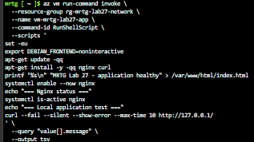

## 6. app install and local validation

Nginx installation, active state and successful localhost response.

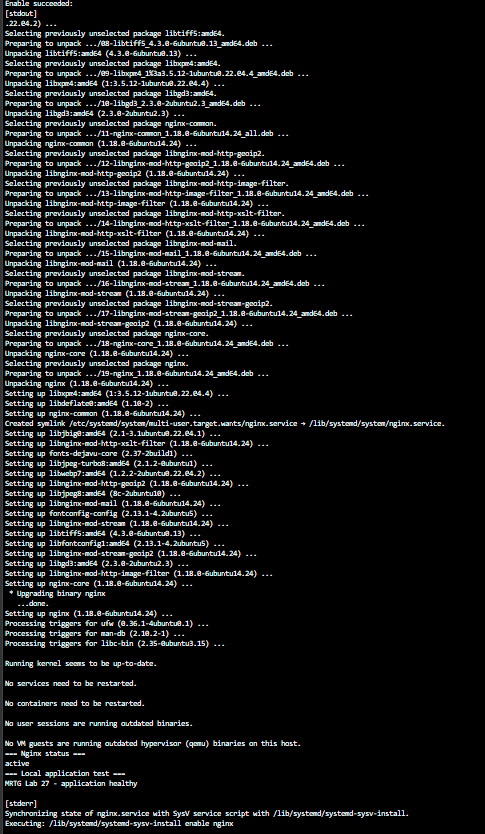

## 7. baseline client to app

Client private-IP HTTP baseline returned 200 at 23:02:23Z.

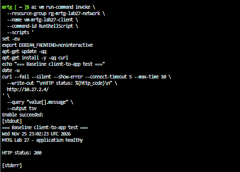

## 8. monitoring prerequisites

Workspace and both Network Watcher extensions Succeeded.

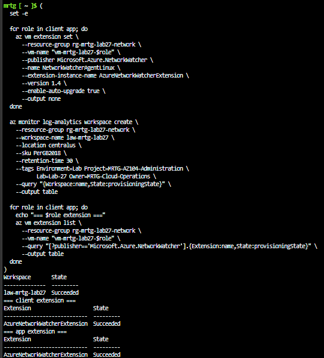

## 9. connection monitor test config

TCP 80, 30-second frequency, 10% failed-check and 100 ms RTT thresholds.

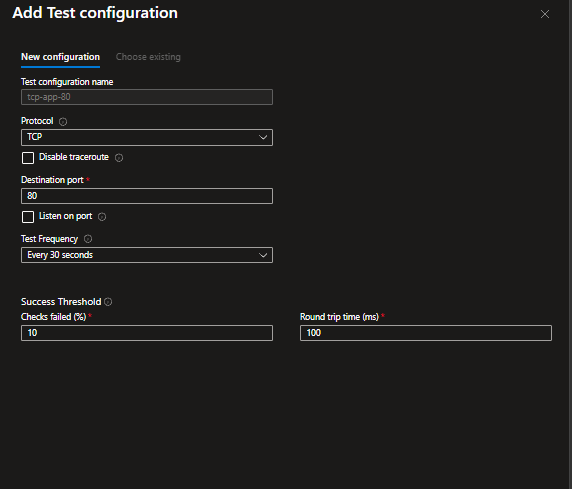

## 10. connection monitor test group

Corrected individual client and app VM endpoints; enabled extensions.

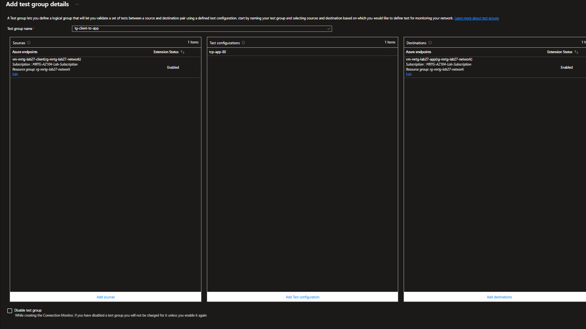

## 11. connection monitor workspace

Custom law-mrtg-lab27 workspace selected in Central US.

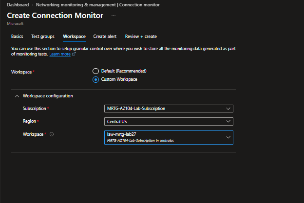

## 12. connection monitor review

Corrected review; portal banner USD 0 versus row USD 0.3/month are estimates, not session spend.

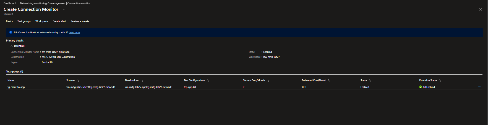

## 13. connection monitor created

Connection Monitor created under NetworkWatcherRG with the intended workspace; subscription ID masked by author.

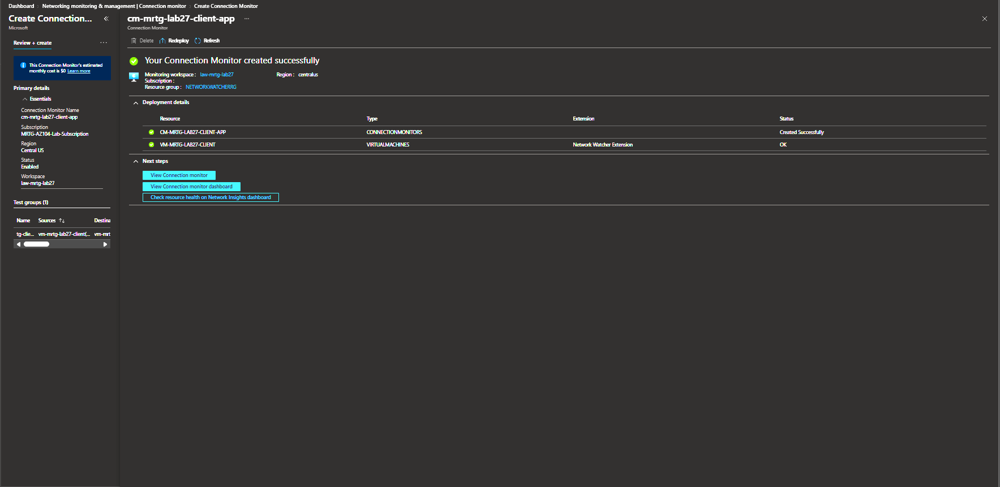

## 14. connection monitor healthy baseline

Green TCP baseline, zero failed checks and 2.22 ms RTT.

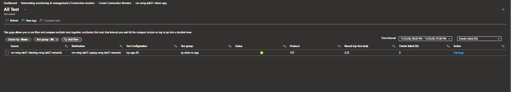

## 15. fault injected client timeout

Priority-200 deny rule Succeeded; client HTTP 000 and curl timeout exit 28.

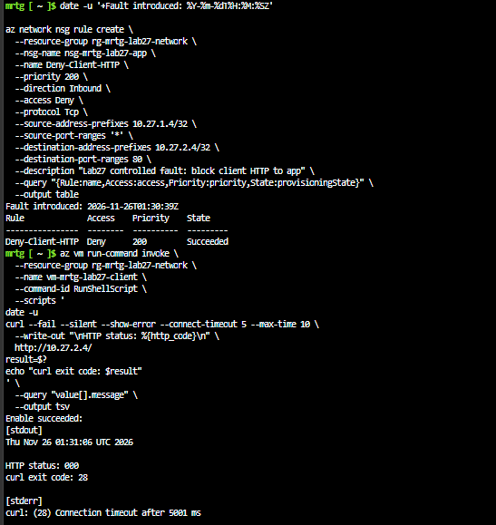

## 16. diagnosis nsg deny app healthy

IP flow names Deny-Client-HTTP while Nginx remains active with localhost HTTP 200.

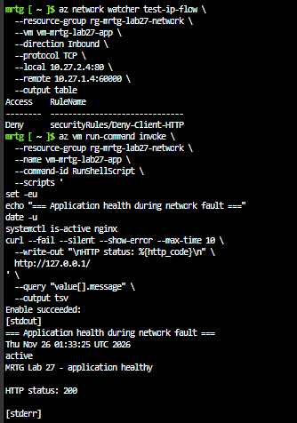

## 17. connection monitor fault detected

Red test and 53.5% failed checks over a mixed one-hour window.

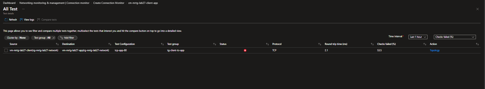

## 18. recovery ip flow and http200

After rule removal, IP flow Allow and client HTTP 200.

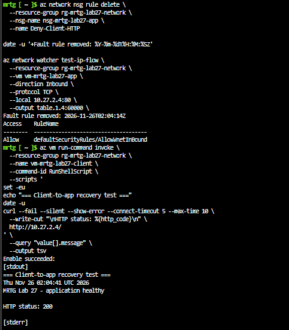

## 19. connection monitor recovered

Post-correction 8:05–8:07 PM window: green, zero failures, 2.61 ms RTT.

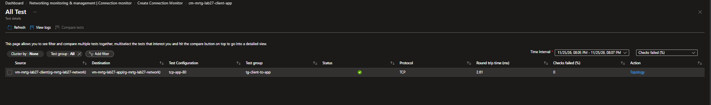

## 20. cleanup verified

Lab group exists=false and zero matching monitors after separate monitor/group deletion.

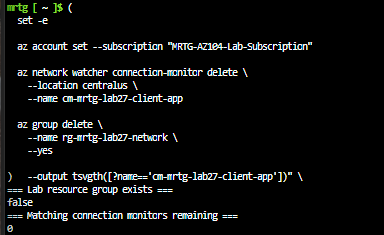

## 21. Cost follow-up — November 26, 2026

November 2026 billing-account view filtered to rg-mrtg-lab27-network: Actual USD 0.69; VMs USD 0.62, Virtual Network USD 0.04, Storage USD 0.03, Bandwidth below USD 0.01 and Log Analytics USD 0.00. Author-redacted screenshot; rounded posted snapshot, not final billing. The separately stored NetworkWatcherRG monitor is outside this filter.

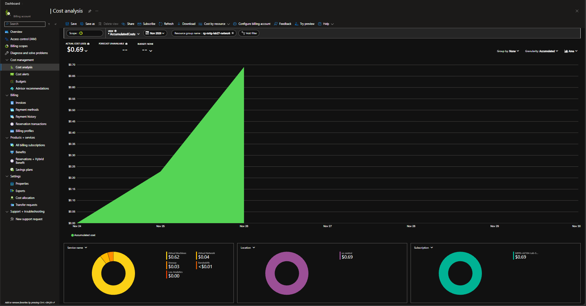
